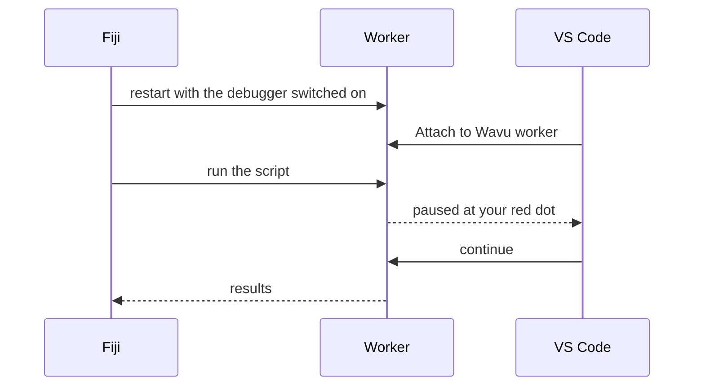

# Debug in VS Code (advanced)

!!! abstract "Optional"
    `ctx.log` messages solve most problems. Use the debugger when you want to
    look *inside* a running script.

## The idea in plain words

Normally the kitchen door is closed: you only see the plate that comes out.
A **debugger** is a window in that door. You mark a line in your script with
a red dot (a **breakpoint**); when the cook reaches that line, everything
pauses and VS Code shows you every variable at that moment: the image, its
shape, the labels. Then you step on, one line at a time.



The template already contains the VS Code settings for this
(`.vscode/launch.json`). You need VS Code's **Python** and **Python
Debugger** extensions; VS Code offers them when you open the folder.

## The easy way: from the Fiji dialog

1. Open your script folder in VS Code and click left of a line number in
   `script.py` to set a **red dot**, for example on the first line of `run`.
2. In Fiji, run the script as usual. In its dialog, tick
   **Debug in VS Code (restart worker with debugpy on port 5678)** and
   press **OK**.
3. The Log says *Restarting the worker with debugpy. In VS Code: Run and
   Debug > 'Attach to Wavu worker'.*, and the status bar waits:
   *Wavu: waiting for VS Code to attach on port 5678 (Esc to give up)*.
4. In VS Code, open **Run and Debug** (the play icon with a bug, on the
   left), choose **Attach to Wavu worker** and press the green ▶ button.
5. The script runs and stops at your red dot.

While paused, hover over a variable to see its value, or look in the
**Variables** panel. Use the toolbar to step over (++f10++) or continue
(++f5++). When it finishes, the results open in Fiji as usual.

## The terminal way

Useful when you debug many times in a row, because the worker stays up:

1. In VS Code's terminal, in your script folder:

    ```sh
    pixi run debug
    ```

2. In Fiji, choose **Plugins › Wavu › Connect to Running Worker** and press
   **OK** (the default handshake file is right). Fiji confirms
   *Connected to the worker serving …*.
3. In VS Code, **Attach to Wavu worker**.
4. In Fiji, **Plugins › Wavu › Run Python Script** and pick the
   *running: …* entry.

When you are done, choose **Plugins › Wavu › Stop Worker**.

!!! tip "Remember to restart after edits"
    Just like normal runs, the worker keeps the version of `script.py` it
    loaded. After editing, stop and start it again.

## In one sentence

Tick **Debug in VS Code** in the dialog, choose **Attach to Wavu worker** in
VS Code, and your script pauses at your breakpoints so you can look inside.
