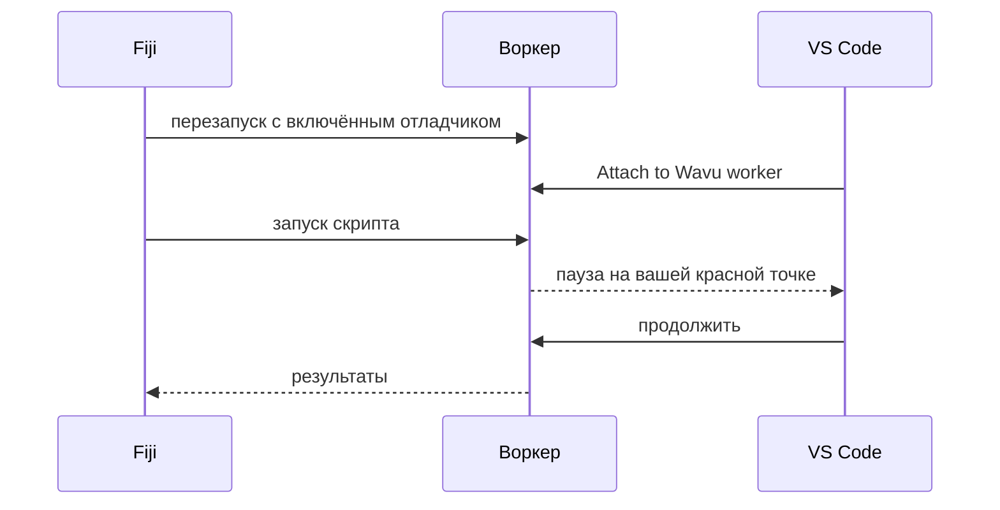

# Отладка в VS Code (для продвинутых)

!!! abstract "По желанию"
    Сообщения `ctx.log` решают большинство проблем. Отладчик нужен, когда вы
    хотите заглянуть *внутрь* работающего скрипта.

## Идея простыми словами

Обычно дверь кухни закрыта: вы видите только тарелку, которую выносят.
**Отладчик** — это окошко в этой двери. Вы отмечаете строку в скрипте
красной точкой (**точкой останова**); когда повар доходит до этой строки,
всё замирает, и VS Code показывает каждую переменную в этот момент:
изображение, его форму, метки. Затем вы идёте дальше по одной строке.



Шаблон уже содержит нужные настройки VS Code (`.vscode/launch.json`). Вам
понадобятся расширения VS Code **Python** и **Python Debugger**; VS Code
предложит их, когда вы откроете папку.

## Простой способ: из диалога Fiji

1. Откройте папку скрипта в VS Code и щёлкните слева от номера строки в
   `script.py`, чтобы поставить **красную точку**, например на первой
   строке `run`.
2. В Fiji запустите скрипт как обычно. В диалоге отметьте
   **Debug in VS Code (restart worker with debugpy on port 5678)** и
   нажмите **OK**.
3. В Log появится *Restarting the worker with debugpy. In VS Code: Run and
   Debug > 'Attach to Wavu worker'.*, а строка состояния ждёт:
   *Wavu: waiting for VS Code to attach on port 5678 (Esc to give up)*.
4. В VS Code откройте **Run and Debug** (значок «play» с жучком слева),
   выберите **Attach to Wavu worker** и нажмите зелёную кнопку ▶.
5. Скрипт запустится и остановится на вашей красной точке.

Во время паузы наведите курсор на переменную, чтобы увидеть её значение, или
посмотрите на панель **Variables**. Кнопками на панели инструментов можно
сделать шаг (++f10++) или продолжить (++f5++). Когда скрипт закончит,
результаты, как обычно, откроются в Fiji.

## Способ через терминал

Удобен, когда вы отлаживаете много раз подряд, потому что воркер продолжает
работать:

1. В терминале VS Code, в папке скрипта:

    ```sh
    pixi run debug
    ```

2. В Fiji выберите **Plugins › Wavu › Connect to Running Worker**
   (подключиться к работающему воркеру) и нажмите **OK** (файл
   рукопожатия по умолчанию подходит). Fiji подтвердит
   *Connected to the worker serving …*.
3. В VS Code выберите **Attach to Wavu worker**.
4. В Fiji выберите **Plugins › Wavu › Run Python Script** и пункт
   *running: …*.

Когда закончите, выберите **Plugins › Wavu › Stop Worker**.

!!! tip "Не забывайте перезапускать после правок"
    Как и при обычных запусках, воркер держит ту версию `script.py`, которую
    загрузил. После правки остановите его и запустите снова.

## Одним предложением

Отметьте **Debug in VS Code** в диалоге, выберите **Attach to Wavu worker**
в VS Code — и скрипт остановится на ваших точках останова, чтобы вы могли
заглянуть внутрь.
