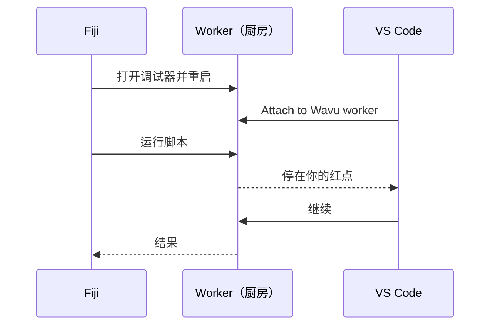
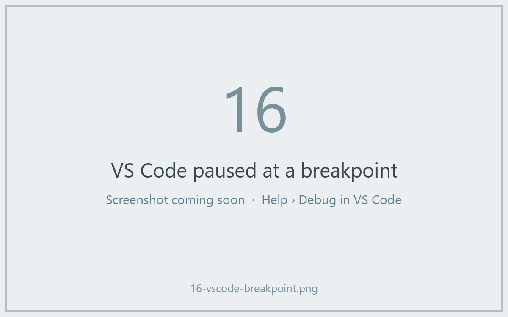

# 在 VS Code 里调试（进阶）

!!! abstract "可选"
    大多数问题靠 `ctx.log` 信息就能解决。想看清一个正在运行的脚本*内部*时，再用调试器。

## 用大白话说

平时厨房的门是关着的：你只能看到端出来的那盘菜。**调试器**（debugger）就是那扇门上开的一扇窗。你在脚本的某一行标一个红点（**断点**，breakpoint）；厨师做到那一行时，一切都会暂停，VS Code 会把那一刻的每个变量都摆给你看：图像、它的形状、标签。然后你可以一行一行往下走。



模板里已经包含了所需的 VS Code 配置（`.vscode/launch.json`）。你需要 VS Code 的 **Python** 和 **Python Debugger** 扩展；打开文件夹时 VS Code 会提示你安装。

## 简单的办法：从 Fiji 对话框开始

1. 在 VS Code 里打开你的脚本文件夹，在 `script.py` 某一行的行号左边点一下，设一个**红点**，比如设在 `run` 的第一行。
2. 在 Fiji 里照常运行脚本。在对话框里勾选 **Debug in VS Code (restart worker with debugpy on port 5678)**，然后点 **OK**。
3. Log 窗口会显示 *Restarting the worker with debugpy. In VS Code: Run and Debug > 'Attach to Wavu worker'.*，状态栏则在等待：*Wavu: waiting for VS Code to attach on port 5678 (Esc to give up)*。
4. 在 VS Code 里打开 **Run and Debug**（左侧带小虫子的播放图标），选择 **Attach to Wavu worker**，点击绿色的 ▶ 按钮。
5. 脚本开始运行，并停在你的红点上。



暂停时，把鼠标悬停在变量上就能看到它的值，或者看 **Variables** 面板。用工具栏单步跳过（++f10++）或继续（++f5++）。运行结束后，结果会像平常一样在 Fiji 里打开。

## 终端的办法

需要连续调试很多次时很方便，因为 worker 会一直开着：

1. 在 VS Code 的终端里，在你的脚本文件夹中运行：

    ```sh
    pixi run debug
    ```

2. 在 Fiji 里选择 **Plugins › Wavu › Connect to Running Worker**，点 **OK**（默认的握手文件就是对的）。Fiji 会确认 *Connected to the worker serving …*。
3. 在 VS Code 里选 **Attach to Wavu worker**。
4. 在 Fiji 里选 **Plugins › Wavu › Run Python Script**，并选择 *running: …* 这一项。

用完之后，选择 **Plugins › Wavu › Stop Worker**。

!!! tip "改完记得重启"
    和平常运行一样，worker 会一直用它当初加载的那个版本的 `script.py`。修改之后，先停掉它，再重新启动。

## 一句话总结

在对话框里勾选 **Debug in VS Code**，在 VS Code 里选择 **Attach to Wavu worker**，你的脚本就会停在断点处，让你看清里面发生了什么。
