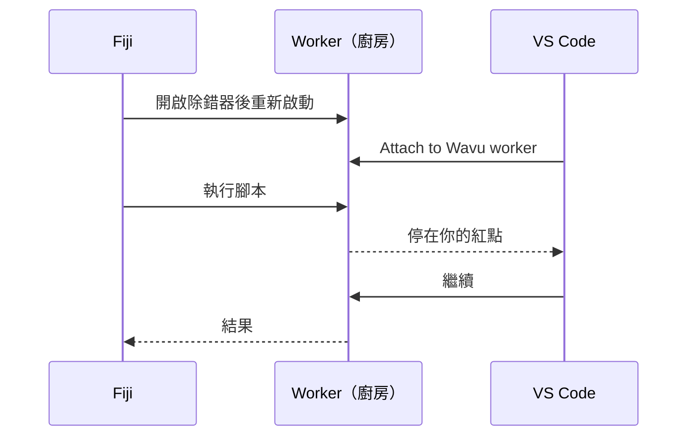

# 在 VS Code 裡除錯（進階）

!!! abstract "選用"
    大部分問題靠 `ctx.log` 訊息就能解決。當你想看清楚一個正在執行的腳本*內部*時，再用除錯器。

## 用白話說

平常廚房的門是關著的：你只看得到端出來的那盤菜。**除錯器**（debugger）就是那扇門上的一扇窗。你在腳本的某一行標上一個紅點（**中斷點**，breakpoint）；當廚師做到那一行，一切都會暫停，VS Code 會把那一刻的每個變數都秀給你看：影像、它的形狀、標籤。然後你可以一行一行往下走。



範本裡已經包含這需要的 VS Code 設定（`.vscode/launch.json`）。你需要 VS Code 的 **Python** 和 **Python Debugger** 擴充功能；開啟資料夾時 VS Code 會建議你安裝。

## 簡單的方法：從 Fiji 對話框開始

1. 在 VS Code 裡開啟你的腳本資料夾，在 `script.py` 某一行的行號左邊點一下，設一個**紅點**，例如設在 `run` 的第一行。
2. 在 Fiji 裡照常執行腳本。在對話框裡勾選 **Debug in VS Code (restart worker with debugpy on port 5678)**，然後按 **OK**。
3. Log 視窗會顯示 *Restarting the worker with debugpy. In VS Code: Run and Debug > 'Attach to Wavu worker'.*，狀態列則在等待：*Wavu: waiting for VS Code to attach on port 5678 (Esc to give up)*。
4. 在 VS Code 裡開啟 **Run and Debug**（左側那個帶有小蟲的播放圖示），選擇 **Attach to Wavu worker**，按下綠色的 ▶ 按鈕。
5. 腳本開始執行，並停在你的紅點上。

暫停時，把滑鼠移到變數上就能看到它的值，或者看 **Variables** 面板。用工具列逐行執行（++f10++）或繼續（++f5++）。執行完後，結果會像平常一樣在 Fiji 裡開啟。

## 終端機的方法

當你要連續除錯很多次時很好用，因為 worker 會一直開著：

1. 在 VS Code 的終端機裡，於你的腳本資料夾執行：

    ```sh
    pixi run debug
    ```

2. 在 Fiji 裡選擇 **Plugins › Wavu › Connect to Running Worker**，按 **OK**（預設的交握檔就是對的）。Fiji 會確認 *Connected to the worker serving …*。
3. 在 VS Code 裡選 **Attach to Wavu worker**。
4. 在 Fiji 裡選 **Plugins › Wavu › Run Python Script**，並挑選 *running: …* 那一項。

用完之後，選擇 **Plugins › Wavu › Stop Worker**。

!!! tip "修改後記得重新啟動"
    和一般執行一樣，worker 會保留它當初載入的那個版本的 `script.py`。修改之後，請先停止它，再重新啟動。

## 一句話總結

在對話框裡勾選 **Debug in VS Code**，在 VS Code 裡選擇 **Attach to Wavu worker**，你的腳本就會停在中斷點，讓你看清楚裡面發生了什麼。
