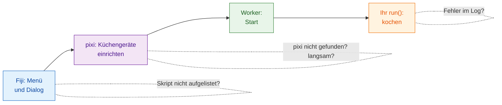

# Fehlerbehebung und FAQ

## Die Idee in einfachen Worten

Wenn im Restaurant eine Bestellung schiefgeht, fragt man sich: Hat der
Kellner die Bestellung aufgenommen, ist die Küche offen, sind die
Küchengeräte bereit, hat der Koch etwas anbrennen lassen? Probleme mit
Wavu stecken an denselben wenigen Stellen, und im **Log-Fenster**
(**Window › Log**, falls es versteckt ist) schreibt Wavu auf, was es gerade
tut. Zeilen von Wavu selbst beginnen mit `[Wavu]`.

## Der erste Durchlauf scheint festzuhängen { #the-first-run-looks-stuck }

Fast sicher lädt er gerade herunter. Beim ersten Start eines Skriptordners
wird seine Umgebung gebaut; mit PyTorch oder Cellpose können das **1–2 GB
und mehrere Minuten** sein. Achten Sie auf

> `[Wavu] First start of '…': downloading its Python packages. This happens once and can take several minutes...`

im Log und auf *Wavu: starting worker… 42s (Esc to cancel)* in Fijis
Statusleiste. Lassen Sie es laufen. Wenn Ihr Skript beim ersten Gebrauch
Modellgewichte herunterlädt, sollte es das mit `ctx.log` sagen
([wie](../write/real-images.md#slow-first-runs-and-how-to-keep-users-calm)).

## „pixi not found“ oder „Could not set up pixi“ { #pixi-not-found-or-could-not-set-up-pixi }

- Führen Sie **Plugins › Wavu › Setup Python (pixi)** erneut aus. Dafür
  braucht es Internetzugang zu github.com.
- Auf einem abgeschotteten oder Offline-Rechner installieren Sie pixi von
  Hand von [pixi.sh](https://pixi.sh) (oder fragen Sie die IT) und starten
  Fiji neu. Wavu sucht es in `Fiji.app/wavu/`, in `~/.wavu/bin`, in Ihrem
  PATH und in `~/.pixi/bin`.
- In einem **Terminal** wird `pixi` nur gefunden, wenn Sie es von pixi.sh
  installiert haben; die von Fiji heruntergeladene Kopie gehört nur Fiji.

## Mein Skript wird nicht aufgelistet, oder „not a Wavu script folder“ { #my-script-is-not-listed-or-not-a-wavu-script-folder }

- Wählen Sie den Ordner, der **`pixi.toml` direkt enthält**, nicht den
  übergeordneten Ordner und keinen eine Ebene tiefer (eine häufige
  Überraschung nach dem Entpacken).
- Wavu listet nur `.py`-Dateien auf, die `def run(...)` definieren. Dateien,
  deren Namen mit `_`, `.` oder `test_` beginnen, werden absichtlich
  ignoriert.
- Lässt sich ein Skript nicht laden, steht im Log
  *could not load script.py: …* mit dem Grund, oft ein Tippfehler oder ein
  fehlendes Paket.

## Im Log erscheint ein Fehler { #an-error-appears-in-the-log }

Ein Fenster zeigt *script failed:* mit einer kurzen Meldung, und das Log
enthält alle Details (den „Traceback“, also die Aufrufkette).

Lesen Sie den Traceback **von unten nach oben**: Die letzte Zeile ist der
Fehler, die Zeilen darüber zeigen auf die Zeile in `script.py`, die ihn
verursacht hat. Häufige Fälle:

| Die letzte Zeile sagt | Bedeutet meistens |
|---|---|
| `ModuleNotFoundError: No module named 'skimage'` | Paket zu `pixi.toml` hinzufügen ([wie](../write/get-the-template.md#adding-a-package)), **Stop Worker**, neu ausführen |
| `KeyError: 'image'` | der Name in `inputs[...]` oder `params[...]` weicht von `PARAMS` ab |
| `ValueError: …` mit Ihrem eigenen Text | Ihre eigene Prüfung hat angeschlagen, so wie gewollt |
| `… needs an image -- open one first` | vor dem Ausführen ein Bild in Fiji öffnen |

## Ich habe mein Skript geändert, aber nichts hat sich geändert { #i-changed-my-script-but-nothing-changed }

Der Worker hat noch die alte Version geladen. Wählen Sie
**Plugins › Wavu › Stop Worker** und führen Sie es erneut aus.

## Esc hält es nicht an { #esc-does-not-stop-it }

Abbrechen ist in Wavu **kooperativ**: Esc setzt eine Flagge, und Ihr Skript
hört auf, sobald es das nächste Mal `ctx.cancelled()` prüft. Ein Skript, das
nie prüft oder in einem einzigen langen Aufruf steckt, läuft weiter, bis
dieser Aufruf endet. Siehe
[Log, Fortschritt und Abbrechen](../write/logs-progress-cancel.md#cancel-why-your-code-has-to-help).
Klicken Sie auf ein Fiji-Fenster, bevor Sie Esc drücken. Als letztes
Mittel beendet **Plugins › Wavu › Stop Worker** den Worker.

## Fiji meldet unterschiedliche Versionen von Client und Worker { #fiji-says-the-client-and-worker-versions-differ }

Die Log-Zeile *Note: Fiji client … and worker … differ* bedeutet, dass die
Wavu-Dateien in Fiji und das Wavu in der Umgebung Ihres Skripts aus
verschiedenen Versionen stammen. Oft funktioniert es trotzdem; wenn etwas
fehlschlägt, aktualisieren Sie die Wavu-ZIP in Fiji.

## In napari { #in-napari }

In napari schreibt Wavu in das **Log-Feld des Wavu-Panels**, nicht in das
Log-Fenster von Fiji; Fehler erscheinen zusätzlich als kurze
napari-Benachrichtigung.

- **napari öffnet sich unter Linux nicht** (*could not connect to display*
  oder ein Fehler zum Qt-Plattform-Plugin): Sagen Sie Qt, welches
  Anzeigesystem es nutzen soll, `export QT_QPA_PLATFORM=xcb` (X11) oder
  `wayland`, und führen Sie dann erneut `pixi run -e napari napari` aus. Auf
  einem Rechner ohne Bildschirm nehmen Sie `offscreen`.
- **"pixi was not found", wenn Sie auf Start worker klicken**: napari wurde
  anders gestartet als mit `pixi run -e napari napari`. Starten Sie es mit
  diesem Befehl aus dem Ordner `Wavu`, oder setzen Sie die
  Umgebungsvariable `WAVU_PIXI` auf den vollständigen Pfad des
  pixi-Programms.
- **Der erste Start worker scheint zu hängen**: Er baut gerade die eigene
  Umgebung des Skripts, genau wie in Fiji. Das Log des Panels zeigt den
  Fortschritt von pixi; warten Sie auf `Worker ready`. **Cancel** bricht ab.
- **Ich habe mein Skript geändert, aber nichts hat sich geändert**: Klicken
  Sie auf **Stop worker** und dann wieder auf **Start worker**.
- **Die Image-Liste ist leer**: Nur Image- und Labels-Layer können gewählt
  werden. Öffnen Sie zuerst ein Bild.

Siehe auch [wavu-napari installieren](../napari/install.md).

## Immer noch nicht weiter? { #still-stuck }

Fragen Sie im [image.sc-Forum](https://forum.image.sc) oder
[eröffnen Sie ein Issue](https://github.com/Oxford-Zeiss-Centre-of-Excellence/Wavu/issues)
(eine Fehlermeldung auf GitHub). Kopieren Sie das ganze Log in Ihre
Nachricht.

## In einem Satz

Öffnen Sie das Log: Es sagt Ihnen, ob pixi noch herunterlädt, ein Ordner
falsch ist, ein Paket fehlt oder Ihr eigener Code einen Fehler ausgelöst
hat.
