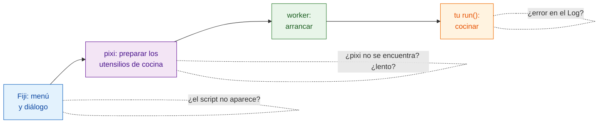

# Solución de problemas y preguntas frecuentes

## La idea en palabras sencillas

Cuando un pedido sale mal en un restaurante, te preguntas: ¿el camarero tomó
el pedido?, ¿la cocina está abierta?, ¿los utensilios de cocina están listos?, ¿al cocinero
se le quemó algo? Los problemas de Wavu caen en esos mismos pocos sitios, y
la **ventana Log** (**Window › Log** si está oculta) es donde Wavu escribe lo
que está haciendo. Las líneas del propio Wavu empiezan por `[Wavu]`.

## La primera ejecución parece atascada

Casi seguro que está descargando. El primer arranque de una carpeta de
script construye su entorno; con PyTorch o Cellpose pueden ser **1–2 GB y
varios minutos**. Busca

> `[Wavu] First start of '…': downloading its Python packages. This happens once and can take several minutes...`

en el Log, y *Wavu: starting worker… 42s (Esc to cancel)* en la barra de
estado de Fiji. Deja que siga. Si tu script descarga pesos de un modelo la
primera vez que se usa, debería avisarlo con `ctx.log`
([cómo](../write/real-images.md#slow-first-runs-and-how-to-keep-users-calm)).

## "pixi not found" o "Could not set up pixi"

- Vuelve a ejecutar **Plugins › Wavu › Setup Python (pixi)**. Necesita
  acceso a internet a github.com.
- En un ordenador bloqueado o sin conexión, instala pixi a mano desde
  [pixi.sh](https://pixi.sh) (o pídeselo a informática) y reinicia Fiji. Wavu
  lo busca en `Fiji.app/wavu/`, en `~/.wavu/bin`, en tu PATH y en
  `~/.pixi/bin`.
- En una **terminal**, `pixi` solo se encuentra si lo instalaste desde
  pixi.sh; la copia que descargó Fiji es privada de Fiji.

## Mi script no aparece, o "not a Wavu script folder"

- Elige la carpeta que **contiene directamente `pixi.toml`**, no la carpeta
  de encima ni una un nivel más abajo (una sorpresa habitual al descomprimir).
- Wavu solo lista archivos `.py` que definen `def run(...)`. Los archivos
  cuyo nombre empieza por `_`, `.` o `test_` se ignoran a propósito.
- Si un script no se puede cargar, el Log dice *could not load script.py: …*
  con el motivo, a menudo una errata o un paquete que falta.

## Aparece un error en el Log { #an-error-appears-in-the-log }

Una ventana dice *script failed:* con un mensaje corto, y el Log contiene
todos los detalles (el "traceback", la traza del error).

Lee el traceback **de abajo arriba**: la última línea es el error, y las
líneas de encima señalan la línea de `script.py` que lo causó. Los más
comunes:

| La última línea dice | Normalmente significa |
|---|---|
| `ModuleNotFoundError: No module named 'skimage'` | añade el paquete a `pixi.toml` ([cómo](../write/get-the-template.md#adding-a-package)), **Stop Worker**, y vuelve a ejecutar |
| `KeyError: 'image'` | el nombre en `inputs[...]` o `params[...]` no coincide con `PARAMS` |
| `ValueError: …` con tu propio texto | ha saltado tu propia comprobación, funciona como debe |
| `… needs an image -- open one first` | abre una imagen en Fiji antes de ejecutar |

## He cambiado mi script pero no cambia nada

El worker sigue teniendo cargada la versión antigua. Elige
**Plugins › Wavu › Stop Worker** y vuelve a ejecutar.

## Esc no lo detiene

Cancelar en Wavu es **cooperativo**: Esc levanta una bandera, y tu script se
detiene la próxima vez que comprueba `ctx.cancelled()`. Un script que nunca
lo comprueba, o que está dentro de una llamada larga, sigue en marcha hasta
que esa llamada termina. Mira
[Log, progreso y cancelar](../write/logs-progress-cancel.md#cancel-why-your-code-has-to-help).
Haz clic en una ventana de Fiji antes de pulsar Esc. Como último recurso,
**Plugins › Wavu › Stop Worker** apaga el worker.

## Fiji dice que las versiones del cliente y del worker son distintas

La línea del Log *Note: Fiji client … and worker … differ* significa que los
archivos de Wavu en Fiji y el Wavu que hay dentro del entorno de tu script son
de versiones distintas. A menudo funciona igual; si algo falla, actualiza el
zip de Wavu en Fiji.

## En napari

En napari, Wavu escribe en el **cuadro de log del panel de Wavu**, no en la
ventana Log de Fiji; los errores aparecen además como una breve notificación
de napari.

- **napari no se abre en Linux** (*could not connect to display*, o un error
  sobre el plugin de plataforma de Qt): dile a Qt qué sistema de pantalla
  usar, `export QT_QPA_PLATFORM=xcb` (X11) o `wayland`, y vuelve a ejecutar
  `pixi run -e napari napari`. En una máquina sin pantalla, usa `offscreen`.
- **"pixi was not found" al pulsar Start worker**: napari se arrancó de otra
  forma que no es `pixi run -e napari napari`. Arráncalo con ese comando desde
  la carpeta `Wavu`, o define la variable de entorno `WAVU_PIXI` con la ruta
  completa del programa pixi.
- **El primer Start worker parece atascado**: está construyendo el entorno
  propio del script, exactamente igual que en Fiji. El log del panel muestra
  el progreso de pixi; espera a `Worker ready`. **Cancel** abandona.
- **He cambiado mi script pero no cambia nada**: pulsa **Stop worker** y
  después **Start worker** otra vez.
- **La lista Image está vacía**: solo se pueden elegir capas Image y Labels.
  Abre primero una imagen.

Mira también [Instalar wavu-napari](../napari/install.md).

## ¿Sigues atascado?

Pregunta en el [foro image.sc](https://forum.image.sc) o
[abre una incidencia (issue)](https://github.com/Oxford-Zeiss-Centre-of-Excellence/Wavu/issues).
Copia el Log completo en tu mensaje.

## En una frase

Abre el Log: te dice si pixi sigue descargando, si la carpeta es incorrecta,
si falta un paquete o si tu propio código ha lanzado un error.
