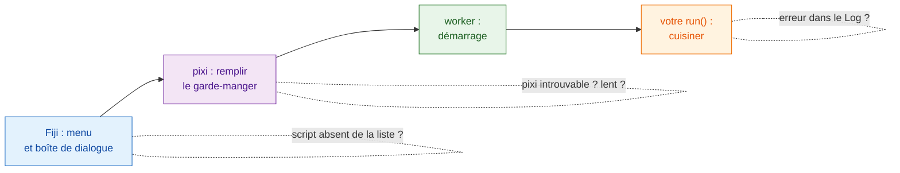
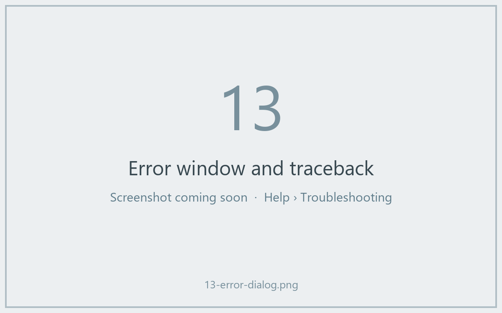

# Dépannage et FAQ

## L'idée en mots simples

Quand une commande tourne mal au restaurant, on se demande : le serveur
a-t-il pris la commande, la cuisine est-elle ouverte, le garde-manger est-il
rempli, le cuisinier a-t-il brûlé quelque chose ? Les problèmes de Wavu se
rangent dans ces mêmes quelques endroits, et la **fenêtre Log**
(**Window › Log** si elle est cachée) est l'endroit où Wavu écrit ce qu'il
fait. Les lignes qui viennent de Wavu lui-même commencent par `[Wavu]`.

## La première exécution semble bloquée { #the-first-run-looks-stuck }

Il est presque certain qu'elle télécharge. Le premier démarrage d'un dossier
de script construit son environnement ; avec PyTorch ou Cellpose, cela peut
représenter **1–2 Go et plusieurs minutes**. Cherchez

> `[Wavu] First start of '…': downloading its Python packages. This happens once and can take several minutes...`

dans le Log, et *Wavu: starting worker… 42s (Esc to cancel)* dans la barre
d'état de Fiji. Laissez faire. Si votre script télécharge des poids de
modèle à la première utilisation, il devrait le dire avec `ctx.log`
([comment](../write/real-images.md#slow-first-runs-and-how-to-keep-users-calm)).

## « pixi not found » ou « Could not set up pixi » { #pixi-not-found-or-could-not-set-up-pixi }

- Relancez **Plugins › Wavu › Setup Python (pixi)**. Il faut un accès
  Internet à github.com.
- Sur un ordinateur verrouillé ou hors ligne, installez pixi à la main depuis
  [pixi.sh](https://pixi.sh) (ou demandez au service informatique), puis
  redémarrez Fiji. Wavu le cherche dans `Fiji.app/wavu/`, dans `~/.wavu/bin`,
  dans votre PATH et dans `~/.pixi/bin`.
- Dans un **terminal**, `pixi` n'est trouvé que si vous l'avez installé
  depuis pixi.sh ; la copie téléchargée par Fiji est réservée à Fiji.

## Mon script n'apparaît pas, ou « not a Wavu script folder » { #my-script-is-not-listed-or-not-a-wavu-script-folder }

- Choisissez le dossier qui **contient directement `pixi.toml`**, pas son
  dossier parent ni un dossier un niveau plus bas (une surprise fréquente
  après une décompression).
- Wavu ne liste que les fichiers `.py` qui définissent `def run(...)`. Les
  fichiers dont le nom commence par `_`, `.` ou `test_` sont ignorés exprès.
- Si un script ne se charge pas, le Log affiche
  *could not load script.py: …* avec la raison, souvent une faute de frappe
  ou un paquet manquant.

## Une erreur apparaît dans le Log { #an-error-appears-in-the-log }

Une fenêtre affiche *script failed:* avec un court message, et le Log
contient tous les détails (la « traceback », la pile d'appels).

Lisez la traceback **de bas en haut** : la dernière ligne est l'erreur, les
lignes au-dessus indiquent la ligne de `script.py` qui l'a provoquée. Les
cas courants :

| La dernière ligne dit | En général, cela veut dire |
|---|---|
| `ModuleNotFoundError: No module named 'skimage'` | ajoutez le paquet à `pixi.toml` ([comment](../write/get-the-template.md#adding-a-package)), faites **Stop Worker**, relancez |
| `KeyError: 'image'` | le nom dans `inputs[...]` ou `params[...]` diffère de celui de `PARAMS` |
| `ValueError: …` avec votre propre texte | votre propre vérification s'est déclenchée, comme prévu |
| `… needs an image -- open one first` | ouvrez une image dans Fiji avant de lancer |

## J'ai modifié mon script mais rien n'a changé { #i-changed-my-script-but-nothing-changed }

Le worker a encore l'ancienne version chargée. Choisissez
**Plugins › Wavu › Stop Worker**, puis relancez.

## Échap ne l'arrête pas { #esc-does-not-stop-it }

L'annulation dans Wavu est **coopérative** : Échap lève un drapeau, et votre
script s'arrête la prochaine fois qu'il vérifie `ctx.cancelled()`. Un script
qui ne vérifie jamais, ou qui est dans un seul long appel, continue jusqu'à
la fin de cet appel. Voir
[Log, progression et annulation](../write/logs-progress-cancel.md#cancel-why-your-code-has-to-help).
Cliquez sur une fenêtre de Fiji avant d'appuyer sur Échap. En dernier
recours, **Plugins › Wavu › Stop Worker** arrête le worker.

## Fiji dit que les versions du client et du worker diffèrent { #fiji-says-the-client-and-worker-versions-differ }

La ligne de Log *Note: Fiji client … and worker … differ* veut dire que les
fichiers Wavu dans Fiji et le Wavu présent dans l'environnement de votre
script viennent de versions différentes. Souvent, ça marche quand même ; si
quelque chose échoue, mettez à jour le zip Wavu dans Fiji.

## Toujours bloqué ? { #still-stuck }

Posez votre question sur le [forum image.sc](https://forum.image.sc) ou
[ouvrez une issue](https://github.com/Oxford-Zeiss-Centre-of-Excellence/Wavu/issues)
(un ticket sur GitHub). Copiez tout le Log dans votre message.

## En une phrase

Ouvrez le Log : il vous dit si pixi est encore en train de télécharger, si
un dossier est mauvais, s'il manque un paquet ou si votre propre code a levé
une erreur.
