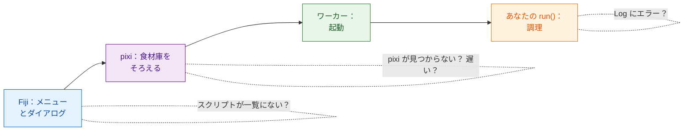

# トラブルシューティングと FAQ

## やさしく言うと

レストランで注文がうまくいかなかったら、こう考えます。ウェイターは注文を
受けた？ 厨房は開いている？ 食材庫はそろっている？ 料理人が何か焦がした？
Wavu の問題も、同じいくつかの場所のどれかで起きます。そして **Log
ウィンドウ**（隠れていたら **Window › Log**）は、Wavu が今していることを
書く場所です。Wavu 自身の行は `[Wavu]` で始まります。

## 最初の実行が止まっているように見える

ほぼ間違いなくダウンロード中です。スクリプトフォルダーの最初の起動では
環境が作られます。PyTorch や Cellpose があると、**1〜2 GB、数分** かかる
ことがあります。Log に

> `[Wavu] First start of '…': downloading its Python packages. This happens once and can take several minutes...`

が出ていないか、Fiji のステータスバーに
*Wavu: starting worker… 42s (Esc to cancel)* が出ていないかを見てください。
そのまま待ちましょう。スクリプトが初回にモデルの重みをダウンロードするなら、
`ctx.log` でそう伝えるべきです（[やり方](../write/real-images.md#slow-first-runs-and-how-to-keep-users-calm)）。

## 「pixi not found」や「Could not set up pixi」

- **Plugins › Wavu › Setup Python (pixi)** をもう一度実行してください。
  github.com へのインターネット接続が必要です。
- 制限の厳しいコンピューターやオフラインのコンピューターでは、
  [pixi.sh](https://pixi.sh) から手で pixi をインストールし（または IT
  担当に頼み）、Fiji を再起動します。Wavu は `Fiji.app/wavu/`、`~/.wavu/bin`、
  PATH、`~/.pixi/bin` で pixi を探します。
- **ターミナル** で `pixi` が見つかるのは、pixi.sh からインストールした場合
  だけです。Fiji がダウンロードしたものは Fiji 専用です。

## スクリプトが一覧にない、または「not a Wavu script folder」

- **`pixi.toml` を直接含むフォルダー** を選んでください。その親フォルダーや、
  1 段深いフォルダーではありません（解凍したときによくある落とし穴です）。
- Wavu が一覧に出すのは `def run(...)` を定義した `.py` ファイルだけです。
  名前が `_`、`.`、`test_` で始まるファイルは、わざと無視されます。
- スクリプトの読み込みに失敗すると、Log に *could not load script.py: …*
  と理由が表示されます。たいていは打ち間違いか、パッケージの不足です。

## Log にエラーが出た { #an-error-appears-in-the-log }

ウィンドウに *script failed:* と短いメッセージが出て、Log には詳しい内容
（「トレースバック」）が残ります。

トレースバックは **下から上へ** 読みます。最後の行がエラーで、その上の行が
`script.py` のどの行で起きたかを指しています。よくあるもの：

| 最後の行 | たいていの意味 |
|---|---|
| `ModuleNotFoundError: No module named 'skimage'` | パッケージを `pixi.toml` に足し（[やり方](../write/get-the-template.md#adding-a-package)）、**Stop Worker** して、もう一度実行する |
| `KeyError: 'image'` | `inputs[...]` や `params[...]` の名前が `PARAMS` と違っている |
| `ValueError: …` あなた自身の文 | あなた自身のチェックが働いた。意図どおりの動作 |
| `… needs an image -- open one first` | 実行する前に Fiji で画像を開く |

## スクリプトを変えたのに何も変わらない

ワーカーが古いバージョンを読み込んだままです。
**Plugins › Wavu › Stop Worker** を選んでから、もう一度実行してください。

## Esc で止まらない

Wavu のキャンセルは **協調的** です。Esc は旗を揚げるだけで、スクリプトは
次に `ctx.cancelled()` を確認したときに止まります。一度も確認しない
スクリプトや、長い 1 回の呼び出しの中にいるスクリプトは、その呼び出しが
終わるまで動き続けます。
[ログ、進捗、キャンセル](../write/logs-progress-cancel.md#cancel-why-your-code-has-to-help)
を見てください。Esc を押す前に Fiji のウィンドウをクリックしてください。
最後の手段として、**Plugins › Wavu › Stop Worker** でワーカーを止められます。

## Fiji がクライアントとワーカーのバージョンが違うと言う

Log の *Note: Fiji client … and worker … differ* という行は、Fiji の中の
Wavu ファイルと、スクリプトの環境の中の Wavu が、別のリリースのものだという
意味です。たいていはそのまま動きます。何かがうまくいかなければ、Fiji の
Wavu zip を更新してください。

## napari の場合

napari では、Wavu は Fiji の Log ウィンドウではなく、**Wavu パネルのログ欄**
に書き込みます。エラーは napari の短い通知としても表示されます。

- **Linux で napari が開かない**（*could not connect to display*、または
  Qt platform plugin に関するエラー）：どのディスプレイシステムを使うかを
  Qt に教えます。`export QT_QPA_PLATFORM=xcb`（X11）または `wayland` を
  設定してから、もう一度 `pixi run -e napari napari` を実行してください。
  画面のないマシンでは `offscreen` を使います。
- **Start worker を押すと「pixi was not found」と出る**：napari が
  `pixi run -e napari napari` 以外の方法で起動されています。`Wavu`
  フォルダーからこのコマンドで起動するか、環境変数 `WAVU_PIXI` に pixi
  プログラムのフルパスを設定してください。
- **最初の Start worker が止まっているように見える**：Fiji とまったく同じで、
  スクリプト専用の環境を作っているところです。パネルのログに pixi の
  進み具合が表示されます。`Worker ready` が出るまで待ってください。
  **Cancel** を押すと中止します。
- **スクリプトを変えたのに何も変わらない**：**Stop worker** を押してから、
  もう一度 **Start worker** を押してください。
- **Image の一覧が空**：選べるのは Image レイヤーと Labels レイヤーだけです。
  先に画像を開いてください。

[wavu-napari をインストールする](../napari/install.md) も見てください。

## それでも解決しない？

[image.sc フォーラム](https://forum.image.sc) で質問するか、
[issue を作成](https://github.com/Oxford-Zeiss-Centre-of-Excellence/Wavu/issues)
してください。Log の内容を全部コピーしてメッセージに貼ってください。

## ひとことで言うと

Log を開きましょう。pixi がまだダウンロード中なのか、フォルダーが違うのか、
パッケージが足りないのか、あなたのコードがエラーを出したのかを教えてくれます。
