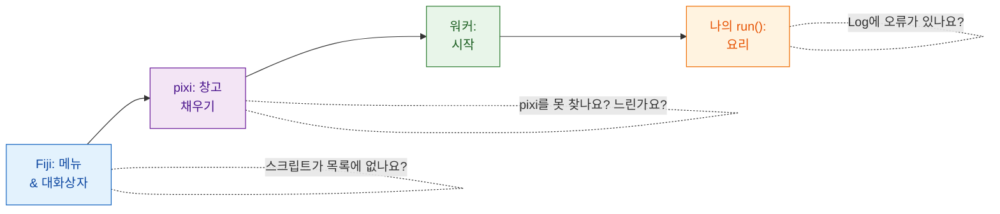

# 문제 해결과 FAQ

## 쉬운 말로 설명하면

레스토랑 주문이 잘못되면 이렇게 물어보죠. 웨이터가 주문을 받았나? 주방은
열렸나? 창고는 채워졌나? 요리사가 뭘 태웠나? Wavu의 문제도 이 몇 군데로
나뉘어요. 그리고 **Log 창**(숨어 있으면 **Window › Log**)이 Wavu가 하는 일을
적는 곳이에요. Wavu가 직접 쓴 줄은 `[Wavu]`로 시작해요.

## 첫 실행이 멈춘 것 같아요

거의 확실히 내려받는 중이에요. 스크립트 폴더를 처음 시작하면 환경을
만들어요. PyTorch나 Cellpose가 있으면 **1–2 GB에 몇 분**이 걸릴 수 있어요.
Log에서

> `[Wavu] First start of '…': downloading its Python packages. This happens once and can take several minutes...`

를, Fiji 상태 표시줄에서 *Wavu: starting worker… 42s (Esc to cancel)*를
찾아보세요. 그냥 기다리세요. 스크립트가 처음 쓸 때 모델 가중치를 내려받는다면
`ctx.log`로 알려 줘야 해요([방법](../write/real-images.md#slow-first-runs-and-how-to-keep-users-calm)).

## "pixi not found" 또는 "Could not set up pixi"

- **Plugins › Wavu › Setup Python (pixi)**를 다시 실행하세요. github.com에
  인터넷으로 접속할 수 있어야 해요.
- 제한이 걸렸거나 오프라인인 컴퓨터라면 [pixi.sh](https://pixi.sh)에서
  pixi를 직접 설치하고(또는 IT 부서에 요청하고) Fiji를 다시 시작하세요.
  Wavu는 `Fiji.app/wavu/`, `~/.wavu/bin`, PATH, `~/.pixi/bin`에서 pixi를 찾아요.
- **터미널**에서는 pixi.sh에서 설치한 경우에만 `pixi`가 찾아져요. Fiji가
  내려받은 사본은 Fiji 전용이에요.

## 스크립트가 목록에 없거나 "not a Wavu script folder"라고 나와요

- **`pixi.toml`을 바로 담고 있는 폴더**를 고르세요. 그 상위 폴더나 한 단계
  더 깊은 폴더가 아니에요(압축 풀 때 흔히 생기는 일이에요).
- Wavu는 `def run(...)`이 정의된 `.py` 파일만 보여 줘요. 이름이 `_`, `.`,
  `test_`로 시작하는 파일은 일부러 무시해요.
- 스크립트를 불러오지 못하면 Log에 *could not load script.py: …*와 이유가
  나와요. 오타나 빠진 패키지인 경우가 많아요.

## Log에 오류가 나타나요 { #an-error-appears-in-the-log }

*script failed:*와 짧은 메시지가 적힌 창이 뜨고, Log에는 자세한 내용
("traceback", 오류 추적 기록)이 있어요.

traceback은 **아래에서 위로** 읽으세요. 마지막 줄이 오류이고, 그 위의 줄들이
오류를 일으킨 `script.py`의 줄을 가리켜요. 흔한 경우는 이래요.

| 마지막 줄 | 보통 이런 뜻이에요 |
|---|---|
| `ModuleNotFoundError: No module named 'skimage'` | `pixi.toml`에 패키지를 추가하고([방법](../write/get-the-template.md#adding-a-package)) **Stop Worker** 후 다시 실행 |
| `KeyError: 'image'` | `inputs[...]`나 `params[...]` 안의 이름이 `PARAMS`와 달라요 |
| `ValueError: …` 내가 쓴 글 | 내가 넣은 검사가 작동했어요. 의도한 대로예요 |
| `… needs an image -- open one first` | 실행 전에 Fiji에서 이미지를 여세요 |

## 스크립트를 고쳤는데 아무것도 안 바뀌어요

워커가 아직 옛 버전을 불러온 상태예요. **Plugins › Wavu › Stop Worker**를
고르고 다시 실행하세요.

## Esc로 멈추지 않아요

Wavu의 취소는 **협력적**이에요. Esc는 깃발을 올리고, 스크립트는 다음에
`ctx.cancelled()`를 확인할 때 멈춰요. 확인하지 않는 스크립트나 긴 호출 하나
안에 있는 스크립트는 그 호출이 끝날 때까지 계속 돌아요.
[로그, 진행 상황, 취소](../write/logs-progress-cancel.md#cancel-why-your-code-has-to-help)를
보세요. Esc를 누르기 전에 Fiji 창을 클릭하세요. 마지막 수단으로
**Plugins › Wavu › Stop Worker**를 고르면 워커가 종료돼요.

## Fiji가 클라이언트와 워커 버전이 다르다고 해요

Log의 *Note: Fiji client … and worker … differ*라는 줄은 Fiji 안의 Wavu 파일과
스크립트 환경 안의 Wavu가 서로 다른 릴리스라는 뜻이에요. 그래도 대개는
작동해요. 뭔가 실패하면 Fiji의 Wavu zip을 업데이트하세요.

## 그래도 안 되나요?

[image.sc 포럼](https://forum.image.sc)에 묻거나
[이슈를 여세요](https://github.com/Oxford-Zeiss-Centre-of-Excellence/Wavu/issues).
Log 전체를 복사해서 메시지에 넣어 주세요.

## 한 문장으로

Log를 열어 보세요. pixi가 아직 내려받는 중인지, 폴더가 틀렸는지, 패키지가
빠졌는지, 내 코드가 오류를 냈는지 알려 줘요.
