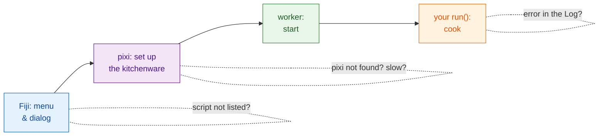

# Troubleshooting and FAQ

## The idea in plain words

When a restaurant order goes wrong, you ask: did the waiter get the order,
is the kitchen open, is the kitchenware ready, did the cook burn something?
Wavu problems fall into the same few places, and the **Log window**
(**Window › Log** if it is hidden) is where Wavu writes what it is doing.
Lines from Wavu itself start with `[Wavu]`.

## The first run looks stuck

It is almost certainly downloading. The first start of a script folder
builds its environment; with PyTorch or Cellpose that can be **1–2 GB and
several minutes**. Look for

> `[Wavu] First start of '…': downloading its Python packages. This happens once and can take several minutes...`

in the Log, and for *Wavu: starting worker… 42s (Esc to cancel)* in Fiji's
status bar. Let it run. If your script downloads model weights on first use,
it should say so with `ctx.log` ([how](../write/real-images.md#slow-first-runs-and-how-to-keep-users-calm)).

## "pixi not found" or "Could not set up pixi"

- Run **Plugins › Wavu › Setup Python (pixi)** again. It needs internet
  access to github.com.
- On a locked-down or offline computer, install pixi by hand from
  [pixi.sh](https://pixi.sh) (or ask IT), then restart Fiji. Wavu looks for it
  in `Fiji.app/wavu/`, in `~/.wavu/bin`, on your PATH and in `~/.pixi/bin`.
- In a **terminal**, `pixi` is only found if you installed it from pixi.sh;
  the copy Fiji downloaded is private to Fiji.

## My script is not listed, or "not a Wavu script folder"

- Pick the folder that **directly contains `pixi.toml`**, not its parent or a
  folder one level deeper (a common unzip surprise).
- Wavu only lists `.py` files that define `def run(...)`. Files whose names
  start with `_`, `.` or `test_` are ignored on purpose.
- If a script fails to load, the Log says *could not load script.py: …*
  with the reason, often a typo or a missing package.

## An error appears in the Log

A window says *script failed:* with a short message, and the Log holds the
full details (the "traceback").

Read the traceback **from the bottom up**: the last line is the error, the
lines above it point to the line in `script.py` that caused it. Common ones:

| Last line says | Usually means |
|---|---|
| `ModuleNotFoundError: No module named 'skimage'` | add the package to `pixi.toml` ([how](../write/get-the-template.md#adding-a-package)), **Stop Worker**, run again |
| `KeyError: 'image'` | the name in `inputs[...]` or `params[...]` differs from `PARAMS` |
| `ValueError: …` your own text | your own check fired, working as intended |
| `… needs an image -- open one first` | open an image in Fiji before running |

## I changed my script but nothing changed

The worker still has the old version loaded. Choose
**Plugins › Wavu › Stop Worker**, then run again.

## Esc does not stop it

Cancel in Wavu is **cooperative**: Esc raises a flag, and your script stops
the next time it checks `ctx.cancelled()`. A script that never checks, or that
is inside one long call, keeps running until that call ends. See
[Logs, progress and cancel](../write/logs-progress-cancel.md#cancel-why-your-code-has-to-help).
Click a Fiji window before pressing Esc. As a last resort,
**Plugins › Wavu › Stop Worker** shuts the worker down.

## Fiji says the client and worker versions differ

The Log line *Note: Fiji client … and worker … differ* means the Wavu files in
Fiji and the Wavu inside your script's environment are from different
releases. It often still works; if something fails, update the Wavu zip in
Fiji.

## In napari

In napari, Wavu writes into the **log box of the Wavu panel**, not Fiji's
Log window; errors also pop up as a short napari notification.

- **napari does not open on Linux** (*could not connect to display*, or an
  error about the Qt platform plugin): tell Qt which display system to use,
  `export QT_QPA_PLATFORM=xcb` (X11) or `wayland`, then run
  `pixi run -e napari napari` again. On a machine without a screen, use
  `offscreen`.
- **"pixi was not found" when you press Start worker**: napari was started
  some other way than `pixi run -e napari napari`. Start it with that
  command from the `Wavu` folder, or set the environment variable
  `WAVU_PIXI` to the full path of the pixi program.
- **The first Start worker seems stuck**: it is building the script's own
  environment, exactly as in Fiji. The panel's log shows pixi's progress;
  wait for `Worker ready`. **Cancel** gives up.
- **I changed my script but nothing changed**: press **Stop worker**, then
  **Start worker** again.
- **The Image list is empty**: only Image and Labels layers can be picked.
  Open an image first.

See also [Install wavu-napari](../napari/install.md).

## Still stuck?

Ask on the [image.sc forum](https://forum.image.sc) or
[open an issue](https://github.com/Oxford-Zeiss-Centre-of-Excellence/Wavu/issues).
Copy the whole Log into your message.

## In one sentence

Open the Log: it tells you whether pixi is still downloading, a folder is
wrong, a package is missing or your own code raised an error.
