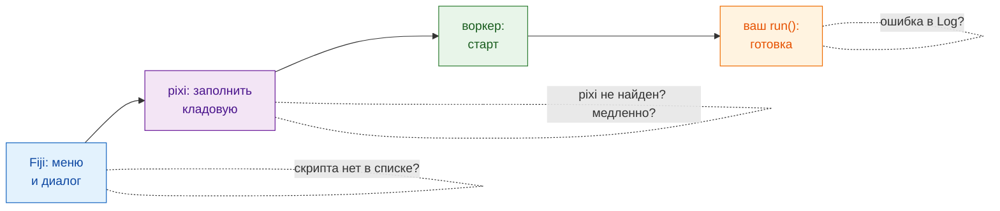

# Решение проблем и FAQ

## Идея простыми словами

Когда в ресторане с заказом что-то не так, вы спрашиваете: принял ли
официант заказ, открыта ли кухня, заполнена ли кладовая, не сжёг ли повар
что-нибудь? Проблемы Wavu случаются в тех же немногих местах, а **окно Log**
(**Window › Log**, если оно скрыто) — это место, где Wavu пишет, что делает.
Строки от самого Wavu начинаются с `[Wavu]`.

## Первый запуск будто завис

Почти наверняка идёт загрузка. При первом старте папки скрипта собирается её
окружение; с PyTorch или Cellpose это может быть **1–2 ГБ и несколько
минут**. Ищите в Log

> `[Wavu] First start of '…': downloading its Python packages. This happens once and can take several minutes...`

и *Wavu: starting worker… 42s (Esc to cancel)* в строке состояния Fiji.
Дайте ему поработать. Если скрипт при первом использовании скачивает веса
модели, он должен сообщать об этом через `ctx.log`
([как](../write/real-images.md#slow-first-runs-and-how-to-keep-users-calm)).

## «pixi not found» или «Could not set up pixi»

- Снова запустите **Plugins › Wavu › Setup Python (pixi)**. Нужен доступ в
  интернет к github.com.
- На компьютере с ограничениями или без интернета установите pixi вручную с
  [pixi.sh](https://pixi.sh) (или попросите IT-отдел), затем перезапустите
  Fiji. Wavu ищет его в `Fiji.app/wavu/`, в `~/.wavu/bin`, в PATH и в
  `~/.pixi/bin`.
- В **терминале** `pixi` находится, только если вы установили его с pixi.sh;
  копия, скачанная Fiji, принадлежит только Fiji.

## Моего скрипта нет в списке, или «not a Wavu script folder»

- Выберите папку, в которой **непосредственно лежит `pixi.toml`**, а не
  родительскую и не вложенную на уровень глубже (частый сюрприз при
  распаковке).
- Wavu показывает только файлы `.py`, в которых есть `def run(...)`. Файлы,
  имена которых начинаются с `_`, `.` или `test_`, намеренно пропускаются.
- Если скрипт не загрузился, Log пишет *could not load script.py: …* с
  причиной — часто это опечатка или отсутствующий пакет.

## В Log появилась ошибка { #an-error-appears-in-the-log }

Окно сообщает *script failed:* с коротким текстом, а в Log лежат все
подробности (так называемый «traceback», трассировка).

Читайте traceback **снизу вверх**: последняя строка — сама ошибка, строки
над ней указывают на строку в `script.py`, которая её вызвала. Частые
случаи:

| В последней строке | Обычно это значит |
|---|---|
| `ModuleNotFoundError: No module named 'skimage'` | добавьте пакет в `pixi.toml` ([как](../write/get-the-template.md#adding-a-package)), **Stop Worker**, запустите снова |
| `KeyError: 'image'` | имя в `inputs[...]` или `params[...]` не совпадает с `PARAMS` |
| `ValueError: …` ваш собственный текст | сработала ваша собственная проверка, всё как задумано |
| `… needs an image -- open one first` | откройте изображение в Fiji перед запуском |

## Я изменил скрипт, но ничего не изменилось

У воркера всё ещё загружена старая версия. Выберите
**Plugins › Wavu › Stop Worker** и запустите снова.

## Esc не останавливает скрипт

Отмена в Wavu **кооперативная**: Esc поднимает флажок, и скрипт
останавливается, когда в следующий раз проверит `ctx.cancelled()`. Скрипт,
который никогда не проверяет флажок или находится внутри одного долгого
вызова, работает, пока этот вызов не закончится. См.
[Log, прогресс и отмена](../write/logs-progress-cancel.md#cancel-why-your-code-has-to-help).
Перед нажатием Esc щёлкните по окну Fiji. В крайнем случае
**Plugins › Wavu › Stop Worker** выключит воркер.

## Fiji пишет, что версии клиента и воркера различаются

Строка в Log *Note: Fiji client … and worker … differ* означает, что файлы
Wavu в Fiji и Wavu внутри окружения скрипта — из разных релизов. Часто всё
равно работает; если что-то ломается, обновите zip Wavu в Fiji.

## Всё ещё не получается?

Спросите на [форуме image.sc](https://forum.image.sc) или
[создайте issue](https://github.com/Oxford-Zeiss-Centre-of-Excellence/Wavu/issues).
Скопируйте в сообщение весь Log.

## Одним предложением

Откройте Log: он подскажет, качает ли ещё pixi, не та ли папка, не хватает
ли пакета или ваш собственный код выбросил ошибку.
