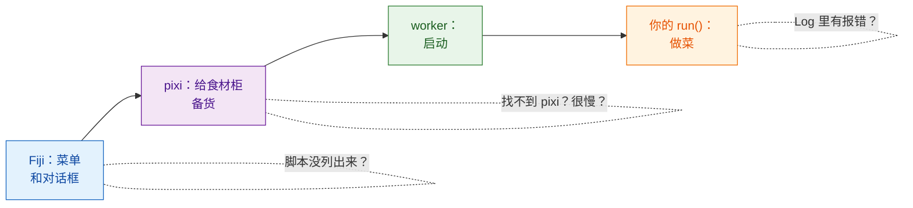
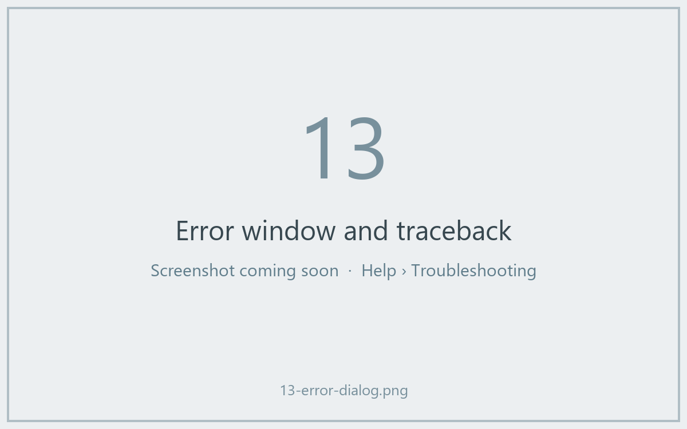

# 故障排除与常见问题

## 用大白话说

餐厅点餐出了岔子，你会问：服务员接到单了吗？厨房开门了吗？食材柜备好货了吗？厨师是不是把菜烧糊了？Wavu 的问题也一样，总是出在这几个地方，而 **Log 窗口**（如果被隐藏了，用 **Window › Log** 调出来）就是 Wavu 记录自己在做什么的地方。Wavu 自己写的行都以 `[Wavu]` 开头。

## 第一次运行好像卡住了

几乎可以肯定它在下载。脚本文件夹第一次启动时会搭建它的环境；如果用到 PyTorch 或 Cellpose，可能有 **1–2 GB、要好几分钟**。请在 Log 里找这一行：

> `[Wavu] First start of '…': downloading its Python packages. This happens once and can take several minutes...`

再看看 Fiji 状态栏上有没有 *Wavu: starting worker… 42s (Esc to cancel)*。让它跑完就好。如果你的脚本第一次使用时会下载模型权重，应该用 `ctx.log` 提示一下（[做法](../write/real-images.md#slow-first-runs-and-how-to-keep-users-calm)）。

## “pixi not found”或“Could not set up pixi”

- 再运行一次 **Plugins › Wavu › Setup Python (pixi)**。它需要能访问 github.com。
- 在权限受限或离线的电脑上，请从 [pixi.sh](https://pixi.sh) 手动安装 pixi（或找 IT 帮忙），然后重启 Fiji。Wavu 会在 `Fiji.app/wavu/`、`~/.wavu/bin`、你的 PATH 以及 `~/.pixi/bin` 中查找它。
- 在**终端**里，只有从 pixi.sh 安装的 `pixi` 才能被找到；Fiji 下载的那一份是 Fiji 自己专用的。

## 我的脚本没有列出来，或提示“not a Wavu script folder”

- 请选择**直接包含 `pixi.toml`** 的那个文件夹，而不是它的上一级，也不是再往下一级的文件夹（解压时常见的意外）。
- Wavu 只列出定义了 `def run(...)` 的 `.py` 文件。文件名以 `_`、`.` 或 `test_` 开头的文件会被有意忽略。
- 如果某个脚本加载失败，Log 会显示 *could not load script.py: …* 和原因，通常是拼写错误或缺少软件包。

## Log 里出现报错 { #an-error-appears-in-the-log }

会弹出一个写着 *script failed:* 和简短信息的窗口，而 Log 里有完整的细节（也就是“traceback”，错误回溯）。

traceback 要**从下往上读**：最后一行是错误本身，上面几行指出是 `script.py` 的哪一行引起的。常见的有：

| 最后一行写着 | 通常意味着 |
|---|---|
| `ModuleNotFoundError: No module named 'skimage'` | 把这个包加进 `pixi.toml`（[做法](../write/get-the-template.md#adding-a-package)），点 **Stop Worker**，再运行一次 |
| `KeyError: 'image'` | `inputs[...]` 或 `params[...]` 里的名称和 `PARAMS` 不一致 |
| `ValueError: …` 你自己写的文字 | 你自己设的检查触发了，一切按预期工作 |
| `… needs an image -- open one first` | 运行前先在 Fiji 里打开一张图像 |

## 我改了脚本，但什么都没变

worker（厨房）里加载的还是旧版本。选择 **Plugins › Wavu › Stop Worker**，再运行一次。

## 按 Esc 停不下来

Wavu 的取消是**协作式的**：Esc 会竖起一面旗子，你的脚本要等下一次检查 `ctx.cancelled()` 时才会停。从不检查的脚本，或者正卡在一个很长的调用里的脚本，会一直运行到那个调用结束。参见[日志、进度和取消](../write/logs-progress-cancel.md#cancel-why-your-code-has-to-help)。按 Esc 之前，先点一下某个 Fiji 窗口。实在不行，**Plugins › Wavu › Stop Worker** 会把 worker 关掉。

## Fiji 提示 client 和 worker 版本不同

Log 里的 *Note: Fiji client … and worker … differ* 表示 Fiji 里的 Wavu 文件和你脚本环境里的 Wavu 来自不同的发布版本。通常仍然能用；如果出了问题，请更新 Fiji 里的 Wavu zip。

## 还是没解决？

到 [image.sc 论坛](https://forum.image.sc)提问，或者[提交一个 issue](https://github.com/Oxford-Zeiss-Centre-of-Excellence/Wavu/issues)。请把整个 Log 复制到你的消息里。

## 一句话总结

打开 Log：它会告诉你是 pixi 还在下载、文件夹选错了、缺了软件包，还是你自己的代码抛出了错误。
