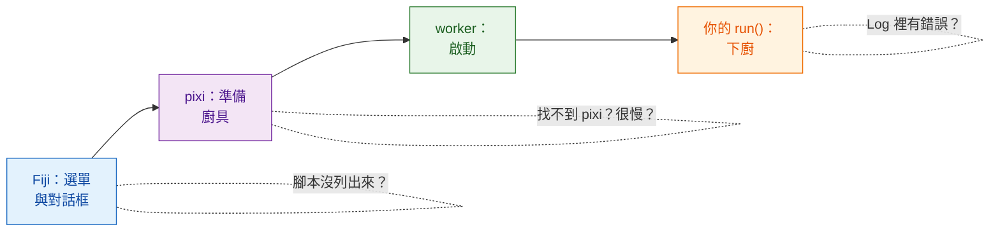

# 疑難排解與常見問題

## 用白話說

餐廳點餐出錯時，你會問：服務生有沒有接到單？廚房開了沒？廚具有沒有備齊？廚師是不是把菜燒焦了？Wavu 的問題也一樣，總是落在這幾個地方，而 **Log 視窗**（如果被藏起來了，用 **Window › Log** 叫出來）就是 Wavu 寫下它正在做什麼的地方。Wavu 自己寫的行都以 `[Wavu]` 開頭。

## 第一次執行好像卡住了

幾乎可以確定它正在下載。腳本資料夾第一次啟動時會建立它的環境；如果用到 PyTorch 或 Cellpose，可能有 **1–2 GB、要花好幾分鐘**。請在 Log 裡找這一行：

> `[Wavu] First start of '…': downloading its Python packages. This happens once and can take several minutes...`

並看看 Fiji 狀態列上是否有 *Wavu: starting worker… 42s (Esc to cancel)*。讓它跑完就好。如果你的腳本第一次使用時會下載模型權重，應該用 `ctx.log` 說一聲（[做法](../write/real-images.md#slow-first-runs-and-how-to-keep-users-calm)）。

## 「pixi not found」或「Could not set up pixi」

- 再執行一次 **Plugins › Wavu › Setup Python (pixi)**。它需要能連上 github.com。
- 在權限受限或離線的電腦上，請從 [pixi.sh](https://pixi.sh) 手動安裝 pixi（或請 IT 幫忙），然後重新啟動 Fiji。Wavu 會在 `Fiji.app/wavu/`、`~/.wavu/bin`、你的 PATH 以及 `~/.pixi/bin` 裡尋找它。
- 在**終端機**裡，只有從 pixi.sh 安裝的 `pixi` 才找得到；Fiji 下載的那一份是 Fiji 專用的。

## 我的腳本沒有列出來，或出現「not a Wavu script folder」

- 請挑選**直接包含 `pixi.toml`** 的那個資料夾，不是它的上一層，也不是再往下一層的資料夾（解壓縮時常見的意外）。
- Wavu 只會列出有定義 `def run(...)` 的 `.py` 檔。檔名以 `_`、`.` 或 `test_` 開頭的檔案會被刻意略過。
- 如果某個腳本載入失敗，Log 會顯示 *could not load script.py: …* 和原因，通常是打錯字或缺少套件。

## Log 裡出現錯誤 { #an-error-appears-in-the-log }

會跳出一個寫著 *script failed:* 和簡短訊息的視窗，而 Log 裡有完整的細節（也就是「traceback」，錯誤追蹤）。

traceback 要**從下往上讀**：最後一行是錯誤本身，上面幾行指出是 `script.py` 裡的哪一行造成的。常見的有：

| 最後一行寫著 | 通常代表 |
|---|---|
| `ModuleNotFoundError: No module named 'skimage'` | 把套件加進 `pixi.toml`（[做法](../write/get-the-template.md#adding-a-package)），按 **Stop Worker**，再執行一次 |
| `KeyError: 'image'` | `inputs[...]` 或 `params[...]` 裡的名稱和 `PARAMS` 不一致 |
| `ValueError: …` 你自己寫的文字 | 你自己設的檢查被觸發了，一切正常運作 |
| `… needs an image -- open one first` | 執行前先在 Fiji 裡開啟一張影像 |

## 我改了腳本，但什麼都沒變

worker（廚房）還載著舊版本。選擇 **Plugins › Wavu › Stop Worker**，再執行一次。

## 按 Esc 停不下來

Wavu 的取消是**合作式的**：Esc 會舉起一面旗子，你的腳本要等到下一次檢查 `ctx.cancelled()` 時才會停。從不檢查的腳本，或正卡在一個很長的呼叫裡的腳本，會一直跑到那個呼叫結束。請看[Log、進度與取消](../write/logs-progress-cancel.md#cancel-why-your-code-has-to-help)。按 Esc 之前，先點一下某個 Fiji 視窗。萬不得已時，**Plugins › Wavu › Stop Worker** 會把 worker 關掉。

## Fiji 說 client 和 worker 的版本不同

Log 裡的 *Note: Fiji client … and worker … differ* 表示 Fiji 裡的 Wavu 檔案和你腳本環境裡的 Wavu 來自不同的發布版本。通常還是能用；如果出了問題，請更新 Fiji 裡的 Wavu zip。

## 在 napari 中

在 napari 中，Wavu 會寫進 **Wavu 面板的 log 框**，而不是 Fiji 的 Log 視窗；錯誤也會以簡短的 napari 通知跳出來。

- **napari 在 Linux 上打不開**（*could not connect to display*，或關於 Qt platform plugin 的錯誤）：告訴 Qt 要用哪種顯示系統，`export QT_QPA_PLATFORM=xcb`（X11）或 `wayland`，然後再執行一次 `pixi run -e napari napari`。在沒有螢幕的機器上，請用 `offscreen`。
- **按下 Start worker 時出現「pixi was not found」**：napari 不是用 `pixi run -e napari napari` 啟動的。請在 `Wavu` 資料夾裡用這個指令啟動它，或把環境變數 `WAVU_PIXI` 設成 pixi 程式的完整路徑。
- **第一次 Start worker 好像卡住了**：它正在建立腳本專屬的環境，和在 Fiji 裡一模一樣。面板的 log 會顯示 pixi 的進度；等到出現 `Worker ready`。按 **Cancel** 可以放棄。
- **我改了腳本，但什麼都沒變**：按 **Stop worker**，再按一次 **Start worker**。
- **Image 清單是空的**：只能選 Image 和 Labels 圖層。請先開啟一張影像。

另請參閱[安裝 wavu-napari](../napari/install.md)。

## 還是卡住？

到 [image.sc 論壇](https://forum.image.sc)發問，或[開一個 issue](https://github.com/Oxford-Zeiss-Centre-of-Excellence/Wavu/issues)。請把整個 Log 複製到你的訊息裡。

## 一句話總結

打開 Log：它會告訴你是 pixi 還在下載、資料夾選錯了、少了套件，還是你自己的程式碼丟出了錯誤。
