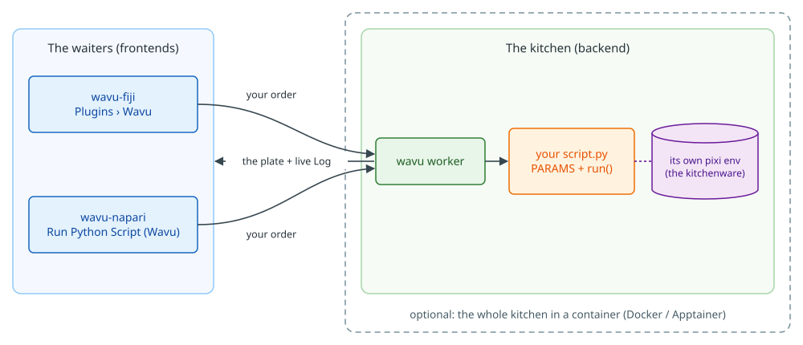

# Wavu: Ihr Python, direkt in Ihrem Bildbetrachter

*Wavu* ist Fidschianisch für **Brücke**. Es verbindet den Betrachter, in dem
Sie sich Ihre Bilder ansehen, **Fiji** oder **napari**, mit Python, wo
Werkzeuge wie Cellpose und scikit-image zu Hause sind.

Stellen Sie sich ein Restaurant vor. **Der Betrachter ist der Kellner**: Er
nimmt Ihre Bestellung auf (ein Dialog mit ein paar Feldern), trägt Ihre
Bilder als **Zutaten** hinein und bringt den Teller an Ihren Tisch (neue
Bilder, Tabellen, Umrisse). **Der Worker ist die Küche** hinter der Tür, und
jedes Rezept hat **seine eigenen Küchengeräte**, eigene Töpfe, Messer und
Öfen (die Python-Pakete): Das Cellpose-Rezept leiht sich also nie die
Werkzeuge des Weichzeichner-Rezepts aus (und macht sie auch nicht kaputt).
Dasselbe Rezept kann von beiden Kellnern serviert werden.

{ width="1000" }

**Ein Skriptordner, zwei Betrachter.** Sie schreiben `script.py` einmal;
Fiji-Nutzer und napari-Nutzer führen es beide aus, jedes Mal in der eigenen
Umgebung des Ordners.

## Warum es Wavu gibt { #why-this-exists }

- **Eine Umgebung für alles geht kaputt.** Installieren Sie mit `pip` ein
  Cellpose-Plugin in die Umgebung von napari, kann es eine andere PyTorch-,
  NumPy- oder Qt-Version mitbringen; das nächste Plugin verlangt wieder andere
  Versionen, und napari oder das Werkzeug einer Kollegin startet nicht mehr.
  `conda` und `pip` in einer Umgebung zu mischen, macht es schlimmer.
- **Python in Fiji ist noch mühsamer.** Fijis eigene Skriptsprache ist Jython
  (Python 2.7, ohne NumPy). Brücken wie PyImageJ verlangen, dass Sie Java-,
  conda- und Paketversionen auf jedem Rechner von Hand abstimmen.
- **Die Antwort von Wavu:** Der Betrachter bleibt klein und sauber, und jedes
  Skript läuft in **seiner eigenen pixi-Umgebung**, gebaut aus seiner eigenen
  `pixi.lock`. Skripte teilen keine Pakete, können also weder einander noch
  napari oder Fiji beschädigen, und derselbe Ordner wird auf jedem Rechner
  identisch installiert.

## Mehr als eine Brücke: ganze Analysen, per Skript

Wavu ist auch ein **Funktionsaufruf**, den Ihre eigenen Skripte machen
können. Ein Groovy-Skript, ein ImageJ-Makro oder ein Python-Notebook läuft
über einen Ordner, erledigt die nativen Schritte selbst (öffnen,
vorverarbeiten, messen, speichern) und gibt nur den schweren Schritt, etwa
Cellpose, an Wavu ab, das ihn in seiner eigenen Umgebung ausführt und das
Ergebnis an das Skript zurückgibt. Ein Skript, der ganze Ordner, jedes Mal
gleich.

## Wo möchten Sie anfangen?

-   :material-lightbulb-outline:{ .lg .middle } **Das Modell verstehen**

    ---

    Kellner, Küche, Küchengeräte: Was läuft wo, und warum geraten sich Ihre
    Pakete nie in die Quere?

    [:octicons-arrow-right-24: So funktioniert es](model/what-is-wavu.md)

-   :material-pencil-outline:{ .lg .middle } **Ein Skript schreiben**

    ---

    Machen Sie aus Ihrem Notebook einen Menüeintrag, Tests zuerst. Holen Sie
    sich die fertige Vorlage mit einem Klick:

    [Vorlage in VS Code öffnen](vscode://vscode.git/clone?url=https%3A%2F%2Fgithub.com%2FOxford-Zeiss-Centre-of-Excellence%2FWavu-Script-Template.git){ .md-button .md-button--primary }

    [:octicons-arrow-right-24: Die Vorlage holen](write/get-the-template.md)

-   :material-microscope:{ .lg .middle } **In Fiji benutzen**

    ---

    Installieren Sie wavu-fiji, starten Sie Ihr erstes Skript an einem
    Beispielbild und geben Sie Werkzeuge als eine einzige ZIP-Datei an Ihr
    Labor weiter.

    [:octicons-arrow-right-24: wavu-fiji](fiji/install.md)

-   :material-layers-outline:{ .lg .middle } **In napari benutzen**

    ---

    Starten Sie napari mit dem Wavu-Panel; die Ergebnisse kommen als Image-,
    Labels- und Shapes-Layer zurück.

    [:octicons-arrow-right-24: wavu-napari](napari/install.md)

## Gut zu wissen

- **Wie viele Daten?** Interaktiv heißt: ein Bild, das in den Speicher
  passt, etwa 1–2 GB. Mit blockweiser, gestreamter Verarbeitung (OME-Zarr)
  schafft Wavu auf einem lokalen Rechner Daten bis etwa 50 GB – **mit einer
  wichtigen Einschränkung**: Fiji und napari sind Canvas-basierte Betrachter
  für Daten im Speicher; während eines Streams sehen sie nur eine kleine
  Vorschau oder das Endergebnis, bleiben langsam und sind nicht der empfohlene
  Ort, um ihn zu steuern. Über etwa 50 GB nehmen Sie eine Batch- oder
  HPC-Pipeline.
- **Jedes Skript hat seine eigene Umgebung**, deshalb kommen sich ein
  PyTorch-Skript und ein reines NumPy-Skript nie in die Quere.
- **Neugierig, wie es gebaut ist?** Die Seite
  [Architektur](model/architecture.md) erklärt den Worker, sein
  HTTP-Protokoll und wie ein Betrachter ihn startet.

Sie möchten jedes Detail, von der Idee bis zum veröffentlichten Fiji-Plugin?
Lesen Sie die
[vollständige Anleitung auf GitHub](https://github.com/Oxford-Zeiss-Centre-of-Excellence/Wavu/blob/main/docs/tutorial-cellpose-plugin.md) (auf Englisch).
