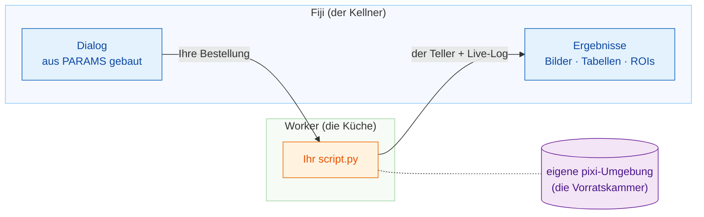

# Wavu: Ihr Python, direkt in Fiji

*Wavu* ist Fidschianisch für **Brücke**. Es verbindet Fiji, wo Sie sich Ihre
Bilder ansehen, mit Python, wo Werkzeuge wie Cellpose und scikit-image zu
Hause sind.

Stellen Sie sich ein Restaurant vor. **Fiji ist der Kellner**: Er nimmt Ihre
Bestellung auf (ein Dialog mit ein paar Feldern) und bringt den Teller an
Ihren Tisch (neue Bilder, Tabellen, Umrisse). **Der Worker ist die Küche**
hinter der Tür, und jedes Rezept hat **seine eigene Vorratskammer**: Das
Cellpose-Rezept leiht sich also nie die Zutaten des Weichzeichner-Rezepts aus
(und macht sie auch nicht kaputt).

## Was möchten Sie tun?

-   :material-play-circle-outline:{ .lg .middle } **Ein Skript benutzen**

    ---

    Installieren Sie Wavu in Fiji und starten Sie Ihr erstes Python-Skript
    an einem Beispielbild. Kein Terminal nötig.

    [:octicons-arrow-right-24: Hier anfangen](start/what-is-wavu.md)

-   :material-pencil-outline:{ .lg .middle } **Ein Skript schreiben**

    ---

    Machen Sie aus Ihrem Notebook einen Menüeintrag in Fiji. Holen Sie sich
    die fertige Vorlage mit einem Klick:

    [Vorlage in VS Code öffnen](vscode://vscode.git/clone?url=https%3A%2F%2Fgithub.com%2FOxford-Zeiss-Centre-of-Excellence%2FWavu-Script-Template.git){ .md-button .md-button--primary }

    [:octicons-arrow-right-24: So funktioniert es](write/get-the-template.md)

-   :material-share-variant-outline:{ .lg .middle } **Ein Skript teilen**

    ---

    Geben Sie Ihr Werkzeug als eine einzige ZIP-Datei an das ganze Labor
    weiter. Eine Veröffentlichung für alle ist optional.

    [:octicons-arrow-right-24: Mit dem eigenen Labor teilen](share/with-your-lab.md)

## Gut zu wissen

- **Kleine, interaktive Daten.** Ein Bild, das in den Arbeitsspeicher passt,
  bis etwa 1–2 GB. Für riesige Datenmengen nehmen Sie besser einen
  Batch-Workflow oder einen Rechencluster (HPC).
- **Jedes Skript hat seine eigene Umgebung**, deshalb kommen sich ein
  PyTorch-Skript und ein reines NumPy-Skript nie in die Quere.

Sie möchten jedes Detail, von der Idee bis zum veröffentlichten Plugin? Lesen
Sie die
[vollständige Anleitung auf GitHub](https://github.com/Oxford-Zeiss-Centre-of-Excellence/Wavu/blob/main/docs/tutorial-cellpose-plugin.md) (auf Englisch).
