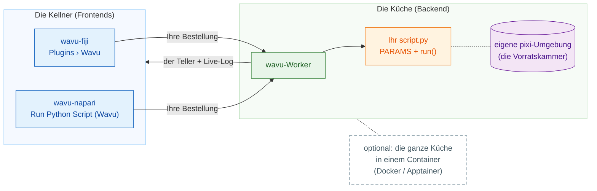

# Wavu: Ihr Python, direkt in Ihrem Bildbetrachter

*Wavu* ist Fidschianisch für **Brücke**. Es verbindet den Betrachter, in dem
Sie sich Ihre Bilder ansehen, **Fiji** oder **napari**, mit Python, wo
Werkzeuge wie Cellpose und scikit-image zu Hause sind.

Stellen Sie sich ein Restaurant vor. **Der Betrachter ist der Kellner**: Er
nimmt Ihre Bestellung auf (ein Dialog mit ein paar Feldern) und bringt den
Teller an Ihren Tisch (neue Bilder, Tabellen, Umrisse). **Der Worker ist die
Küche** hinter der Tür, und jedes Rezept hat **seine eigene
Vorratskammer**: Das Cellpose-Rezept leiht sich also nie die Zutaten des
Weichzeichner-Rezepts aus (und macht sie auch nicht kaputt). Dasselbe Rezept
kann von beiden Kellnern serviert werden.

**Ein Skriptordner, zwei Betrachter.** Sie schreiben `script.py` einmal;
Fiji-Nutzer und napari-Nutzer führen es beide aus, jedes Mal in der eigenen
Umgebung des Ordners.

## Wo möchten Sie anfangen?

-   :material-lightbulb-outline:{ .lg .middle } **Das Modell verstehen**

    ---

    Kellner, Küche, Vorratskammer: Was läuft wo, und warum geraten sich Ihre
    Pakete nie in die Quere?

    [:octicons-arrow-right-24: So funktioniert es](model/what-is-wavu.md)

-   :material-pencil-outline:{ .lg .middle } **Ein Skript schreiben**

    ---

    Machen Sie aus Ihrem Notebook einen Menüeintrag, Tests zuerst. Holen Sie
    sich die fertige Vorlage mit einem Klick:

    [Vorlage in VS Code öffnen](vscode://vscode.git/clone?url=https%3A%2F%2Fgithub.com%2FOxford-Zeiss-Centre-of-Excellence%2FWavu-Script-Template.git){ .md-button .md-button--primary }

    [:octicons-arrow-right-24: Die Vorlage holen](write/get-the-template.md)

-   :material-microscope:{ .lg .middle } **In Fiji benutzen**

    ---

    Installieren Sie wavu-fiji, starten Sie Ihr erstes Skript an einem
    Beispielbild und geben Sie Werkzeuge als eine einzige ZIP-Datei an Ihr
    Labor weiter.

    [:octicons-arrow-right-24: wavu-fiji](fiji/install.md)

-   :material-layers-outline:{ .lg .middle } **In napari benutzen**

    ---

    Starten Sie napari mit dem Wavu-Panel; die Ergebnisse kommen als Image-,
    Labels- und Shapes-Layer zurück.

    [:octicons-arrow-right-24: wavu-napari](napari/install.md)

## Gut zu wissen

- **Kleine, interaktive Daten.** Ein Bild, das in den Arbeitsspeicher passt,
  bis etwa 1–2 GB. Für riesige Datenmengen nehmen Sie besser einen
  Batch-Workflow oder einen Rechencluster (HPC).
- **Jedes Skript hat seine eigene Umgebung**, deshalb kommen sich ein
  PyTorch-Skript und ein reines NumPy-Skript nie in die Quere.
- **Neugierig, wie es gebaut ist?** Die Seite
  [Architektur](model/architecture.md) erklärt den Worker, sein
  HTTP-Protokoll und wie ein Betrachter ihn startet.

Sie möchten jedes Detail, von der Idee bis zum veröffentlichten Fiji-Plugin?
Lesen Sie die
[vollständige Anleitung auf GitHub](https://github.com/Oxford-Zeiss-Centre-of-Excellence/Wavu/blob/main/docs/tutorial-cellpose-plugin.md) (auf Englisch).
