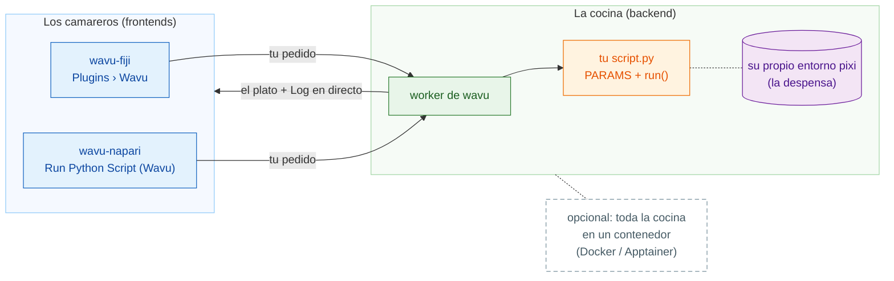

# Wavu: tu Python, dentro de tu visor de imágenes

*Wavu* significa **puente** en fiyiano. Conecta el visor donde miras tus
imágenes, **Fiji** o **napari**, con Python, donde viven herramientas como
Cellpose y scikit-image.

Piensa en un restaurante. **El visor es el camarero**: toma tu pedido (un
diálogo con unos pocos campos) y te trae el plato a la mesa (imágenes nuevas,
tablas, contornos). **El worker es la cocina** que está detrás de la puerta, y
cada receta tiene **su propia despensa**, así que la receta de Cellpose nunca
toma prestados (ni estropea) los ingredientes de la receta del desenfoque. La
misma receta la puede servir cualquiera de los dos camareros.

**Una carpeta de script, dos visores.** Escribes `script.py` una vez; lo
ejecutan tanto los usuarios de Fiji como los de napari, siempre en el entorno
propio de la carpeta.

## ¿Por dónde quieres empezar?

-   :material-lightbulb-outline:{ .lg .middle } **Entender el modelo**

    ---

    Camarero, cocina, despensa: qué se ejecuta dónde, y por qué tus paquetes
    nunca chocan.

    [:octicons-arrow-right-24: Cómo funciona](model/what-is-wavu.md)

-   :material-pencil-outline:{ .lg .middle } **Escribir un script**

    ---

    Convierte tu notebook en una entrada de menú, con las pruebas primero.
    Consigue la plantilla lista para usar con un clic:

    [Abrir la plantilla en VS Code](vscode://vscode.git/clone?url=https%3A%2F%2Fgithub.com%2FOxford-Zeiss-Centre-of-Excellence%2FWavu-Script-Template.git){ .md-button .md-button--primary }

    [:octicons-arrow-right-24: Conseguir la plantilla](write/get-the-template.md)

-   :material-microscope:{ .lg .middle } **Usarlo en Fiji**

    ---

    Instala wavu-fiji, ejecuta tu primer script sobre una imagen de ejemplo
    y comparte herramientas con tu laboratorio en un solo archivo zip.

    [:octicons-arrow-right-24: wavu-fiji](fiji/install.md)

-   :material-layers-outline:{ .lg .middle } **Usarlo en napari**

    ---

    Arranca napari con el panel de Wavu; los resultados vuelven como capas
    Image, Labels y Shapes.

    [:octicons-arrow-right-24: wavu-napari](napari/install.md)

## Conviene saber

- **Datos pequeños e interactivos.** Una imagen que quepa en memoria, hasta
  aproximadamente 1–2 GB. Para datos enormes, usa un flujo de trabajo por
  lotes o en un clúster (HPC).
- **Cada script tiene su propio entorno**, así que un script con PyTorch y
  otro que solo usa NumPy nunca se pelean.
- **¿Te pica la curiosidad por cómo está hecho?** La página de
  [arquitectura](model/architecture.md) explica el worker, su protocolo HTTP
  y cómo lo arranca un visor.

¿Quieres todos los detalles, desde la idea hasta un plugin de Fiji publicado?
Lee la
[guía completa en GitHub](https://github.com/Oxford-Zeiss-Centre-of-Excellence/Wavu/blob/main/docs/tutorial-cellpose-plugin.md) (en inglés).
