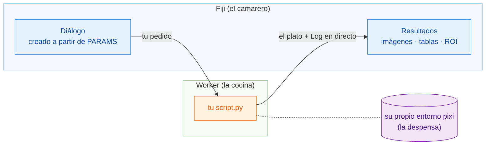

# Wavu: tu Python, dentro de Fiji

*Wavu* significa **puente** en fiyiano. Conecta Fiji, donde miras tus
imágenes, con Python, donde viven herramientas como Cellpose y scikit-image.

Piensa en un restaurante. **Fiji es el camarero**: toma tu pedido (un diálogo
con unos pocos campos) y te trae el plato a la mesa (imágenes nuevas, tablas,
contornos). **El worker es la cocina** que está detrás de la puerta, y cada
receta tiene **su propia despensa**, así que la receta de Cellpose nunca toma
prestados (ni estropea) los ingredientes de la receta del desenfoque.

## ¿Qué quieres hacer?

-   :material-play-circle-outline:{ .lg .middle } **Usar un script**

    ---

    Instala Wavu en Fiji y ejecuta tu primer script de Python sobre una
    imagen de ejemplo. Sin terminal.

    [:octicons-arrow-right-24: Empieza aquí](start/what-is-wavu.md)

-   :material-pencil-outline:{ .lg .middle } **Escribir un script**

    ---

    Convierte tu notebook en una entrada del menú de Fiji. Consigue la
    plantilla lista para usar con un clic:

    [Abrir la plantilla en VS Code](vscode://vscode.git/clone?url=https%3A%2F%2Fgithub.com%2FOxford-Zeiss-Centre-of-Excellence%2FWavu-Script-Template.git){ .md-button .md-button--primary }

    [:octicons-arrow-right-24: Cómo funciona](write/get-the-template.md)

-   :material-share-variant-outline:{ .lg .middle } **Compartir un script**

    ---

    Da tu herramienta a todo el laboratorio en un solo archivo zip.
    Publicarla para todo el mundo es opcional.

    [:octicons-arrow-right-24: Compartir con tu laboratorio](share/with-your-lab.md)

## Conviene saber

- **Datos pequeños e interactivos.** Una imagen que quepa en memoria, hasta
  aproximadamente 1–2 GB. Para datos enormes, usa un flujo de trabajo por
  lotes o en un clúster (HPC).
- **Cada script tiene su propio entorno**, así que un script con PyTorch y
  otro que solo usa NumPy nunca se pelean.

¿Quieres todos los detalles, desde la idea hasta un plugin publicado? Lee la
[guía completa en GitHub](https://github.com/Oxford-Zeiss-Centre-of-Excellence/Wavu/blob/main/docs/tutorial-cellpose-plugin.md) (en inglés).
