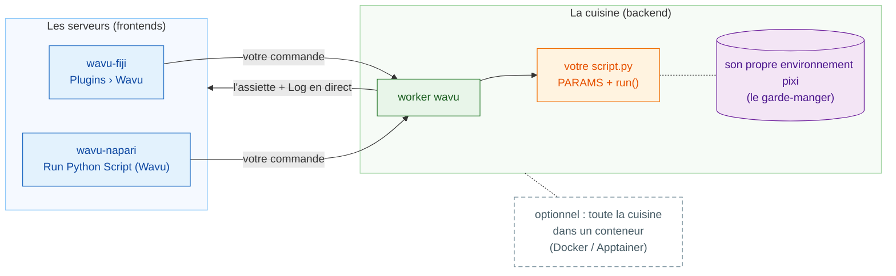

# Wavu : votre Python, dans votre visualiseur d'images

*Wavu* veut dire **pont** en fidjien. Il relie le visualiseur où vous
regardez vos images, **Fiji** ou **napari**, à Python, où vivent des outils
comme Cellpose et scikit-image.

Imaginez un restaurant. **Le visualiseur est le serveur** : il prend votre
commande (une boîte de dialogue avec quelques champs) et rapporte l'assiette
à votre table (nouvelles images, tableaux, contours). **Le worker est la
cuisine** derrière la porte, et chaque recette a **son propre garde-manger** :
la recette Cellpose n'emprunte (et ne casse) jamais les ingrédients de la
recette de flou. La même recette peut être servie par l'un ou l'autre
serveur.

**Un dossier de script, deux visualiseurs.** Vous écrivez `script.py` une
seule fois ; les utilisateurs de Fiji comme ceux de napari le lancent, à
chaque fois dans l'environnement propre au dossier.

## Par où voulez-vous commencer ? { #where-do-you-want-to-start }

-   :material-lightbulb-outline:{ .lg .middle } **Comprendre le modèle**

    ---

    Serveur, cuisine, garde-manger : ce qui tourne où, et pourquoi vos
    paquets n'entrent jamais en conflit.

    [:octicons-arrow-right-24: Comment ça marche](model/what-is-wavu.md)

-   :material-pencil-outline:{ .lg .middle } **Écrire un script**

    ---

    Transformez votre notebook en entrée de menu, en commençant par les
    tests. Récupérez le modèle prêt à l'emploi en un clic :

    [Ouvrir le modèle dans VS Code](vscode://vscode.git/clone?url=https%3A%2F%2Fgithub.com%2FOxford-Zeiss-Centre-of-Excellence%2FWavu-Script-Template.git){ .md-button .md-button--primary }

    [:octicons-arrow-right-24: Obtenir le modèle](write/get-the-template.md)

-   :material-microscope:{ .lg .middle } **L'utiliser dans Fiji**

    ---

    Installez wavu-fiji, lancez votre premier script sur une image
    d'exemple, et partagez vos outils avec votre labo sous forme d'un seul
    fichier zip.

    [:octicons-arrow-right-24: wavu-fiji](fiji/install.md)

-   :material-layers-outline:{ .lg .middle } **L'utiliser dans napari**

    ---

    Lancez napari avec le panneau Wavu ; les résultats reviennent sous forme
    de calques Image, Labels et Shapes.

    [:octicons-arrow-right-24: wavu-napari](napari/install.md)

## Bon à savoir { #good-to-know }

- **Données petites et interactives.** Une image qui tient en mémoire,
  jusqu'à environ 1–2 Go. Pour de très gros volumes, utilisez plutôt un
  traitement par lots ou un cluster de calcul (HPC).
- **Chaque script a son propre environnement** : un script PyTorch et un
  script qui n'utilise que NumPy ne se gênent jamais.
- **Curieux de savoir comment c'est construit ?** La page
  [architecture](model/architecture.md) explique le worker, son protocole
  HTTP et la façon dont un visualiseur le démarre.

Vous voulez tous les détails, de l'idée au plugin Fiji publié ? Lisez le
[guide complet sur GitHub](https://github.com/Oxford-Zeiss-Centre-of-Excellence/Wavu/blob/main/docs/tutorial-cellpose-plugin.md) (en anglais).
