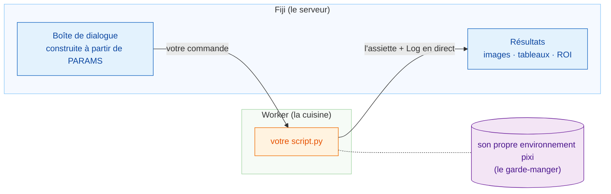

# Wavu : votre Python, dans Fiji

*Wavu* veut dire **pont** en fidjien. Il relie Fiji, où vous regardez vos
images, à Python, où vivent des outils comme Cellpose et scikit-image.

Imaginez un restaurant. **Fiji est le serveur** : il prend votre commande (une
boîte de dialogue avec quelques champs) et rapporte l'assiette à votre table
(nouvelles images, tableaux, contours). **Le worker est la cuisine** derrière
la porte, et chaque recette a **son propre garde-manger** : la recette
Cellpose n'emprunte (et ne casse) jamais les ingrédients de la recette de
flou.

## Que voulez-vous faire ?

-   :material-play-circle-outline:{ .lg .middle } **Utiliser un script**

    ---

    Installez Wavu dans Fiji et lancez votre premier script Python sur une
    image d'exemple. Aucun terminal nécessaire.

    [:octicons-arrow-right-24: Commencer ici](start/what-is-wavu.md)

-   :material-pencil-outline:{ .lg .middle } **Écrire un script**

    ---

    Transformez votre notebook en entrée de menu Fiji. Récupérez le modèle
    prêt à l'emploi en un clic :

    [Ouvrir le modèle dans VS Code](vscode://vscode.git/clone?url=https%3A%2F%2Fgithub.com%2FOxford-Zeiss-Centre-of-Excellence%2FWavu-Script-Template.git){ .md-button .md-button--primary }

    [:octicons-arrow-right-24: Comment ça marche](write/get-the-template.md)

-   :material-share-variant-outline:{ .lg .middle } **Partager un script**

    ---

    Donnez votre outil à tout le labo sous forme d'un seul fichier zip. La
    publication pour le monde entier est facultative.

    [:octicons-arrow-right-24: Partager avec votre labo](share/with-your-lab.md)

## Bon à savoir

- **Données petites et interactives.** Une image qui tient en mémoire,
  jusqu'à environ 1–2 Go. Pour de très gros volumes, utilisez plutôt un
  traitement par lots ou un cluster de calcul (HPC).
- **Chaque script a son propre environnement** : un script PyTorch et un
  script qui n'utilise que NumPy ne se gênent jamais.

Vous voulez tous les détails, de l'idée au plugin publié ? Lisez le
[guide complet sur GitHub](https://github.com/Oxford-Zeiss-Centre-of-Excellence/Wavu/blob/main/docs/tutorial-cellpose-plugin.md) (en anglais).
