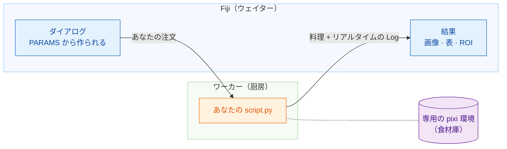

# Wavu: あなたの Python を Fiji の中で

*Wavu* はフィジー語で **橋** という意味です。画像を見る場所である Fiji と、
Cellpose や scikit-image などのツールがある Python をつなぎます。

レストランを思い浮かべてください。**Fiji はウェイター**です。注文
（いくつかの入力欄があるダイアログ）を受け取り、料理（新しい画像、表、
輪郭）をテーブルまで運んできます。**ワーカーはドアの向こうの厨房**です。
そしてレシピごとに **専用の食材庫** があるので、Cellpose のレシピがぼかしの
レシピの材料を借りたり、壊したりすることはありません。

## 何をしたいですか？

-   :material-play-circle-outline:{ .lg .middle } **スクリプトを使う**

    ---

    Fiji に Wavu をインストールして、サンプル画像で最初の Python
    スクリプトを実行します。ターミナルは不要です。

    [:octicons-arrow-right-24: ここから始める](start/what-is-wavu.md)

-   :material-pencil-outline:{ .lg .middle } **スクリプトを書く**

    ---

    ノートブックを Fiji のメニュー項目に変えます。すぐに使えるひな形は
    ワンクリックで手に入ります。

    [VS Code でテンプレートを開く](vscode://vscode.git/clone?url=https%3A%2F%2Fgithub.com%2FOxford-Zeiss-Centre-of-Excellence%2FWavu-Script-Template.git){ .md-button .md-button--primary }

    [:octicons-arrow-right-24: しくみを見る](write/get-the-template.md)

-   :material-share-variant-outline:{ .lg .middle } **スクリプトを共有する**

    ---

    ツールを zip ファイル 1 つにして、研究室全体に配れます。世界への公開は
    任意です。

    [:octicons-arrow-right-24: 研究室で共有する](share/with-your-lab.md)

## 知っておくと良いこと

- **小さめのデータを対話的に。** メモリに収まる画像 1 枚、だいたい 1〜2 GB
  までが対象です。巨大なデータには、バッチ処理や HPC のワークフローを
  使ってください。
- **スクリプトごとに専用の環境があります。** そのため、PyTorch を使う
  スクリプトと NumPy だけのスクリプトがぶつかることはありません。

アイデアからプラグインの公開まで、すべての詳細を知りたい方は
[GitHub の完全ガイド](https://github.com/Oxford-Zeiss-Centre-of-Excellence/Wavu/blob/main/docs/tutorial-cellpose-plugin.md)（英語）をどうぞ。
