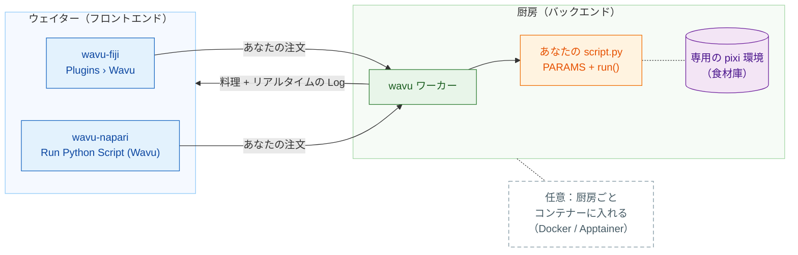

# Wavu: あなたの Python を、画像ビューアーの中で

*Wavu* はフィジー語で **橋** という意味です。画像を見る場所であるビューアー、
つまり **Fiji** や **napari** と、Cellpose や scikit-image などのツールが
ある Python をつなぎます。

レストランを思い浮かべてください。**ビューアーはウェイター**です。注文
（いくつかの入力欄があるダイアログ）を受け取り、料理（新しい画像、表、
輪郭）をテーブルまで運んできます。**ワーカーはドアの向こうの厨房**です。
そしてレシピごとに **専用の食材庫** があるので、Cellpose のレシピがぼかしの
レシピの材料を借りたり、壊したりすることはありません。同じレシピを、
どちらのウェイターでも出せます。

**スクリプトフォルダーは 1 つ、ビューアーは 2 つ。** `script.py` は一度
書くだけです。Fiji のユーザーも napari のユーザーもそれを実行でき、毎回
そのフォルダー専用の環境で動きます。

## どこから始めますか？

-   :material-lightbulb-outline:{ .lg .middle } **しくみを理解する**

    ---

    ウェイター、厨房、食材庫。何がどこで動くのか、なぜパッケージが
    ぶつからないのかを説明します。

    [:octicons-arrow-right-24: しくみ](model/what-is-wavu.md)

-   :material-pencil-outline:{ .lg .middle } **スクリプトを書く**

    ---

    ノートブックをメニュー項目に変えます。テストから始めましょう。
    すぐに使えるひな形はワンクリックで手に入ります。

    [VS Code でテンプレートを開く](vscode://vscode.git/clone?url=https%3A%2F%2Fgithub.com%2FOxford-Zeiss-Centre-of-Excellence%2FWavu-Script-Template.git){ .md-button .md-button--primary }

    [:octicons-arrow-right-24: テンプレートを入手する](write/get-the-template.md)

-   :material-microscope:{ .lg .middle } **Fiji で使う**

    ---

    wavu-fiji をインストールし、サンプル画像で最初のスクリプトを実行して、
    ツールを zip ファイル 1 つで研究室と共有します。

    [:octicons-arrow-right-24: wavu-fiji](fiji/install.md)

-   :material-layers-outline:{ .lg .middle } **napari で使う**

    ---

    Wavu パネル付きで napari を起動します。結果は Image、Labels、Shapes
    レイヤーとして戻ってきます。

    [:octicons-arrow-right-24: wavu-napari](napari/install.md)

## 知っておくと良いこと

- **小さめのデータを対話的に。** メモリに収まる画像 1 枚、だいたい 1〜2 GB
  までが対象です。巨大なデータには、バッチ処理や HPC のワークフローを
  使ってください。
- **スクリプトごとに専用の環境があります。** そのため、PyTorch を使う
  スクリプトと NumPy だけのスクリプトがぶつかることはありません。
- **どう作られているか気になりますか？** [アーキテクチャ](model/architecture.md)
  のページで、ワーカー、その HTTP プロトコル、ビューアーがワーカーを
  起動する方法を説明しています。

アイデアから Fiji プラグインの公開まで、すべての詳細を知りたい方は
[GitHub の完全ガイド](https://github.com/Oxford-Zeiss-Centre-of-Excellence/Wavu/blob/main/docs/tutorial-cellpose-plugin.md)（英語）をどうぞ。
