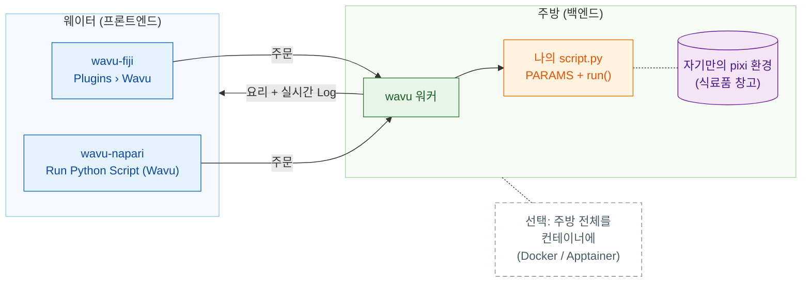

# Wavu: 이미지 뷰어 안에서 쓰는 나의 Python

*Wavu*는 피지어로 **다리**라는 뜻이에요. 이미지를 보는 뷰어, 곧 **Fiji**나
**napari**를, Cellpose나 scikit-image 같은 도구가 있는 Python과 이어 줘요.

레스토랑을 떠올려 보세요. **뷰어는 웨이터**예요. 주문(입력란 몇 개가 있는
대화상자)을 받고, 요리(새 이미지, 표, 윤곽선)를 테이블로 가져다줘요.
**워커(worker)는 문 뒤의 주방**이고, 레시피마다 **자기만의 식료품 창고**가
있어요. 그래서 Cellpose 레시피가 블러 레시피의 재료를 빌리거나 망가뜨리는
일은 없어요. 같은 레시피를 어느 웨이터든 내갈 수 있어요.

**스크립트 폴더 하나, 뷰어 둘.** `script.py`는 한 번만 쓰면 돼요. Fiji
사용자도 napari 사용자도 그것을 실행하고, 매번 그 폴더만의 환경에서 돌아요.

## 어디서 시작할까요?

-   :material-lightbulb-outline:{ .lg .middle } **작동 방식 이해하기**

    ---

    웨이터, 주방, 식료품 창고: 무엇이 어디서 실행되는지, 왜 패키지가
    서로 충돌하지 않는지 알아봐요.

    [:octicons-arrow-right-24: 작동 방식](model/what-is-wavu.md)

-   :material-pencil-outline:{ .lg .middle } **스크립트 작성하기**

    ---

    노트북을 메뉴 항목으로 바꿔 보세요. 테스트부터 시작해요. 미리 만들어 둔
    기본 틀을 클릭 한 번으로 받을 수 있어요.

    [VS Code에서 템플릿 열기](vscode://vscode.git/clone?url=https%3A%2F%2Fgithub.com%2FOxford-Zeiss-Centre-of-Excellence%2FWavu-Script-Template.git){ .md-button .md-button--primary }

    [:octicons-arrow-right-24: 템플릿 받기](write/get-the-template.md)

-   :material-microscope:{ .lg .middle } **Fiji에서 쓰기**

    ---

    wavu-fiji를 설치하고, 샘플 이미지로 첫 스크립트를 실행하고, zip 파일
    하나로 연구실과 도구를 공유해요.

    [:octicons-arrow-right-24: wavu-fiji](fiji/install.md)

-   :material-layers-outline:{ .lg .middle } **napari에서 쓰기**

    ---

    Wavu 패널과 함께 napari를 시작해요. 결과는 Image, Labels, Shapes
    레이어로 돌아와요.

    [:octicons-arrow-right-24: wavu-napari](napari/install.md)

## 알아 두면 좋은 점

- **작고 대화형인 데이터용이에요.** 메모리에 들어가는 이미지 한 장,
  대략 1–2 GB까지예요. 아주 큰 데이터는 배치(batch)나 HPC 워크플로를 쓰세요.
- **스크립트마다 자기 환경이 있어요.** 그래서 PyTorch 스크립트와 NumPy만
  쓰는 스크립트가 서로 충돌하지 않아요.
- **어떻게 만들어졌는지 궁금한가요?** [아키텍처](model/architecture.md)
  페이지에서 워커, 워커의 HTTP 프로토콜, 뷰어가 워커를 시작하는 방법을
  설명해요.

아이디어부터 Fiji 플러그인 출시까지 모든 내용을 보고 싶다면
[GitHub의 전체 가이드](https://github.com/Oxford-Zeiss-Centre-of-Excellence/Wavu/blob/main/docs/tutorial-cellpose-plugin.md)(영어)를
읽어 보세요.
