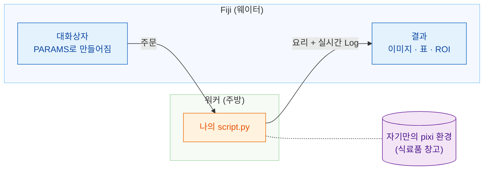

# Wavu: Fiji 안에서 쓰는 나의 Python

*Wavu*는 피지어로 **다리**라는 뜻이에요. 이미지를 보는 Fiji와, Cellpose나
scikit-image 같은 도구가 있는 Python을 이어 줘요.

레스토랑을 떠올려 보세요. **Fiji는 웨이터**예요. 주문(입력란 몇 개가 있는
대화상자)을 받고, 요리(새 이미지, 표, 윤곽선)를 테이블로 가져다줘요.
**워커(worker)는 문 뒤의 주방**이고, 레시피마다 **자기만의 식료품 창고**가
있어요. 그래서 Cellpose 레시피가 블러 레시피의 재료를 빌리거나 망가뜨리는
일은 없어요.

## 무엇을 하고 싶으세요?

-   :material-play-circle-outline:{ .lg .middle } **스크립트 사용하기**

    ---

    Fiji에 Wavu를 설치하고 샘플 이미지로 첫 Python 스크립트를 실행해
    보세요. 터미널은 필요 없어요.

    [:octicons-arrow-right-24: 여기서 시작하기](start/what-is-wavu.md)

-   :material-pencil-outline:{ .lg .middle } **스크립트 작성하기**

    ---

    노트북을 Fiji 메뉴 항목으로 바꿔 보세요. 미리 만들어 둔 기본 틀을
    클릭 한 번으로 받을 수 있어요.

    [VS Code에서 템플릿 열기](vscode://vscode.git/clone?url=https%3A%2F%2Fgithub.com%2FOxford-Zeiss-Centre-of-Excellence%2FWavu-Script-Template.git){ .md-button .md-button--primary }

    [:octicons-arrow-right-24: 작동 방식](write/get-the-template.md)

-   :material-share-variant-outline:{ .lg .middle } **스크립트 공유하기**

    ---

    zip 파일 하나로 연구실 전체에 도구를 나눠 주세요. 전 세계에 공개하는
    것은 선택이에요.

    [:octicons-arrow-right-24: 연구실과 공유하기](share/with-your-lab.md)

## 알아 두면 좋은 점

- **작고 대화형인 데이터용이에요.** 메모리에 들어가는 이미지 한 장,
  대략 1–2 GB까지예요. 아주 큰 데이터는 배치(batch)나 HPC 워크플로를 쓰세요.
- **스크립트마다 자기 환경이 있어요.** 그래서 PyTorch 스크립트와 NumPy만
  쓰는 스크립트가 서로 충돌하지 않아요.

아이디어부터 플러그인 출시까지 모든 내용을 보고 싶다면
[GitHub의 전체 가이드](https://github.com/Oxford-Zeiss-Centre-of-Excellence/Wavu/blob/main/docs/tutorial-cellpose-plugin.md)(영어)를
읽어 보세요.
