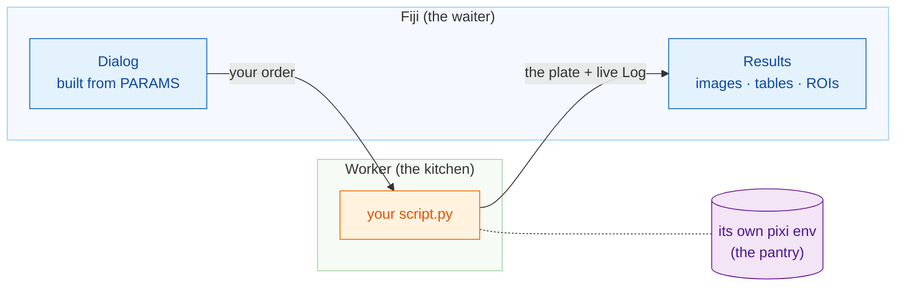

# Wavu: your Python, inside Fiji

*Wavu* is Fijian for **bridge**. It connects Fiji, where you look at your
images, to Python, where tools like Cellpose and scikit-image live.

Think of a restaurant. **Fiji is the waiter**: it takes your order (a dialog
with a few fields) and brings the plate back to your table (new images,
tables, outlines). **The worker is the kitchen** behind the door, and every
recipe has **its own pantry**, so the Cellpose recipe never borrows (or
breaks) the ingredients of the blur recipe.

## What do you want to do?

-   :material-play-circle-outline:{ .lg .middle } **Use a script**

    ---

    Install Wavu in Fiji and run your first Python script on a sample
    image. No terminal needed.

    [:octicons-arrow-right-24: Start here](start/what-is-wavu.md)

-   :material-pencil-outline:{ .lg .middle } **Write a script**

    ---

    Turn your notebook into a Fiji menu item. Get the ready-made
    boilerplate with one click:

    [Open the template in VS Code](vscode://vscode.git/clone?url=https%3A%2F%2Fgithub.com%2FOxford-Zeiss-Centre-of-Excellence%2FWavu-Script-Template.git){ .md-button .md-button--primary }

    [:octicons-arrow-right-24: How it works](write/get-the-template.md)

-   :material-share-variant-outline:{ .lg .middle } **Share a script**

    ---

    Give your tool to the whole lab as one zip file. Publishing to the
    world is optional.

    [:octicons-arrow-right-24: Share with your lab](share/with-your-lab.md)

## Good to know

- **Small, interactive data.** One image that fits in memory, up to roughly
  1–2 GB. For huge data, use a batch or HPC workflow instead.
- **Every script has its own environment**, so a PyTorch script and a
  NumPy-only script never fight.

Want every detail, from idea to a released plugin? Read the
[full guide on GitHub](https://github.com/Oxford-Zeiss-Centre-of-Excellence/Wavu/blob/main/docs/tutorial-cellpose-plugin.md).
