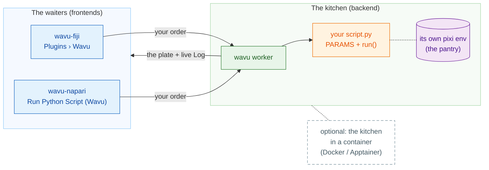

# Wavu: your Python, inside your image viewer

*Wavu* is Fijian for **bridge**. It connects the viewer where you look at
your images, **Fiji** or **napari**, to Python, where tools like Cellpose and
scikit-image live.

Think of a restaurant. **The viewer is the waiter**: it takes your order (a
dialog with a few fields) and brings the plate back to your table (new
images, tables, outlines). **The worker is the kitchen** behind the door, and
every recipe has **its own pantry**, so the Cellpose recipe never borrows (or
breaks) the ingredients of the blur recipe. The same recipe can be served by
either waiter.

**One script folder, two viewers.** You write `script.py` once; Fiji users
and napari users both run it, each time in the folder's own environment.

## Where do you want to start?

-   :material-lightbulb-outline:{ .lg .middle } **Understand the model**

    ---

    Waiter, kitchen, pantry: what runs where, and why your packages never
    clash.

    [:octicons-arrow-right-24: How it works](model/what-is-wavu.md)

-   :material-pencil-outline:{ .lg .middle } **Write a script**

    ---

    Turn your notebook into a menu item, tests first. Get the ready-made
    boilerplate with one click:

    [Open the template in VS Code](vscode://vscode.git/clone?url=https%3A%2F%2Fgithub.com%2FOxford-Zeiss-Centre-of-Excellence%2FWavu-Script-Template.git){ .md-button .md-button--primary }

    [:octicons-arrow-right-24: Get the template](write/get-the-template.md)

-   :material-microscope:{ .lg .middle } **Use it in Fiji**

    ---

    Install wavu-fiji, run your first script on a sample image, and share
    tools with your lab as one zip file.

    [:octicons-arrow-right-24: wavu-fiji](fiji/install.md)

-   :material-layers-outline:{ .lg .middle } **Use it in napari**

    ---

    Start napari with the Wavu panel; results come back as Image, Labels and
    Shapes layers.

    [:octicons-arrow-right-24: wavu-napari](napari/install.md)

## Good to know

- **Small, interactive data.** One image that fits in memory, up to roughly
  1–2 GB. For huge data, use a batch or HPC workflow instead.
- **Every script has its own environment**, so a PyTorch script and a
  NumPy-only script never fight.
- **Curious how it is built?** The [architecture](model/architecture.md) page
  explains the worker, its HTTP protocol and how a viewer starts it.

Want every detail, from idea to a released Fiji plugin? Read the
[full guide on GitHub](https://github.com/Oxford-Zeiss-Centre-of-Excellence/Wavu/blob/main/docs/tutorial-cellpose-plugin.md).
