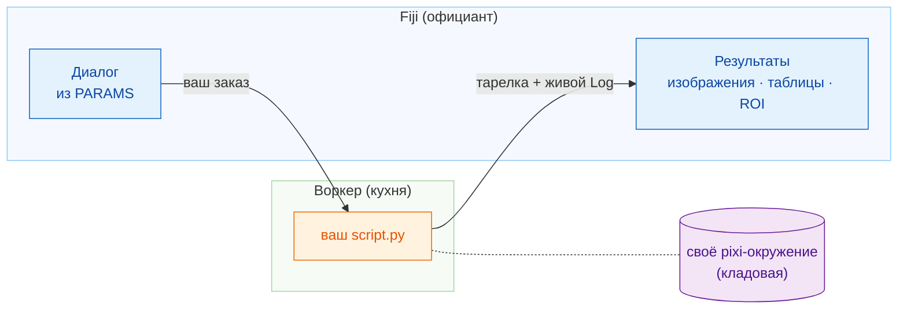

# Wavu: ваш Python внутри Fiji

*Wavu* по-фиджийски значит **мост**. Он соединяет Fiji, где вы смотрите на
изображения, с Python, где живут такие инструменты, как Cellpose и
scikit-image.

Представьте ресторан. **Fiji — это официант**: он принимает ваш заказ (диалог
с несколькими полями) и приносит тарелку обратно к столу (новые изображения,
таблицы, контуры). **Воркер (worker) — это кухня** за дверью, и у каждого
рецепта **своя кладовая**, поэтому рецепт Cellpose никогда не берёт (и не
портит) продукты рецепта размытия.

## Что вы хотите сделать?

-   :material-play-circle-outline:{ .lg .middle } **Использовать скрипт**

    ---

    Установите Wavu в Fiji и запустите свой первый Python-скрипт на
    примере изображения. Терминал не нужен.

    [:octicons-arrow-right-24: Начать здесь](start/what-is-wavu.md)

-   :material-pencil-outline:{ .lg .middle } **Написать скрипт**

    ---

    Превратите свой ноутбук в пункт меню Fiji. Получите готовую
    заготовку одним щелчком:

    [Открыть шаблон в VS Code](vscode://vscode.git/clone?url=https%3A%2F%2Fgithub.com%2FOxford-Zeiss-Centre-of-Excellence%2FWavu-Script-Template.git){ .md-button .md-button--primary }

    [:octicons-arrow-right-24: Как это работает](write/get-the-template.md)

-   :material-share-variant-outline:{ .lg .middle } **Поделиться скриптом**

    ---

    Отдайте свой инструмент всей лаборатории одним zip-файлом. Публикация
    для всего мира — по желанию.

    [:octicons-arrow-right-24: Поделиться с лабораторией](share/with-your-lab.md)

## Полезно знать

- **Небольшие данные, интерактивная работа.** Одно изображение, которое
  помещается в память, примерно до 1–2 ГБ. Для огромных данных используйте
  пакетную обработку или HPC.
- **У каждого скрипта своё окружение**, поэтому скрипт с PyTorch и скрипт
  только с NumPy никогда не конфликтуют.

Хотите все подробности, от идеи до выпущенного плагина? Читайте
[полное руководство на GitHub](https://github.com/Oxford-Zeiss-Centre-of-Excellence/Wavu/blob/main/docs/tutorial-cellpose-plugin.md).
