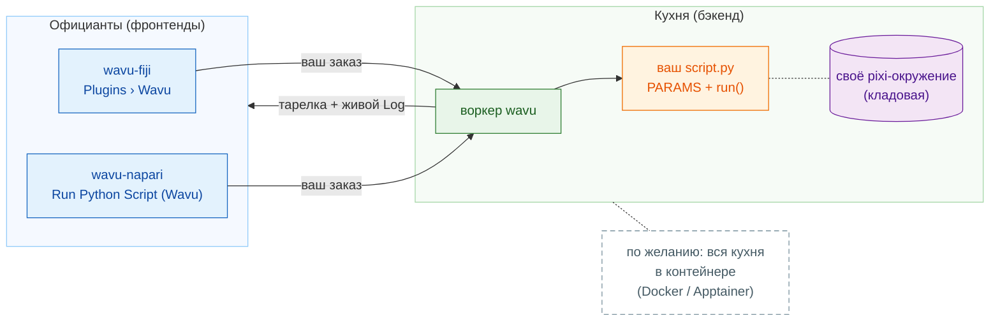

# Wavu: ваш Python внутри вашего просмотрщика изображений

*Wavu* по-фиджийски значит **мост**. Он соединяет просмотрщик, в котором вы
смотрите на изображения, **Fiji** или **napari**, с Python, где живут такие
инструменты, как Cellpose и scikit-image.

Представьте ресторан. **Просмотрщик — это официант**: он принимает ваш заказ
(диалог с несколькими полями) и приносит тарелку обратно к столу (новые
изображения, таблицы, контуры). **Воркер (worker) — это кухня** за дверью, и
у каждого рецепта **своя кладовая**, поэтому рецепт Cellpose никогда не
берёт (и не портит) продукты рецепта размытия. Один и тот же рецепт может
подать любой из двух официантов.

**Одна папка скрипта, два просмотрщика.** Вы пишете `script.py` один раз;
его запускают и пользователи Fiji, и пользователи napari, каждый раз в
собственном окружении этой папки.

## С чего начать?

-   :material-lightbulb-outline:{ .lg .middle } **Понять модель**

    ---

    Официант, кухня, кладовая: что где работает и почему ваши пакеты
    никогда не конфликтуют.

    [:octicons-arrow-right-24: Как это работает](model/what-is-wavu.md)

-   :material-pencil-outline:{ .lg .middle } **Написать скрипт**

    ---

    Превратите свой ноутбук в пункт меню, начиная с тестов. Получите
    готовую заготовку одним щелчком:

    [Открыть шаблон в VS Code](vscode://vscode.git/clone?url=https%3A%2F%2Fgithub.com%2FOxford-Zeiss-Centre-of-Excellence%2FWavu-Script-Template.git){ .md-button .md-button--primary }

    [:octicons-arrow-right-24: Получить шаблон](write/get-the-template.md)

-   :material-microscope:{ .lg .middle } **Работать в Fiji**

    ---

    Установите wavu-fiji, запустите первый скрипт на примере изображения
    и делитесь инструментами с лабораторией одним zip-файлом.

    [:octicons-arrow-right-24: wavu-fiji](fiji/install.md)

-   :material-layers-outline:{ .lg .middle } **Работать в napari**

    ---

    Запустите napari с панелью Wavu; результаты возвращаются как слои
    Image, Labels и Shapes.

    [:octicons-arrow-right-24: wavu-napari](napari/install.md)

## Полезно знать

- **Небольшие данные, интерактивная работа.** Одно изображение, которое
  помещается в память, примерно до 1–2 ГБ. Для огромных данных используйте
  пакетную обработку или HPC.
- **У каждого скрипта своё окружение**, поэтому скрипт с PyTorch и скрипт
  только с NumPy никогда не конфликтуют.
- **Интересно, как это устроено?** Страница
  [Архитектура](model/architecture.md) объясняет воркер, его HTTP-протокол
  и то, как просмотрщик его запускает.

Хотите все подробности, от идеи до выпущенного плагина для Fiji? Читайте
[полное руководство на GitHub](https://github.com/Oxford-Zeiss-Centre-of-Excellence/Wavu/blob/main/docs/tutorial-cellpose-plugin.md) (на английском).
