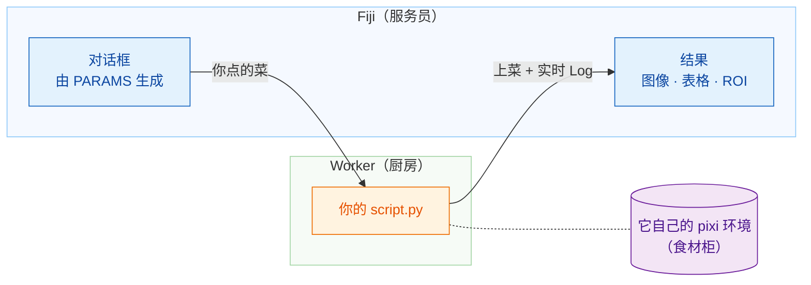

# Wavu：在 Fiji 里运行你的 Python

*Wavu* 是斐济语里的“**桥**”。它把你看图像用的 Fiji，和 Cellpose、
scikit-image 这些工具所在的 Python 连接起来。

想象一家餐厅。**Fiji 是服务员**：它帮你点菜（一个只有几个输入框的对话框），
再把菜端回你的桌上（新的图像、表格、轮廓）。**worker 是门后的厨房**，
而每道食谱都有**自己的食材柜**，所以 Cellpose 的食谱绝不会借用（或弄坏）
模糊处理食谱的食材。

## 你想做什么？

-   :material-play-circle-outline:{ .lg .middle } **使用脚本**

    ---

    在 Fiji 里安装 Wavu，用示例图像运行你的第一个 Python 脚本。
    不需要终端。

    [:octicons-arrow-right-24: 从这里开始](start/what-is-wavu.md)

-   :material-pencil-outline:{ .lg .middle } **编写脚本**

    ---

    把你的笔记本变成 Fiji 的一个菜单项。点一下就能拿到现成的模板：

    [在 VS Code 中打开模板](vscode://vscode.git/clone?url=https%3A%2F%2Fgithub.com%2FOxford-Zeiss-Centre-of-Excellence%2FWavu-Script-Template.git){ .md-button .md-button--primary }

    [:octicons-arrow-right-24: 工作原理](write/get-the-template.md)

-   :material-share-variant-outline:{ .lg .middle } **分享脚本**

    ---

    用一个 zip 文件把你的工具交给整个实验室。要不要发布给全世界，
    完全可选。

    [:octicons-arrow-right-24: 分享给实验室](share/with-your-lab.md)

## 须知

- **小规模、交互式的数据。**一张能放进内存的图像，大约 1–2 GB 以内。
  数据量很大时，请改用批处理或 HPC（高性能计算）流程。
- **每个脚本都有自己的环境**，所以用 PyTorch 的脚本和只用 NumPy 的脚本
  永远不会互相冲突。

想了解从想法到发布插件的全部细节？请阅读
[GitHub 上的完整指南](https://github.com/Oxford-Zeiss-Centre-of-Excellence/Wavu/blob/main/docs/tutorial-cellpose-plugin.md)（英文）。
