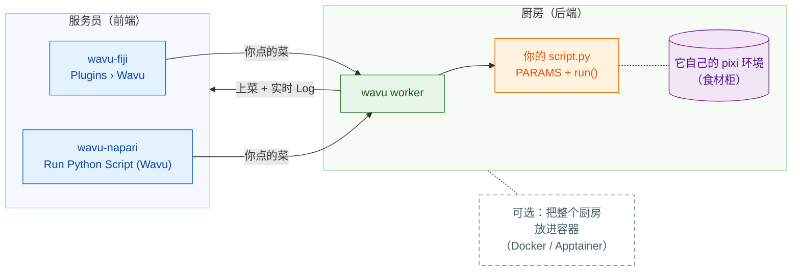

# Wavu：在 Fiji/napari 里运行你的 Python

*Wavu* 是斐济语里的“**桥**”。它把你看图像用的 **Fiji** 或
**napari**，和 Cellpose、scikit-image 这些工具所在的 Python 连接起来。

想象一家餐厅。**Fiji/napari 是服务员**：它帮你点菜（一个只有几个输入框的对话框），
再把菜端回你的桌上（新的图像、表格、轮廓）。**worker 是门后的厨房**，
而每道食谱都有**自己的食材柜**，所以 Cellpose 的食谱绝不会借用（或弄坏）
模糊处理食谱的食材。同一道食谱，哪位服务员都能端上桌。

**一个脚本文件夹，Fiji 和 napari 都能用。**`script.py` 你只需写一次；Fiji 用户和
napari 用户都能运行它，每次都在该文件夹自己的环境中运行。

## 你想从哪里开始？

-   :material-lightbulb-outline:{ .lg .middle } **理解工作模式**

    ---

    服务员、厨房、食材柜：什么在哪里运行，以及为什么你的包永远不会互相
    冲突。

    [:octicons-arrow-right-24: 工作原理](model/what-is-wavu.md)

-   :material-pencil-outline:{ .lg .middle } **编写脚本**

    ---

    把你的笔记本变成一个菜单项，先写测试。点一下就能拿到现成的模板：

    [在 VS Code 中打开模板](vscode://vscode.git/clone?url=https%3A%2F%2Fgithub.com%2FOxford-Zeiss-Centre-of-Excellence%2FWavu-Script-Template.git){ .md-button .md-button--primary }

    [:octicons-arrow-right-24: 获取模板](write/get-the-template.md)

-   :material-microscope:{ .lg .middle } **在 Fiji 中使用**

    ---

    安装 wavu-fiji，用示例图像运行你的第一个脚本，再用一个 zip 文件把工具
    分享给实验室。

    [:octicons-arrow-right-24: wavu-fiji](fiji/install.md)

-   :material-layers-outline:{ .lg .middle } **在 napari 中使用**

    ---

    带着 Wavu 面板启动 napari；结果会以 Image、Labels 和 Shapes 图层返回。

    [:octicons-arrow-right-24: wavu-napari](napari/install.md)

## 须知

- **小规模、交互式的数据。**一张能放进内存的图像，大约 1–2 GB 以内。
  数据量很大时，请改用批处理或 HPC（高性能计算）流程。
- **每个脚本都有自己的环境**，所以用 PyTorch 的脚本和只用 NumPy 的脚本
  永远不会互相冲突。
- **好奇它是怎么实现的？**[架构](model/architecture.md)页面介绍了
  worker、它的 HTTP 协议，以及 Fiji/napari 如何启动它。

想了解从想法到发布 Fiji 插件的每个细节？请阅读
[GitHub 上的完整指南](https://github.com/Oxford-Zeiss-Centre-of-Excellence/Wavu/blob/main/docs/tutorial-cellpose-plugin.md)（英文）。
