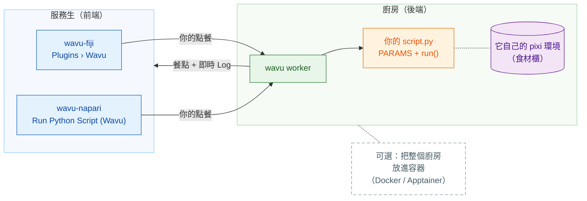

# Wavu：讓你的 Python 在 Fiji/napari 裡執行

*Wavu* 是斐濟語的「**橋**」。它把你看影像用的 **Fiji** 或
**napari**，和 Cellpose、scikit-image 這些工具所在的 Python 連在一起。

想像一間餐廳。**Fiji/napari 是服務生**：它幫你點餐（一個只有幾個欄位的對話框），
再把餐點端回你的桌上（新的影像、表格、輪廓）。**worker 是門後的廚房**，
而每道食譜都有**自己的食材櫃**，所以 Cellpose 的食譜永遠不會借用（或弄壞）
模糊處理食譜的材料。同一道食譜，哪一位服務生都能端上桌。

**一個腳本資料夾，Fiji 和 napari 都能用。**`script.py` 你只要寫一次；Fiji 使用者和
napari 使用者都能執行它，每次都在該資料夾自己的環境中執行。

## 你想從哪裡開始？

-   :material-lightbulb-outline:{ .lg .middle } **了解運作模式**

    ---

    服務生、廚房、食材櫃：什麼在哪裡執行，以及為什麼你的套件永遠不會互相
    衝突。

    [:octicons-arrow-right-24: 運作原理](model/what-is-wavu.md)

-   :material-pencil-outline:{ .lg .middle } **撰寫腳本**

    ---

    把你的筆記本變成一個選單項目，先寫測試。按一下就能拿到現成的範本：

    [在 VS Code 中開啟範本](vscode://vscode.git/clone?url=https%3A%2F%2Fgithub.com%2FOxford-Zeiss-Centre-of-Excellence%2FWavu-Script-Template.git){ .md-button .md-button--primary }

    [:octicons-arrow-right-24: 取得範本](write/get-the-template.md)

-   :material-microscope:{ .lg .middle } **在 Fiji 中使用**

    ---

    安裝 wavu-fiji，用範例影像執行你的第一個腳本，再用一個 zip 檔把工具
    分享給實驗室。

    [:octicons-arrow-right-24: wavu-fiji](fiji/install.md)

-   :material-layers-outline:{ .lg .middle } **在 napari 中使用**

    ---

    帶著 Wavu 面板啟動 napari；結果會以 Image、Labels 和 Shapes 圖層回來。

    [:octicons-arrow-right-24: wavu-napari](napari/install.md)

## 先知道這些

- **小型、互動式的資料。**一張放得進記憶體的影像，大約 1–2 GB 以內。
  資料很大時，請改用批次處理或 HPC（高效能運算）流程。
- **每個腳本都有自己的環境**，所以用 PyTorch 的腳本和只用 NumPy 的腳本
  永遠不會打架。
- **好奇它是怎麼做出來的？**[架構](model/architecture.md)頁面說明了
  worker、它的 HTTP 協定，以及 Fiji/napari 如何啟動它。

想知道從構想到發布 Fiji 外掛的每個細節？請看
[GitHub 上的完整指南](https://github.com/Oxford-Zeiss-Centre-of-Excellence/Wavu/blob/main/docs/tutorial-cellpose-plugin.md)（英文）。
