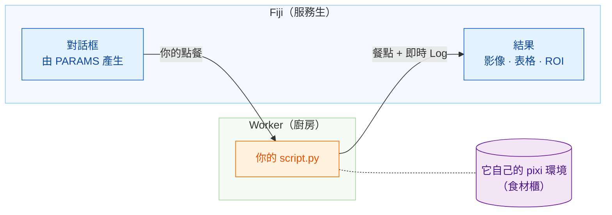

# Wavu：讓你的 Python 在 Fiji 裡執行

*Wavu* 是斐濟語的「**橋**」。它把你看影像用的 Fiji，和 Cellpose、
scikit-image 這些工具所在的 Python 連在一起。

想像一間餐廳。**Fiji 是服務生**：它幫你點餐（一個只有幾個欄位的對話框），
再把餐點端回你的桌上（新的影像、表格、輪廓）。**worker 是門後的廚房**，
而每道食譜都有**自己的食材櫃**，所以 Cellpose 的食譜永遠不會借用（或弄壞）
模糊處理食譜的材料。

## 你想做什麼？

-   :material-play-circle-outline:{ .lg .middle } **使用腳本**

    ---

    在 Fiji 裡安裝 Wavu，用範例影像執行你的第一個 Python 腳本。
    不需要終端機。

    [:octicons-arrow-right-24: 從這裡開始](start/what-is-wavu.md)

-   :material-pencil-outline:{ .lg .middle } **撰寫腳本**

    ---

    把你的筆記本變成 Fiji 的一個選單項目。按一下就能拿到現成的範本：

    [在 VS Code 中開啟範本](vscode://vscode.git/clone?url=https%3A%2F%2Fgithub.com%2FOxford-Zeiss-Centre-of-Excellence%2FWavu-Script-Template.git){ .md-button .md-button--primary }

    [:octicons-arrow-right-24: 運作方式](write/get-the-template.md)

-   :material-share-variant-outline:{ .lg .middle } **分享腳本**

    ---

    用一個 zip 檔把你的工具交給整個實驗室。要不要公開給全世界，
    由你決定。

    [:octicons-arrow-right-24: 分享給實驗室](share/with-your-lab.md)

## 先知道這些

- **小型、互動式的資料。**一張放得進記憶體的影像，大約 1–2 GB 以內。
  資料很大時，請改用批次處理或 HPC（高效能運算）流程。
- **每個腳本都有自己的環境**，所以用 PyTorch 的腳本和只用 NumPy 的腳本
  永遠不會打架。

想知道從構想到發布外掛的每個細節？請看
[GitHub 上的完整指南](https://github.com/Oxford-Zeiss-Centre-of-Excellence/Wavu/blob/main/docs/tutorial-cellpose-plugin.md)（英文）。
