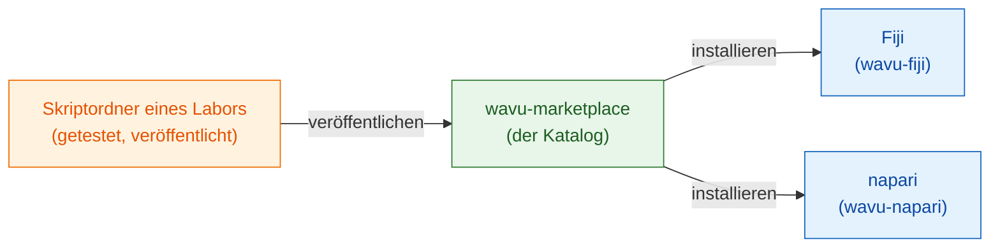

# wavu-marketplace

!!! info "Demnächst"
    wavu-marketplace ist geplant, aber noch nicht gebaut. Diese Seite sagt,
    was es sein wird und was Sie heute schon tun können.

## Die Idee in einfachen Worten

Heute schreibt jedes Labor seine eigenen Rezepte. Ein gutes Rezept (eine
Cellpose-Segmentierung, ein Entrauschungsschritt, ein Spot-Zähler) verdient
es, **geteilt** zu werden, damit andere Köche es nutzen können, ohne es neu
zu bauen.

**wavu-marketplace** wird das Regal mit fertigen Rezepten: ein Katalog von
Wavu-Skriptordnern, den jeder durchsuchen, ausprobieren und installieren
kann. Weil jedes Skript **seine eigenen Küchengeräte** mitbringt (seine
eigene, festgeschriebene pixi-Umgebung), kann die Installation von zehn
Werkzeugen aus zehn Laboren weder Ihren Betrachter noch die Werkzeuge
untereinander beschädigen.

## Was es bieten wird

- **Werkzeuge durchsuchen** nach Aufgabe (Segmentierung, Entrauschen,
  Tracking…), mit kurzer Beschreibung, einem Beispielbild und der Angabe, wie
  man es zitiert.
- **Installation mit einem Klick** in Fiji oder napari; die Umgebung des
  Werkzeugs wird beim ersten Einsatz aus seiner eigenen `pixi.lock` gebaut,
  genau so, wie die Autorin oder der Autor es getestet hat.
- **Eigene Skriptordner veröffentlichen** aus ihrem GitHub-Release, mit
  Tests, die zuerst bestehen müssen.
- **Dasselbe Werkzeug in beiden Betrachtern**, denn ein Wavu-Skriptordner
  läuft bereits in Fiji und in napari.

## Was Sie heute schon tun können

- Ein Werkzeug als ein einziges Zip mit Ihrem Labor teilen:
  [Mit dem eigenen Labor teilen](fiji/with-your-lab.md).
- Es über ein GitHub-Release und eine ImageJ-Update-Site für alle
  veröffentlichen: [Mit der ganzen Welt teilen](fiji/with-the-world.md).
- Mit der [Skriptvorlage](write/get-the-template.md) beginnen, damit Ihr
  Werkzeug bereit ist, sobald der Marketplace öffnet.

Haben Sie ein Werkzeug, das Sie gern im Katalog sähen, oder Ideen dafür?
[Eröffnen Sie ein Issue](https://github.com/Oxford-Zeiss-Centre-of-Excellence/Wavu/issues).

## In einem Satz

wavu-marketplace (demnächst) wird ein Regal mit fertigen, getesteten
Wavu-Werkzeugen, die sich mit einem Klick in Fiji oder napari installieren,
jedes mit seinen eigenen Küchengeräten.
