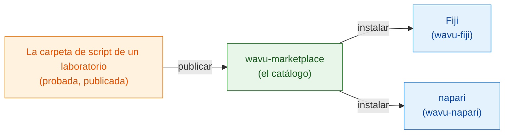

# wavu-marketplace

!!! info "Próximamente"
    wavu-marketplace está planeado, pero aún no está construido. Esta página
    cuenta qué será y qué puedes hacer ya hoy.

## La idea en palabras sencillas

Hoy cada laboratorio escribe sus propias recetas. Una buena receta (una
segmentación con Cellpose, un paso de eliminación de ruido, un contador de
puntos) merece **compartirse**, para que otros cocineros la usen sin tener
que rehacerla.

**wavu-marketplace** será la estantería de recetas listas para usar: un
catálogo de carpetas de script de Wavu que cualquiera puede explorar, probar
e instalar. Como cada script trae **sus propios utensilios de cocina** (su
propio entorno pixi bloqueado), instalar diez herramientas de diez
laboratorios nunca puede romper tu visor ni romperse entre ellas.

## Qué ofrecerá

- **Explorar y buscar** herramientas por tarea (segmentación, eliminación de
  ruido, seguimiento…), con una descripción breve, una imagen de ejemplo y la
  cita que hay que usar.
- **Instalación con un clic** en Fiji o napari; el entorno de la herramienta
  se construye a partir de su propio `pixi.lock` la primera vez que se usa,
  exactamente como lo probó su autor.
- **Publicar tu propia** carpeta de script desde su release de GitHub, con
  pruebas que deben pasar primero.
- **La misma herramienta en los dos visores**, porque una carpeta de script
  de Wavu ya funciona en Fiji y en napari.

## Basado en los principios FAIR

Cada herramienta de wavu-marketplace seguirá los
[principios FAIR](https://www.go-fair.org/fair-principles/) para el software de
investigación: **F**indable (localizable), **A**ccessible (accesible),
**I**nteroperable (interoperable), **R**eusable (reutilizable).
Una carpeta de script de Wavu ya tiene casi todas las piezas; el marketplace
las comprobará antes de incluir una herramienta.

| Principio | Qué significa para una herramienta de Wavu | De dónde sale |
|---|---|---|
| **Findable** (localizable) | Una entrada en el catálogo con un nombre claro, descripción, palabras clave y autores; un identificador persistente (DOI) para cada release | `README.md`, `CITATION.cff`, un DOI de Zenodo por cada release de GitHub |
| **Accessible** (accesible) | Descarga gratuita mediante protocolos web estándar, desde un repositorio público; los metadatos siguen en línea aunque se retire una versión | release de GitHub, código abierto |
| **Interoperable** (interoperable) | Formatos de archivo abiertos de entrada y salida (OME-Zarr, OME-TIFF, ImageJ RoiSet, CSV); la misma herramienta funciona en Fiji y en napari | el contrato del script, wavu-fiji, wavu-napari |
| **Reusable** (reutilizable) | Una licencia, una cita, pruebas y los utensilios de cocina exactos (`pixi.lock`), para que la herramienta funcione igual en cualquier ordenador, años después | `LICENSE`, `CITATION.cff`, `test_script.py`, `pixi.lock` |

## Qué puedes hacer hoy

- Compartir una herramienta con tu laboratorio en un solo zip:
  [Compartir con tu laboratorio](fiji/with-your-lab.md).
- Publicarla para todo el mundo con una release de GitHub y un sitio de
  actualización de ImageJ: [Compartir con el mundo](fiji/with-the-world.md).
- Empezar desde la [plantilla de script](write/get-the-template.md), para
  que tu herramienta esté lista para el marketplace cuando abra.

¿Tienes una herramienta que te gustaría ver en la lista, o ideas para el
catálogo?
[Abre un issue](https://github.com/Oxford-Zeiss-Centre-of-Excellence/Wavu/issues).

## En una frase

wavu-marketplace (próximamente) será una estantería de herramientas de Wavu
listas y probadas que se instalan en Fiji o napari con un clic, cada una con
sus propios utensilios de cocina.
