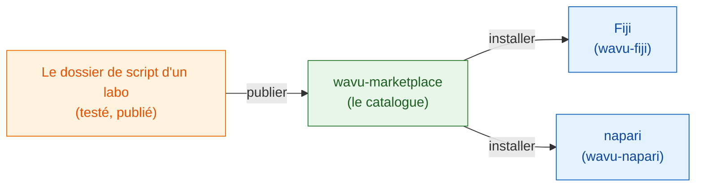

# wavu-marketplace

!!! info "Bientôt disponible"
    wavu-marketplace est prévu, mais pas encore construit. Cette page explique
    ce qu'il sera, et ce que vous pouvez déjà faire aujourd'hui.

## L'idée en mots simples

Aujourd'hui, chaque labo écrit ses propres recettes. Une bonne recette (une
segmentation Cellpose, une étape de débruitage, un compteur de spots) mérite
d'être **partagée**, pour que d'autres cuisiniers puissent l'utiliser sans la
refaire.

**wavu-marketplace** sera l'étagère des recettes toutes prêtes : un catalogue
de dossiers de script Wavu que chacun peut parcourir, essayer et installer.
Comme chaque script apporte **sa propre batterie de cuisine** (son propre
environnement pixi verrouillé), installer dix outils de dix labos ne peut
jamais casser votre visualiseur, ni les outils entre eux.

## Ce qu'il proposera

- **Parcourir et rechercher** des outils par tâche (segmentation, débruitage,
  suivi…), avec une courte description, une image d'exemple et la citation à
  utiliser.
- **Installation en un clic** dans Fiji ou napari ; l'environnement de l'outil
  est construit à partir de son propre `pixi.lock` au premier usage,
  exactement comme l'auteur l'a testé.
- **Publier votre propre** dossier de script à partir de sa release GitHub,
  avec des tests qui doivent d'abord réussir.
- **Le même outil dans les deux visualiseurs**, car un dossier de script Wavu
  fonctionne déjà dans Fiji et dans napari.

## Fondé sur les principes FAIR

Chaque outil de wavu-marketplace suivra les
[principes FAIR](https://www.go-fair.org/fair-principles/) pour les logiciels de
recherche : **F**indable (trouvable), **A**ccessible (accessible),
**I**nteroperable (interopérable), **R**eusable (réutilisable).
Un dossier de script Wavu contient déjà la plupart des éléments ; la
marketplace les vérifiera avant de lister un outil.

| Principe | Ce que cela signifie pour un outil Wavu | D'où cela vient |
|---|---|---|
| **Findable** (trouvable) | Une entrée de catalogue avec un nom clair, une description, des mots-clés et des auteurs ; un identifiant pérenne (DOI) pour chaque release | `README.md`, `CITATION.cff`, un DOI Zenodo par release GitHub |
| **Accessible** (accessible) | Téléchargement gratuit par les protocoles web standard, depuis un dépôt public ; les métadonnées restent en ligne même si une version est retirée | release GitHub, code source ouvert |
| **Interoperable** (interopérable) | Des formats de fichiers ouverts en entrée et en sortie (OME-Zarr, OME-TIFF, ImageJ RoiSet, CSV) ; le même outil fonctionne dans Fiji et dans napari | le contrat de script, wavu-fiji, wavu-napari |
| **Reusable** (réutilisable) | Une licence, une citation, des tests et la batterie de cuisine exacte (`pixi.lock`), pour que l'outil fonctionne de la même façon sur chaque ordinateur, des années plus tard | `LICENSE`, `CITATION.cff`, `test_script.py`, `pixi.lock` |

## Ce que vous pouvez faire aujourd'hui

- Partager un outil avec votre labo en un seul zip :
  [Partager avec votre labo](fiji/with-your-lab.md).
- Le publier pour tout le monde via une release GitHub et un site de mise à
  jour ImageJ : [Partager avec le monde](fiji/with-the-world.md).
- Partir du [modèle de script](write/get-the-template.md), pour que votre
  outil soit prêt pour la marketplace dès son ouverture.

Vous avez un outil que vous aimeriez voir listé, ou des idées pour le
catalogue ?
[Ouvrez une issue](https://github.com/Oxford-Zeiss-Centre-of-Excellence/Wavu/issues).

## En une phrase

wavu-marketplace (bientôt disponible) sera une étagère d'outils Wavu tout
prêts et testés, qui s'installent dans Fiji ou napari en un clic, chacun avec
sa propre batterie de cuisine.
