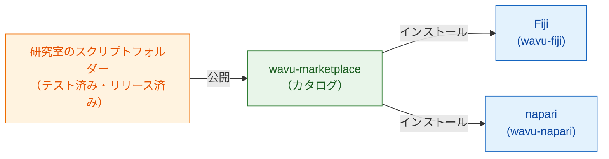

# wavu-marketplace

!!! info "近日公開"
    wavu-marketplace は計画中で、まだできていません。このページでは、それが
    どんなものになるのか、そして今日すでにできることを説明します。

## かんたんに言うと

今は、どの研究室も自分たちのレシピを自分で書いています。良いレシピ
（Cellpose によるセグメンテーション、ノイズ除去の手順、スポットのカウンター）は
**共有** されるべきです。そうすれば、ほかの料理人が作り直さずに使えます。

**wavu-marketplace** は、すぐ使えるレシピを並べた棚になります。誰でも見て、
試して、インストールできる Wavu スクリプトフォルダーのカタログです。どの
スクリプトも **専用の調理器具**（ロックされた専用の pixi 環境）を持ってくる
ので、10 の研究室から 10 のツールを入れても、ビューアーが壊れることも、
ツール同士が壊し合うこともありません。

## できるようになること

- タスク別（セグメンテーション、ノイズ除去、トラッキング…）にツールを
  **探して検索** できます。短い説明、サンプル画像、引用すべき文献つきです。
- Fiji や napari に **ワンクリックでインストール** できます。ツールの環境は、
  初回の使用時に専用の `pixi.lock` から、作者がテストしたとおりに作られます。
- 自分のスクリプトフォルダーを GitHub のリリースから **公開** できます。
  先にテストが通る必要があります。
- **同じツールが Fiji でも napari でも** 使えます。Wavu のスクリプトフォルダーは
  もともと両方で動くからです。

## FAIR 原則にもとづいています

wavu-marketplace のすべてのツールは、研究用ソフトウェアのための
[FAIR 原則](https://www.go-fair.org/fair-principles/)に従います。
**F**indable（見つけられる）、**A**ccessible（アクセスできる）、
**I**nteroperable（相互運用できる）、**R**eusable（再利用できる）です。
Wavu のスクリプトフォルダーには、必要なものがすでにほとんどそろっています。
marketplace は、ツールを掲載する前にそれらを確認します。

| 原則 | Wavu ツールにとっての意味 | どこから来るか |
|---|---|---|
| **Findable**（見つけられる） | わかりやすい名前、説明、キーワード、作者を記したカタログ項目と、リリースごとの永続的な識別子（DOI）です | `README.md`、`CITATION.cff`、GitHub リリースごとの Zenodo DOI |
| **Accessible**（アクセスできる） | 公開リポジトリから、標準的な Web プロトコルで無料でダウンロードできます。バージョンが取り下げられても、メタデータはオンラインに残ります | GitHub リリース、オープンソースのコード |
| **Interoperable**（相互運用できる） | 入力も出力もオープンなファイル形式（OME-Zarr、OME-TIFF、ImageJ RoiSet、CSV）です。同じツールが Fiji でも napari でも動きます | スクリプト契約、wavu-fiji、wavu-napari |
| **Reusable**（再利用できる） | ライセンス、引用情報、テスト、そして正確な調理器具（`pixi.lock`）があるので、何年たっても、どのコンピューターでも同じように動きます | `LICENSE`、`CITATION.cff`、`test_script.py`、`pixi.lock` |

## 今日できること

- ツールを zip 1 つで研究室と共有する：[研究室で共有する](fiji/with-your-lab.md)。
- GitHub のリリースと ImageJ のアップデートサイトで全員に公開する：
  [世界と共有する](fiji/with-the-world.md)。
- [スクリプトのテンプレート](write/get-the-template.md) から始めておけば、
  マーケットプレイスが開いたときにすぐ載せられます。

載せてほしいツールや、カタログへのアイデアはありますか？
[Issue を作成してください](https://github.com/Oxford-Zeiss-Centre-of-Excellence/Wavu/issues)。

## ひとことで言うと

wavu-marketplace（近日公開）は、テスト済みですぐ使える Wavu ツールの棚に
なります。どのツールも専用の調理器具を持ち、ワンクリックで Fiji や napari に
インストールできます。
