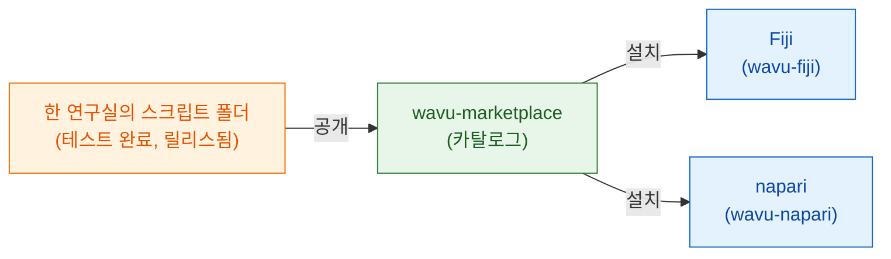

# wavu-marketplace

!!! info "곧 나와요"
    wavu-marketplace는 계획 중이고 아직 만들어지지 않았어요. 이 페이지는
    그것이 어떤 모습이 될지, 그리고 지금 당장 할 수 있는 일을 알려 줘요.

## 쉽게 말하면

지금은 연구실마다 자기 레시피를 직접 써요. 좋은 레시피(Cellpose 분할, 노이즈
제거 단계, 점 개수 세기)는 **공유**될 만해요. 그러면 다른 요리사가 다시
만들지 않고 바로 쓸 수 있으니까요.

**wavu-marketplace**는 바로 쓸 수 있는 레시피를 모아 둔 선반이 될 거예요.
누구나 둘러보고, 써 보고, 설치할 수 있는 Wavu 스크립트 폴더 카탈로그예요.
스크립트마다 **자기만의 주방 도구**(잠금 파일로 고정된 자기만의 pixi 환경)를
가져오니까, 열 개 연구실에서 도구 열 개를 설치해도 뷰어가 망가지거나 도구끼리
서로 망가뜨리는 일은 없어요.

## 제공할 기능

- 작업별(분할, 노이즈 제거, 추적…)로 도구를 **둘러보고 검색**할 수 있어요.
  짧은 설명, 예시 이미지, 인용할 문헌도 함께 나와요.
- Fiji나 napari에 **클릭 한 번으로 설치**해요. 도구의 환경은 처음 쓸 때
  자기 `pixi.lock`으로 만들어져서, 작성자가 테스트한 그대로예요.
- 내 스크립트 폴더를 GitHub 릴리스에서 **직접 공개**할 수 있어요. 먼저
  테스트를 통과해야 해요.
- **같은 도구를 두 뷰어 모두에서** 써요. Wavu 스크립트 폴더는 이미 Fiji와
  napari 양쪽에서 돌아가니까요.

## FAIR 원칙을 바탕으로

wavu-marketplace의 모든 도구는 연구 소프트웨어를 위한
[FAIR 원칙](https://www.go-fair.org/fair-principles/)을 따를 거예요.
**F**indable(찾을 수 있음), **A**ccessible(접근할 수 있음),
**I**nteroperable(상호 운용할 수 있음), **R**eusable(재사용할 수 있음)이에요.
Wavu 스크립트 폴더에는 필요한 것이 이미 대부분 들어 있어요. 마켓플레이스는
도구를 올리기 전에 이것들을 확인해요.

| 원칙 | Wavu 도구에게 뜻하는 것 | 어디서 오나요 |
|---|---|---|
| **Findable**(찾을 수 있음) | 분명한 이름, 설명, 키워드, 작성자가 담긴 카탈로그 항목과 릴리스마다 붙는 영구 식별자(DOI)예요 | `README.md`, `CITATION.cff`, GitHub 릴리스마다 Zenodo DOI |
| **Accessible**(접근할 수 있음) | 공개 저장소에서 표준 웹 프로토콜로 무료로 내려받을 수 있어요. 버전을 내리더라도 메타데이터는 온라인에 남아요 | GitHub 릴리스, 오픈 소스 코드 |
| **Interoperable**(상호 운용할 수 있음) | 입력과 출력 모두 열린 파일 형식(OME-Zarr, OME-TIFF, ImageJ RoiSet, CSV)이에요. 같은 도구가 Fiji와 napari 모두에서 돌아가요 | 스크립트 계약, wavu-fiji, wavu-napari |
| **Reusable**(재사용할 수 있음) | 라이선스, 인용 정보, 테스트, 그리고 정확한 주방 도구(`pixi.lock`)가 있어서, 몇 년 뒤에도 어느 컴퓨터에서나 똑같이 돌아가요 | `LICENSE`, `CITATION.cff`, `test_script.py`, `pixi.lock` |

## 지금 할 수 있는 일

- 도구를 zip 하나로 연구실과 공유해요: [연구실과 공유하기](fiji/with-your-lab.md).
- GitHub 릴리스와 ImageJ 업데이트 사이트로 모두에게 공개해요:
  [전 세계와 공유하기](fiji/with-the-world.md).
- [스크립트 템플릿](write/get-the-template.md)에서 시작하면, 마켓플레이스가
  열릴 때 내 도구가 바로 준비돼 있어요.

목록에 올라왔으면 하는 도구나 카탈로그에 대한 아이디어가 있나요?
[이슈를 열어 주세요](https://github.com/Oxford-Zeiss-Centre-of-Excellence/Wavu/issues).

## 한 문장으로

wavu-marketplace(곧 나와요)는 테스트를 거친, 바로 쓸 수 있는 Wavu 도구의
선반이 될 거예요. 도구마다 자기만의 주방 도구를 갖고, 클릭 한 번으로 Fiji나
napari에 설치돼요.
