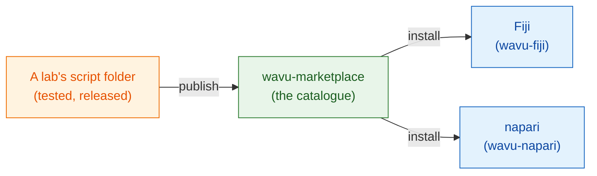

# wavu-marketplace

!!! info "Coming soon"
    wavu-marketplace is planned, not built yet. This page says what it will
    be, and what you can already do today.

## The idea in plain words

Today every lab writes its own recipes. A good recipe (a Cellpose
segmentation, a denoising step, a spot counter) deserves to be **shared**,
so other cooks can use it without rebuilding it.

**wavu-marketplace** will be the shelf of ready-made recipes: a catalogue of
Wavu script folders that anyone can browse, try and install. Because every
script brings **its own kitchenware** (its own locked pixi environment),
installing ten tools from ten labs can never break your viewer or each other.

## What it will offer

- **Browse and search** tools by task (segmentation, denoising, tracking…),
  with a short description, an example image and the citation to use.
- **One-click install** into Fiji or napari; the tool's environment is
  built from its own `pixi.lock` on first use, exactly as the author tested it.
- **Publish your own** script folder from its GitHub release, with tests that
  must pass first.
- **The same tool in both viewers**, because a Wavu script folder already
  works in Fiji and in napari.

## Built on the FAIR principles

Every tool in wavu-marketplace will follow the
[FAIR principles](https://www.go-fair.org/fair-principles/) for research
software: **F**indable, **A**ccessible, **I**nteroperable, **R**eusable.
A Wavu script folder already has most of the pieces; the marketplace will
check them before a tool is listed.

| Principle | What it means for a Wavu tool | Where it comes from |
|---|---|---|
| **Findable** | A catalogue entry with a clear name, description, keywords and authors; a persistent identifier (DOI) for every release | `README.md`, `CITATION.cff`, a Zenodo DOI per GitHub release |
| **Accessible** | Free to download over standard web protocols, from a public repository; the metadata stays online even if a version is withdrawn | GitHub release, open source code |
| **Interoperable** | Open file formats in and out (OME-Zarr, OME-TIFF, ImageJ RoiSet, CSV); the same tool works in Fiji and in napari | the script contract, wavu-fiji, wavu-napari |
| **Reusable** | A licence, a citation, tests, and the exact kitchenware (`pixi.lock`), so the tool runs the same way on every computer, years later | `LICENSE`, `CITATION.cff`, `test_script.py`, `pixi.lock` |

## What you can do today

- Share a tool with your lab as one zip: [Share with your lab](fiji/with-your-lab.md).
- Publish it for everyone through a GitHub release and an ImageJ update
  site: [Share with the world](fiji/with-the-world.md).
- Start from the [script template](write/get-the-template.md), so your tool
  is ready for the marketplace when it opens.

Have a tool you would like to see listed, or ideas for the catalogue?
[Open an issue](https://github.com/Oxford-Zeiss-Centre-of-Excellence/Wavu/issues).

## In one sentence

wavu-marketplace (coming soon) will be a shelf of ready-made, tested Wavu
tools that install into Fiji or napari with one click, each with its own
kitchenware.
