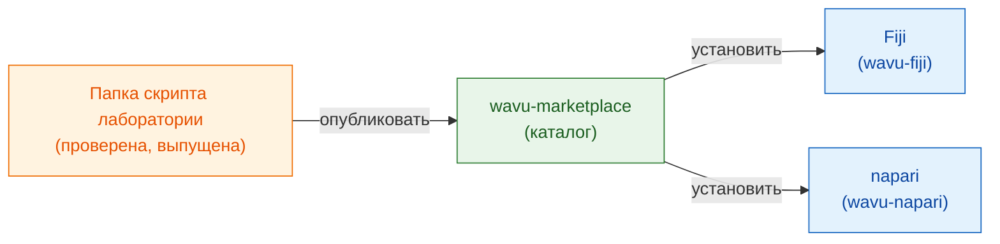

# wavu-marketplace

!!! info "Скоро"
    wavu-marketplace запланирован, но ещё не создан. Эта страница
    рассказывает, каким он будет и что вы можете сделать уже сегодня.

## Идея простыми словами

Сегодня каждая лаборатория пишет свои рецепты сама. Хороший рецепт
(сегментация Cellpose, шаг шумоподавления, счётчик пятен) заслуживает того,
чтобы им **поделились**: тогда другие повара смогут пользоваться им, не
собирая его заново.

**wavu-marketplace** станет полкой готовых рецептов: каталогом папок
скриптов Wavu, который любой может просматривать, пробовать и устанавливать.
Поскольку каждый скрипт приносит **свою кухонную утварь** (своё
зафиксированное pixi-окружение), установка десяти инструментов из десяти
лабораторий никогда не сломает ваш просмотрщик и не сломает их друг другу.

## Что он будет предлагать

- **Просмотр и поиск** инструментов по задаче (сегментация, шумоподавление,
  трекинг…), с кратким описанием, примером изображения и ссылкой для
  цитирования.
- **Установка в один клик** в Fiji или napari; окружение инструмента
  собирается из его собственного `pixi.lock` при первом запуске — ровно так,
  как его проверил автор.
- **Публикация своей** папки скрипта из её релиза на GitHub, с тестами,
  которые сначала должны пройти.
- **Один и тот же инструмент в обоих просмотрщиках**, потому что папка
  скрипта Wavu уже работает и в Fiji, и в napari.

## Что можно сделать уже сегодня

- Поделиться инструментом с лабораторией одним zip-архивом:
  [Поделиться с лабораторией](fiji/with-your-lab.md).
- Опубликовать его для всех через релиз на GitHub и сайт обновлений ImageJ:
  [Поделиться со всем миром](fiji/with-the-world.md).
- Начать с [шаблона скрипта](write/get-the-template.md), чтобы ваш
  инструмент был готов к маркетплейсу, когда тот откроется.

Есть инструмент, который вы хотели бы видеть в каталоге, или идеи для него?
[Откройте issue](https://github.com/Oxford-Zeiss-Centre-of-Excellence/Wavu/issues).

## Одним предложением

wavu-marketplace (скоро) станет полкой готовых, проверенных инструментов
Wavu, которые устанавливаются в Fiji или napari в один клик, каждый со своей
кухонной утварью.
