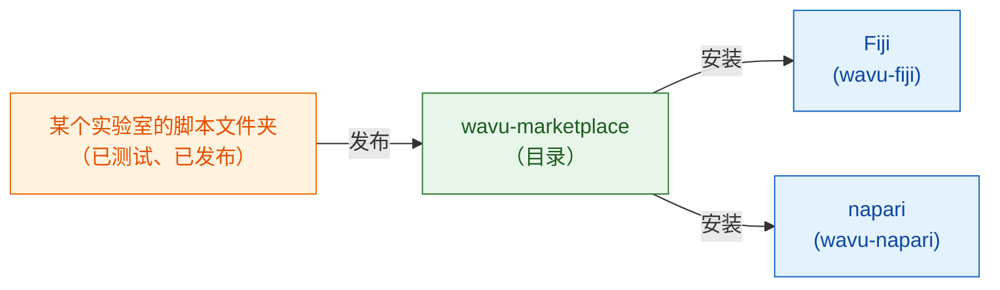

# wavu-marketplace

!!! info "即将推出"
    wavu-marketplace 还在规划中，尚未完成。这一页说明它将会是什么样子，
    以及你今天就能做的事。

## 用大白话说

现在每个实验室都自己写食谱。一道好食谱（Cellpose 分割、去噪步骤、亮点计数器）
值得**分享**出去，让其他厨师不必从头做起就能使用。

**wavu-marketplace** 会是一个摆满现成食谱的架子：一份 Wavu 脚本文件夹的目录，
任何人都能浏览、试用和安装。因为每个脚本都带着**自己的厨具**（它自己锁定的
pixi 环境），从十个实验室装十个工具，也绝不会弄坏你的 Fiji 或 napari，
工具之间也不会互相破坏。

## 它将提供什么

- 按任务（分割、去噪、追踪…）**浏览和搜索**工具，附有简短说明、示例图像和
  应引用的文献。
- **一键安装**到 Fiji 或 napari；工具的环境会在第一次使用时，由它自己的
  `pixi.lock` 创建，和作者测试时完全一样。
- 从 GitHub release **发布你自己的**脚本文件夹，前提是测试要先通过。
- **同一个工具在 Fiji 和 napari 都能用**，因为 Wavu 脚本文件夹本来就能在
  两边运行。

## 以 FAIR 原则为基础

wavu-marketplace 里的每个工具，都会遵循科研软件的
[FAIR 原则](https://www.go-fair.org/fair-principles/)：
**F**indable（可发现）、**A**ccessible（可获取）、
**I**nteroperable（可互操作）、**R**eusable（可重用）。
Wavu 脚本文件夹已经具备大部分要素；marketplace 会在工具上架前逐一检查。

| 原则 | 对 Wavu 工具意味着什么 | 从哪里来 |
|---|---|---|
| **Findable**（可发现） | 目录条目有清楚的名称、说明、关键词和作者；每个 release 都有持久标识符（DOI） | `README.md`、`CITATION.cff`、每个 GitHub release 一个 Zenodo DOI |
| **Accessible**（可获取） | 通过标准网络协议，从公开的代码仓库免费下载；即使某个版本被撤下，元数据仍会保留在网上 | GitHub release、开源代码 |
| **Interoperable**（可互操作） | 输入和输出都用开放的文件格式（OME-Zarr、OME-TIFF、ImageJ RoiSet、CSV）；同一个工具在 Fiji 和 napari 都能用 | 脚本约定、wavu-fiji、wavu-napari |
| **Reusable**（可重用） | 有许可证、引用信息、测试，以及确切的厨具（`pixi.lock`），让工具在每台电脑上、多年之后都以同样的方式运行 | `LICENSE`、`CITATION.cff`、`test_script.py`、`pixi.lock` |

## 你今天就能做的事

- 用一个 zip 把工具分享给实验室：[分享给实验室](fiji/with-your-lab.md)。
- 通过 GitHub release 和 ImageJ 更新站点公开给所有人：
  [分享给全世界](fiji/with-the-world.md)。
- 从[脚本模板](write/get-the-template.md)开始，让你的工具在 marketplace
  开张时就准备好。

有想看到上架的工具，或对目录有什么想法吗？
[提一个 issue](https://github.com/Oxford-Zeiss-Centre-of-Excellence/Wavu/issues)。

## 一句话总结

wavu-marketplace（即将推出）会是一个摆满现成、已测试 Wavu 工具的架子，一键就能
装进 Fiji 或 napari，每个工具都有自己的厨具。
