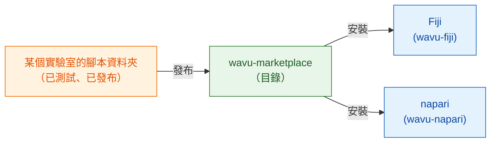

# wavu-marketplace

!!! info "即將推出"
    wavu-marketplace 還在規劃中，尚未完成。這一頁說明它將會是什麼樣子，
    以及你今天就能做的事。

## 用白話說

現在每個實驗室都自己寫食譜。一道好食譜（Cellpose 分割、去噪步驟、亮點計數器）
值得**分享**出去，讓其他廚師不必從頭做起就能使用。

**wavu-marketplace** 會是一個擺滿現成食譜的架子：一份 Wavu 腳本資料夾的目錄，
任何人都能瀏覽、試用和安裝。因為每個腳本都帶著**自己的廚具**（它自己鎖定的
pixi 環境），從十個實驗室裝十個工具，也絕不會弄壞你的 Fiji 或 napari，
工具之間也不會互相弄壞。

## 它將提供什麼

- 依任務（分割、去噪、追蹤…）**瀏覽和搜尋**工具，附上簡短說明、範例影像和
  應引用的文獻。
- **一鍵安裝**到 Fiji 或 napari；工具的環境會在第一次使用時，由它自己的
  `pixi.lock` 建立，和作者測試時一模一樣。
- 從 GitHub release **發布你自己的**腳本資料夾，前提是測試要先通過。
- **同一個工具在 Fiji 和 napari 都能用**，因為 Wavu 腳本資料夾本來就能在
  兩邊執行。

## 以 FAIR 原則為基礎

wavu-marketplace 裡的每個工具，都會遵守研究軟體的
[FAIR 原則](https://www.go-fair.org/fair-principles/)：
**F**indable（可找到）、**A**ccessible（可取得）、
**I**nteroperable（可互通）、**R**eusable（可重複使用）。
Wavu 腳本資料夾已經具備大部分的要素；marketplace 會在工具上架前逐一檢查。

| 原則 | 對 Wavu 工具的意義 | 從哪裡來 |
|---|---|---|
| **Findable**（可找到） | 目錄條目有清楚的名稱、說明、關鍵字和作者；每個 release 都有永久識別碼（DOI） | `README.md`、`CITATION.cff`、每個 GitHub release 一個 Zenodo DOI |
| **Accessible**（可取得） | 透過標準網路協定，從公開的儲存庫免費下載；即使某個版本被撤下，後設資料仍會留在網路上 | GitHub release、開放原始碼 |
| **Interoperable**（可互通） | 輸入和輸出都用開放的檔案格式（OME-Zarr、OME-TIFF、ImageJ RoiSet、CSV）；同一個工具在 Fiji 和 napari 都能用 | 腳本約定、wavu-fiji、wavu-napari |
| **Reusable**（可重複使用） | 有授權條款、引用資訊、測試，以及確切的廚具（`pixi.lock`），讓工具在每台電腦上、多年之後都以同樣的方式執行 | `LICENSE`、`CITATION.cff`、`test_script.py`、`pixi.lock` |

## 你今天就能做的事

- 用一個 zip 把工具分享給實驗室：[分享給實驗室](fiji/with-your-lab.md)。
- 透過 GitHub release 和 ImageJ 更新站點公開給所有人：
  [分享給全世界](fiji/with-the-world.md)。
- 從[腳本範本](write/get-the-template.md)開始，讓你的工具在 marketplace
  開張時就準備好。

有想看到上架的工具，或對目錄有什麼想法嗎？
[開一個 issue](https://github.com/Oxford-Zeiss-Centre-of-Excellence/Wavu/issues)。

## 一句話總結

wavu-marketplace（即將推出）會是一個擺滿現成、已測試 Wavu 工具的架子，一鍵就能
裝進 Fiji 或 napari，每個工具都有自己的廚具。
