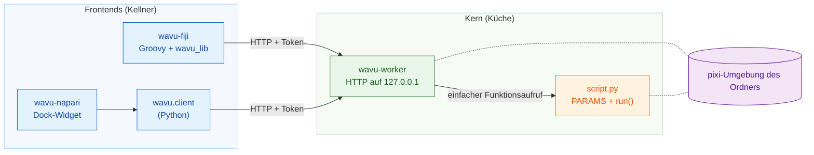
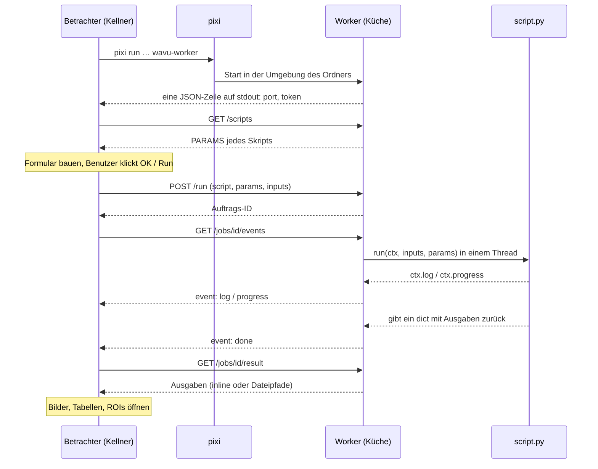

# Architektur (für Fortgeschrittene)

!!! abstract "Für Neugierige und für Entwickler"
    Sie brauchen diese Seite nicht, um Skripte zu schreiben oder auszuführen.
    Lesen Sie sie, wenn Sie genau wissen möchten, was zwischen dem Betrachter
    und Ihrem Python passiert, oder wenn Sie einen neuen Betrachter an Wavu
    anbinden möchten.

## Die Idee in einfachen Worten

Zurück zum Restaurant. Wavu hat **einen Küchenentwurf und zwei Kellner**.

- **Der Kern** (`src/wavu`) ist die Küche: das **Worker**-Programm, die
  kleine Sprache, die es spricht (HTTP und JSON), die Regeln, denen ein
  Rezept folgt (der *Skript-Vertrag*: `PARAMS` plus `run`), und
  `wavu.client`, ein fertiger Kellner in Python.
- **Die Frontends** sind die Kellner: **wavu-fiji** (Groovy-Skripte im Menü
  von Fiji, kein Java-Build) und **wavu-napari** (ein napari-Dock-Widget auf
  Basis von `wavu.client`).

Ein Kellner kocht nie. Er geht in die Küche, liest die Speisekarte, bringt
Ihre Bestellung hinein und die Teller heraus. Weil beide Kellner mit
derselben Küche dieselbe Sprache sprechen, bedient ein Skriptordner beide.



## Ein Worker pro Skriptordner { #one-worker-per-script-folder }

Ein **Skriptordner** ist ein Ordner mit einer `pixi.toml`. Der Worker
bedient genau einen Ordner und läuft **in der eigenen pixi-Umgebung dieses
Ordners**. Der Aufruf Ihres `run` ist deshalb ein ganz normaler
Python-Funktionsaufruf: kein Kopieren von Python-Objekten zwischen
Prozessen, kein neuer Prozess pro Auftrag.

Beim Start sieht sich der Worker jede `.py`-Datei im Ordner an, die `run`
definiert. Namen, die mit `_`, `.` oder `test_` beginnen, werden
übersprungen. Eine Datei, die sich nicht importieren lässt, hält die anderen
nicht auf; ihr Fehler wird von `/scripts` unter `errors` gemeldet.

Zwei Ordner bedeuten zwei Worker, jeder in seiner eigenen Umgebung. Deshalb
kommen sich ein PyTorch-Skript und ein reines NumPy-Skript nie in die Quere.

## Wie ein Frontend den Worker startet { #how-a-frontend-starts-the-worker }

Das Frontend führt im Skriptordner einen Befehl aus:

```sh
pixi run --manifest-path <folder>/pixi.toml [--frozen] wavu-worker --script-dir <folder>
```

- Beim ersten Mal installiert pixi die Umgebung (bei schweren Paketen einige
  Minuten, einmalig). Spätere Starts dauern Sekunden.
- `--frozen` installiert genau das, was in `pixi.lock` steht. wavu-fiji
  setzt es für **installierte** Skripte (Ordner unter
  `<Fiji>/wavu/scripts/`, die eine `pixi.lock` mitbringen);
  `wavu.client.Worker.start(..., frozen=True)` macht dasselbe.
- **Bereinigung der Umgebungsvariablen.** `wavu.client` entfernt die
  Variablen `PIXI_*`, `CONDA_*`, `VIRTUAL_ENV*`, `PYTHONHOME`, `PYTHONPATH`
  und `INIT_CWD` des Gastprogramms, bevor es den Kindprozess startet. Sonst
  könnte ein Betrachter, der selbst unter `pixi run` läuft (wie napari), den
  Kindprozess die falsche Umgebung aktivieren lassen. Beide Clients setzen
  außerdem `NO_COLOR=1`, `PYTHONUNBUFFERED=1` und `PYTHONIOENCODING=utf-8`.

### Der Handshake { #the-handshake }

Der Worker wählt einen zufälligen freien Port auf `127.0.0.1`, erzeugt ein
zufälliges Token und gibt **genau eine JSON-Zeile** auf stdout aus:

```json
{"wavu": "0.1.0", "port": 51234, "token": "..."}
```

Das Frontend liest Zeilen, bis eine mit `port` und `token` kommt. Alles
andere (der Installationsfortschritt von pixi, der über stderr kommt) landet
im Log für den Benutzer. Nach dem Handshake schreibt der Worker nie wieder
auf stdout: Das `print` eines Skripts landet im Log des jeweiligen Auftrags.

### Anhängen: die Handshake-Datei { #attach-mode-the-handshake-file }

Mit `--handshake-file` (Standardpfad `~/.wavu/worker.json`) schreibt der
Worker Port, Token, `pid`, `host`, `script_dir` und `tmp_dir` zusätzlich in
eine Datei und löscht sie beim Beenden. Die Tasks `pixi run worker` und
`pixi run debug` der Vorlage nutzen das, und beide Frontends haben einen
Knopf oder Menüeintrag **Connect to running worker** (mit laufendem Worker
verbinden), der diese Datei liest.

### Lebensdauer { #lifetime }

| Wie er endet | Wann |
|---|---|
| stdin wird geschlossen | das Frontend, das ihn gestartet hat, wird beendet (es hält die Pipe offen) |
| `POST /shutdown` | **Stop Worker** in Fiji, **Stop worker** in napari, `Worker.stop()` |
| nie über stdin | gestartet mit `--detached` (für Terminal und Container) |

Ein Worker, den ein Betrachter gestartet hat, überlebt ihn also nie.

## Authentifizierung per Token { #token-authentication }

Jede Anfrage braucht `Authorization: Bearer <token>`; sonst lautet die
Antwort `401`. Der Worker vergleicht Tokens mit `hmac.compare_digest`. Wozu
der Aufwand auf `127.0.0.1`? Andere Benutzer auf demselben Rechner und
Webseiten in Ihrem Browser erreichen localhost ebenfalls; das Token hindert
sie daran, über Ihren Worker Skripte auszuführen. Das Token kennt nur der
Elternprozess, oder es steht in der Handshake-Datei.

## Die HTTP-API { #the-http-api }

| Methode | Pfad | Was sie tut |
|---|---|---|
| GET | `/health` | `{"ok": true, "wavu", "scripts", "script_dir"}` |
| GET | `/scripts` | `name`, `doc` und `params` (das `PARAMS`-Schema) jedes Skripts, plus `errors` |
| POST | `/run` | `{"script", "params", "inputs", "inline_limit"?}` → `{"job": id}`, oder `400` mit einer Meldung |
| GET | `/jobs/<id>/events[?since=N]` | Server-Sent Events: `log`, `progress`, dann eines von `done`, `error`, `cancelled` |
| POST | `/jobs/<id>/cancel` | bittet den Auftrag, anzuhalten |
| GET | `/jobs/<id>/result` | `status` plus `outputs` oder `error`; `409`, solange er noch läuft |
| POST | `/shutdown` | antwortet, dann beendet sich der Worker |

Der Ereignisstrom ist reiner Text, ein Ereignis nach dem anderen:

```text
id: 3
event: progress
data: {"value": 0.5}
```

Alle 15 Sekunden kommt ein Kommentar `: keepalive`. Der Strom schließt nach
dem abschließenden Ereignis. Bricht die Verbindung ab, verbinden Sie sich
mit `?since=<bereits gesehene Ereignisse>` neu, und nichts geht verloren;
wavu-fiji macht das automatisch.

## Ein Durchlauf von Anfang bis Ende { #one-run-end-to-end }



## Daten auf der Leitung { #data-on-the-wire }

Wavu ist eine Brücke für **kleine Daten** (ein Bild im Arbeitsspeicher, etwa
bis 1–2 GB).

- **Inline:** Ein kleines Array (höchstens **4 MiB**) reist im JSON als
  Base64-kodierte Little-Endian-Bytes, mit `dtype`, `shape` und `meta`. Der
  Worker und `wavu.client` verlangen außerdem, dass es höchstens 3-D ist.
- **Per Datei:** Alles Größere geht als TIFF (ebenso 4-D- und 5-D-Arrays vom
  Worker und von `wavu.client`). Eingaben schreibt das Frontend in einen
  temporären Ordner; Ausgaben landen im eigenen temporären Ordner des
  Auftrags (`job-…` im temporären Ordner `wavu-…` des Workers, der beim
  Beenden des Workers gelöscht wird, außer mit `--keep-tmp`).
- `meta` enthält `title`, `pixel_um`, `axes` und, bei Ausgaben,
  `channel_names` sowie beliebige `extra`-Schlüssel aus `wavu.Image`.

Jede Ausgabe hat eine Art (`kind`):

| kind | enthält | entsteht aus |
|---|---|---|
| `image` | inline `data` oder `path` zu einem ImageJ-TIFF | NumPy-Array oder `wavu.Image` (umgewandelt in uint8, uint16 oder float32) |
| `table` | `path` zu einer CSV-Datei, plus `columns` | pandas-DataFrame oder Liste von dicts |
| `rois` | `path` zu einer ImageJ-RoiSet-ZIP | `wavu.RoiSet` |
| `file` | `path` | `pathlib.Path` |
| `value` | `value` | Zahl, Text, bool oder `None` |

Jedes Frontend entscheidet, wie es eine Art *anzeigt*: siehe
[Was Sie zurückgeben können](../write/outputs.md) für Fiji und
[Was Sie in napari zurückbekommen](../napari/layers.md).

## Abbrechen ist kooperativ { #cancellation-is-cooperative }

`POST /jobs/<id>/cancel` setzt nur eine Flagge. Ihr Skript bemerkt sie über
`ctx.cancelled()` oder `ctx.check_cancelled()` und hält an einer sicheren
Stelle an. Wenn `run` zurückkehrt oder einen Fehler auslöst, nachdem die
Flagge gesetzt wurde, endet der Auftrag als `cancelled`. Ein Skript, das in
einem einzigen langen Aufruf steckt, beendet zuerst diesen Aufruf; der
einzige harte Stopp ist das Beenden des Workers. Siehe
[Log, Fortschritt und Abbrechen](../write/logs-progress-cancel.md).

## Debuggen und Anhängen { #debugging-and-attaching }

- `wavu-worker --debugpy 5678 [--debugpy-wait]` startet debugpy, damit sich
  **Attach to Wavu worker** in VS Code verbinden kann. Der Dialog von
  wavu-fiji hat ein Kästchen **Debug in VS Code**, das den Worker auf diese
  Weise neu startet.
- `pixi run debug` (Task der Vorlage) startet einen abgekoppelten Worker mit
  debugpy und einer Handshake-Datei; der Betrachter hängt sich dann mit
  **Connect to running worker** an. Einzelheiten:
  [In VS Code debuggen](../help/debug-in-vscode.md).
- `WAVU_ACCESS_LOG=1` lässt den Worker jede HTTP-Anfrage auf stderr ausgeben.

## Container { #containers }

Das `Dockerfile` eines Skriptordners (aus der Vorlage) oder das
`Dockerfile` im Wurzelverzeichnis von Wavu (mit
`--build-arg SCRIPT_DIR=...`) baut ein Image, das `pixi.lock` mit
`pixi install --locked` installiert und
`wavu-worker --host 0.0.0.0 --port 8765 --detached` ausführt, mit seiner
Handshake-Datei in `/data/.wavu/worker.json` und Auftragsdateien in
`/data/.wavu-tmp`. Das Wavu-Release veröffentlicht ein solches Image nur für
das Vorlagenskript (`ghcr.io/oxford-zeiss-centre-of-excellence/wavu-worker`);
Images Ihrer eigenen Skripte bauen und veröffentlichen Sie selbst.

Im Container hat Ihr Datenordner einen anderen Pfad, deshalb müssen
Dateipfade übersetzt werden. Beide Frontends fragen nach einem Ordner auf
dem Host und demselben Ordner im Container: wavu-fiji in
**Connect to Running Worker**, wavu-napari unter **Remote / container**
(entfernt / Container); beide haben außerdem ein Feld **Host** für einen
Worker auf einem anderen Rechner. `wavu.client` macht dasselbe über
`Worker.connect(handshake, host=None, host_prefix=None, worker_prefix=None)`:
`to_worker` und `from_worker` schreiben Pfade in beide Richtungen um, und
große Eingaben werden nach `<host folder>/.wavu-tmp` geschrieben, damit der
Container sie sieht. Ein Container, der ohne die beiden Präfixe verbunden
ist, nimmt nur Eingaben in Inline-Größe an (bis 4 MiB und 3-D) und gibt nur
Ausgaben in Inline-Größe zurück. Wie man das nutzt:
[Als Container teilen](../write/container.md).

## Isolation ist keine Sicherheit { #isolation-is-not-security }

Die Umgebung jedes Ordners hält **Pakete** auseinander. Sie sperrt das
Skript nicht ein: Ein Skript läuft als Sie und kann lesen, schreiben und
löschen, was Sie können. Führen Sie Skripte aus, denen Sie vertrauen, wie
bei einem Notebook.

## Ein neues Frontend hinzufügen { #adding-a-new-frontend }

Jedes Programm, das einen Prozess starten und HTTP sprechen kann, kann ein
Kellner werden. Der Vertrag:

1. **Starten:** `pixi run --manifest-path <folder>/pixi.toml wavu-worker
   --script-dir <folder>` mit einer Pipe auf stdin, und diese Pipe offen
   halten. (Oder über `~/.wavu/worker.json` anhängen.)
2. **Handshake:** stdout-Zeilen lesen, bis sich eine als JSON mit `port` und
   `token` parsen lässt. stderr dem Benutzer zeigen: Beim ersten Start
   werden Pakete installiert.
3. **Speisekarte:** `GET /scripts` und aus jedem `PARAMS`-Eintrag ein
   Formular bauen (`float`, `int`, `str`, `bool`, `choice`, `image`).
   `image`-Felder wählen eines der im Betrachter geöffneten Bilder.
4. **Bestellen:** `POST /run` mit den Werten; Bilder gehen inline oder als
   TIFF-Pfad, mit `pixel_um` in `meta`, falls bekannt.
5. **Mitlesen:** `/jobs/<id>/events` lesen, `log` und `progress` anzeigen,
   einen Abbrechen-Knopf anbieten, der `/cancel` aufruft.
6. **Servieren:** `GET /jobs/<id>/result` und jede Ausgabeart auf die
   Objekte Ihres Betrachters abbilden.

In Python erledigt `wavu.client` bereits die Schritte 1, 2, 4, 5 und den
Ladeteil von 6, einschließlich Bereinigung der Umgebungsvariablen und
temporärer Dateien:

```python
from wavu.client import Worker

with Worker.start("path/to/script-folder", on_log=print) as w:
    print(w.scripts())
    result = w.run("script", params={"sigma": 2.0}, inputs={"image": arr}, on_log=print)
    blurred = result.outputs["blurred"].value
```

`run` nimmt außerdem `on_progress` und ein `threading.Event` namens
`cancel`; es gibt jede Ausgabe bereits geladen zurück (Array, Tabelle,
`RoiSet`, `Path` oder Wert) und löst `WorkerError` (mit dem Traceback) oder
`JobCancelled` aus. wavu-napari besteht aus ein paar hundert Zeilen darauf:
siehe [Interna von wavu-napari](../napari/internals.md).

Die vollständige Referenz ist
[docs/protocol.md auf GitHub](https://github.com/Oxford-Zeiss-Centre-of-Excellence/Wavu/blob/main/docs/protocol.md)
(auf Englisch); die Gründe hinter jeder Entscheidung stehen in
[docs/decisions.md](https://github.com/Oxford-Zeiss-Centre-of-Excellence/Wavu/blob/main/docs/decisions.md).

## In einem Satz

Ein Betrachter startet pro Skriptordner einen `wavu-worker` in der
pixi-Umgebung dieses Ordners, liest einen einzeiligen Handshake und bestellt
dann Durchläufe über eine kleine, per Token geschützte HTTP-API auf
`127.0.0.1`, sodass jeder Betrachter, der sie spricht, dieselben Skripte
servieren kann.
