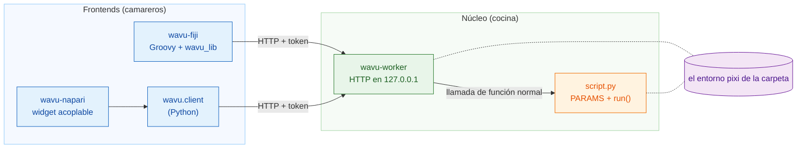
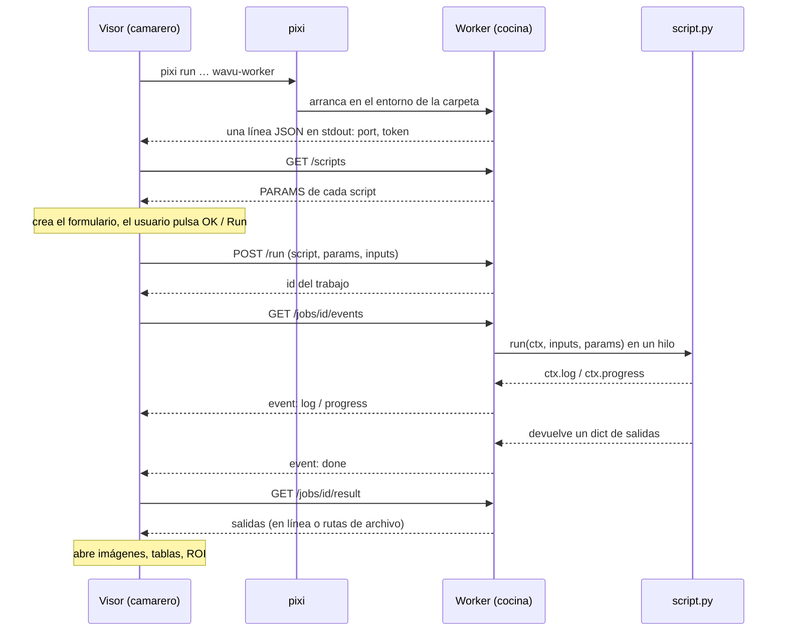

# Arquitectura (avanzado)

!!! abstract "Para curiosos y para constructores"
    No necesitas esta página para escribir ni ejecutar scripts. Léela si
    quieres saber exactamente qué pasa entre el visor y tu Python, o si
    quieres conectar un visor nuevo a Wavu.

## La idea en palabras sencillas

Volvamos al restaurante. Wavu tiene **un solo diseño de cocina y dos
camareros**.

- **El núcleo** (`src/wavu`) es la cocina: el programa **worker**, el pequeño
  idioma que habla (HTTP y JSON), las reglas que sigue una receta (el
  *contrato del script*: `PARAMS` más `run`) y `wavu.client`, un camarero de
  Python ya hecho.
- **Los frontends** son los camareros: **wavu-fiji** (scripts Groovy en el
  menú de Fiji, sin compilar Java) y **wavu-napari** (un widget acoplable de
  napari construido sobre `wavu.client`).

Un camarero nunca cocina. Va a la cocina, lee la carta, lleva tu pedido
dentro y saca los platos. Como los dos camareros hablan el mismo idioma con la
misma cocina, una misma carpeta de script sirve para los dos.



## Un worker por carpeta de script

Una **carpeta de script** es una carpeta con un `pixi.toml`. El worker sirve
exactamente una carpeta, y se ejecuta **dentro del propio entorno pixi de esa
carpeta**. Así, llamar a tu `run` es una llamada de función de Python
corriente: sin copiar objetos de Python entre procesos y sin un proceso nuevo
por cada trabajo.

Al arrancar, el worker revisa cada archivo `.py` de la carpeta que define
`run`. Se saltan los nombres que empiezan por `_`, `.` o `test_`. Un archivo
que falla al importarse no detiene a los demás; `/scripts` informa de su
error en `errors`.

Dos carpetas significan dos workers, cada uno en su propio entorno. Por eso un
script con PyTorch y otro que solo usa NumPy nunca chocan.

## Cómo arranca el worker un frontend

El frontend ejecuta un único comando en la carpeta de script:

```sh
pixi run --manifest-path <folder>/pixi.toml [--frozen] wavu-worker --script-dir <folder>
```

- La primera ejecución hace que pixi instale el entorno (minutos con pilas de
  paquetes pesadas, una sola vez). Las siguientes arrancan en segundos.
- `--frozen` instala exactamente lo que dice `pixi.lock`. wavu-fiji lo añade
  para los scripts **instalados** (carpetas bajo `<Fiji>/wavu/scripts/` que
  incluyen un `pixi.lock`); `wavu.client.Worker.start(..., frozen=True)` hace
  lo mismo.
- **Limpieza del entorno.** `wavu.client` elimina las variables `PIXI_*`,
  `CONDA_*`, `VIRTUAL_ENV*`, `PYTHONHOME`, `PYTHONPATH` e `INIT_CWD` del
  programa anfitrión antes de arrancar el proceso hijo. Sin eso, un visor que
  a su vez se ejecuta con `pixi run` (napari lo hace) podría hacer que el hijo
  active el entorno equivocado. Los dos clientes fijan además `NO_COLOR=1`,
  `PYTHONUNBUFFERED=1` y `PYTHONIOENCODING=utf-8`.

### El saludo inicial (handshake)

El worker elige un puerto libre al azar en `127.0.0.1`, genera un token
aleatorio e imprime **exactamente una línea JSON** en stdout:

```json
{"wavu": "0.1.0", "port": 51234, "token": "..."}
```

El frontend lee líneas hasta encontrar una con `port` y `token`. Todo lo
demás (el progreso de instalación de pixi, que llega por stderr) va al log del
usuario. Tras el saludo, el worker no vuelve a escribir en stdout: el `print`
de un script va al log de ese trabajo.

### Modo de conexión: el archivo de saludo

Con `--handshake-file` (ruta por defecto `~/.wavu/worker.json`), el worker
escribe además el puerto, el token, `pid`, `host`, `script_dir` y `tmp_dir` en
un archivo, y lo borra al salir. Las tareas `pixi run worker` y
`pixi run debug` de la plantilla lo usan, y los dos frontends tienen un botón
o una entrada de menú **Connect to running worker** (conectar a un worker en
marcha) que lo lee.

### Ciclo de vida

| Cómo termina | Cuándo |
|---|---|
| se cierra stdin | sale el frontend que lo arrancó (mantiene abierta la tubería) |
| `POST /shutdown` | **Stop Worker** en Fiji, **Stop worker** en napari, `Worker.stop()` |
| nunca por stdin | arrancado con `--detached` (uso en terminal y en contenedores) |

Así, un worker arrancado por un visor nunca sobrevive a ese visor.

## Autenticación por token

Cada petición necesita `Authorization: Bearer <token>`; si no, la respuesta es
`401`. El worker compara los tokens con `hmac.compare_digest`. ¿Por qué
molestarse en `127.0.0.1`? Otros usuarios del mismo equipo y las páginas web
de tu navegador también pueden llegar a localhost; el token les impide
ejecutar scripts a través de tu worker. El token solo está en el proceso
padre, o en el archivo de saludo.

## La API HTTP

| Método | Ruta | Qué hace |
|---|---|---|
| GET | `/health` | `{"ok": true, "wavu", "scripts", "script_dir"}` |
| GET | `/scripts` | `name`, `doc` y `params` (el esquema de `PARAMS`) de cada script, más `errors` |
| POST | `/run` | `{"script", "params", "inputs", "inline_limit"?}` → `{"job": id}`, o `400` con un mensaje |
| GET | `/jobs/<id>/events[?since=N]` | eventos enviados por el servidor (SSE): `log`, `progress` y después uno de `done`, `error`, `cancelled` |
| POST | `/jobs/<id>/cancel` | pide al trabajo que se detenga |
| GET | `/jobs/<id>/result` | `status` más `outputs` o `error`; `409` mientras sigue en marcha |
| POST | `/shutdown` | responde y después el worker termina |

El flujo de eventos es texto plano, un evento cada vez:

```text
id: 3
event: progress
data: {"value": 0.5}
```

Cada 15 segundos llega un comentario `: keepalive`. El flujo se cierra tras
el evento final. Si se corta la conexión, vuelve a conectar con
`?since=<eventos ya vistos>` y no se pierde nada; wavu-fiji lo hace
automáticamente.

## Una ejecución, de principio a fin



## Los datos en tránsito { #data-on-the-wire }

Wavu es un puente para **datos pequeños** (una imagen en memoria, hasta
aproximadamente 1–2 GB).

- **En línea (inline):** un array pequeño (como mucho **4 MiB**) viaja dentro
  del JSON como bytes little-endian en base64, con `dtype`, `shape` y `meta`.
  El worker y `wavu.client` exigen además que tenga como mucho 3 dimensiones.
- **Por archivo:** todo lo que sea más grande va como TIFF (igual que los
  arrays 4-D y 5-D del worker y de `wavu.client`). El frontend escribe las
  entradas en una carpeta temporal; las salidas acaban en la carpeta temporal
  propia del trabajo (`job-…` dentro de la carpeta temporal `wavu-…` del
  worker, que se borra cuando el worker termina salvo con `--keep-tmp`).
- `meta` lleva `title`, `pixel_um`, `axes` y, en las salidas,
  `channel_names` y cualquier clave `extra` de `wavu.Image`.

Cada salida tiene un `kind`:

| kind | lleva | se crea a partir de |
|---|---|---|
| `image` | `data` en línea, o `path` a un TIFF de ImageJ | array de NumPy o `wavu.Image` (convertido a uint8, uint16 o float32) |
| `table` | `path` a un CSV, más `columns` | DataFrame de pandas o lista de dicts |
| `rois` | `path` a un zip RoiSet de ImageJ | `wavu.RoiSet` |
| `file` | `path` | `pathlib.Path` |
| `value` | `value` | número, texto, bool o `None` |

Cada frontend decide cómo *mostrar* cada kind: mira
[Qué puedes devolver](../write/outputs.md), que tiene una pestaña para Fiji
y otra para napari.

## Cancelar es cooperativo

`POST /jobs/<id>/cancel` solo levanta una bandera. Tu script la ve con
`ctx.cancelled()` o `ctx.check_cancelled()` y se detiene en un punto seguro.
Si `run` termina, o lanza un error, después de levantarse la bandera, el
trabajo acaba como `cancelled`. Un script atascado en una sola llamada larga
termina primero esa llamada; la única parada forzada es apagar el worker.
Mira [Log, progreso y cancelar](../write/logs-progress-cancel.md).

## Depurar y conectarse

- `wavu-worker --debugpy 5678 [--debugpy-wait]` arranca debugpy para que
  **Attach to Wavu worker** de VS Code pueda conectarse. El diálogo de
  wavu-fiji tiene una casilla **Debug in VS Code** que reinicia el worker de
  esta forma.
- `pixi run debug` (tarea de la plantilla) arranca un worker separado
  (detached) con debugpy y un archivo de saludo; el visor se conecta después
  con **Connect to running worker**. Detalles:
  [Depurar en VS Code](../help/debug-in-vscode.md).
- `WAVU_ACCESS_LOG=1` hace que el worker imprima cada petición HTTP en
  stderr.

## Contenedores

El `Dockerfile` de una carpeta de script (el de la plantilla) o el
`Dockerfile` raíz de Wavu (con `--build-arg SCRIPT_DIR=...`) construye una
imagen que instala `pixi.lock` con `pixi install --locked` y ejecuta
`wavu-worker --host 0.0.0.0 --port 8765 --detached`, con su archivo de saludo
en `/data/.wavu/worker.json` y los archivos de los trabajos en
`/data/.wavu-tmp`. La versión publicada de Wavu solo trae una imagen así para
el script de la plantilla
(`ghcr.io/oxford-zeiss-centre-of-excellence/wavu-worker`); las imágenes de
tus propios scripts las construyes y publicas tú.

Dentro del contenedor, tu carpeta de datos tiene otra ruta, así que hay que
traducir las rutas de archivo. Los dos frontends piden una carpeta del equipo
anfitrión y esa misma carpeta dentro del contenedor: wavu-fiji en
**Connect to Running Worker**, wavu-napari en **Remote / container**; los dos
tienen además un campo **Host** para un worker en otro equipo. `wavu.client`
hace lo mismo con
`Worker.connect(handshake, host=None, host_prefix=None, worker_prefix=None)`:
`to_worker` y `from_worker` reescriben las rutas en ambos sentidos, y las
entradas grandes se escriben en `<host folder>/.wavu-tmp` para que el
contenedor pueda verlas. Un contenedor conectado sin los dos prefijos solo
acepta entradas que caben en línea (hasta 4 MiB y 3-D) y solo devuelve salidas
de ese tamaño. Cómo usarlo:
[Compartir como contenedor](../write/container.md).

## Aislar no es proteger

El entorno de cada carpeta mantiene apartados los **paquetes**. No encierra al
script: un script se ejecuta como tú y puede leer, escribir y borrar todo lo
que tú puedes. Ejecuta scripts de confianza, igual que harías con un
notebook.

## Añadir un frontend nuevo

Cualquier programa que pueda arrancar un proceso y hablar HTTP puede ser un
camarero. El contrato:

1. **Arrancar** `pixi run --manifest-path <folder>/pixi.toml wavu-worker
   --script-dir <folder>` con una tubería en stdin, y mantener esa tubería
   abierta. (O conectarse mediante `~/.wavu/worker.json`.)
2. **Saludo:** leer líneas de stdout hasta que una se pueda leer como JSON
   con `port` y `token`. Mostrar stderr al usuario: el primer arranque
   instala paquetes.
3. **Carta:** `GET /scripts` y crear un formulario a partir de cada entrada
   de `PARAMS` (`float`, `int`, `str`, `bool`, `choice`, `image`). Los campos
   `image` eligen una de las imágenes abiertas en el visor.
4. **Pedido:** `POST /run` con los valores; las imágenes van en línea o como
   ruta a un TIFF, con `pixel_um` en `meta` si lo conoces.
5. **Seguimiento:** leer `/jobs/<id>/events`, mostrar `log` y `progress`, y
   ofrecer un botón de cancelar que llame a `/cancel`.
6. **Servir:** `GET /jobs/<id>/result` y convertir cada kind de salida en los
   objetos de tu visor.

En Python, `wavu.client` ya hace los pasos 1, 2, 4, 5 y la parte de carga del
6, incluidas la limpieza del entorno y los archivos temporales:

```python
from wavu.client import Worker

with Worker.start("path/to/script-folder", on_log=print) as w:
    print(w.scripts())
    result = w.run("script", params={"sigma": 2.0}, inputs={"image": arr}, on_log=print)
    blurred = result.outputs["blurred"].value
```

`run` acepta también `on_progress` y un `threading.Event` llamado `cancel`;
devuelve todas las salidas ya cargadas (array, tabla, `RoiSet`, `Path` o
valor) y lanza `WorkerError` (con el traceback) o `JobCancelled`.
wavu-napari son unos pocos cientos de líneas sobre esto: mira
[Funcionamiento interno de wavu-napari](../napari/internals.md).

La referencia completa está en
[docs/protocol.md en GitHub](https://github.com/Oxford-Zeiss-Centre-of-Excellence/Wavu/blob/main/docs/protocol.md)
(en inglés); los motivos de cada decisión están en
[docs/decisions.md](https://github.com/Oxford-Zeiss-Centre-of-Excellence/Wavu/blob/main/docs/decisions.md).

## En una frase

Un visor arranca un `wavu-worker` por carpeta de script dentro del entorno
pixi de esa carpeta, lee un saludo de una línea y después pide ejecuciones a
través de una pequeña API HTTP protegida por token en `127.0.0.1`, así que
cualquier visor que la hable puede servir los mismos scripts.
