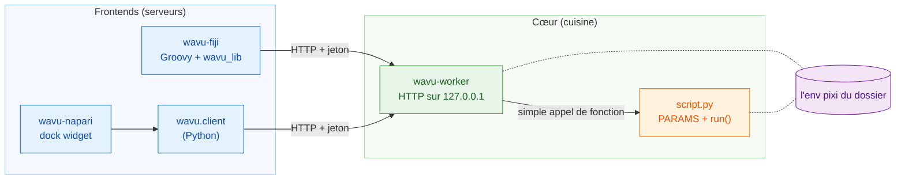
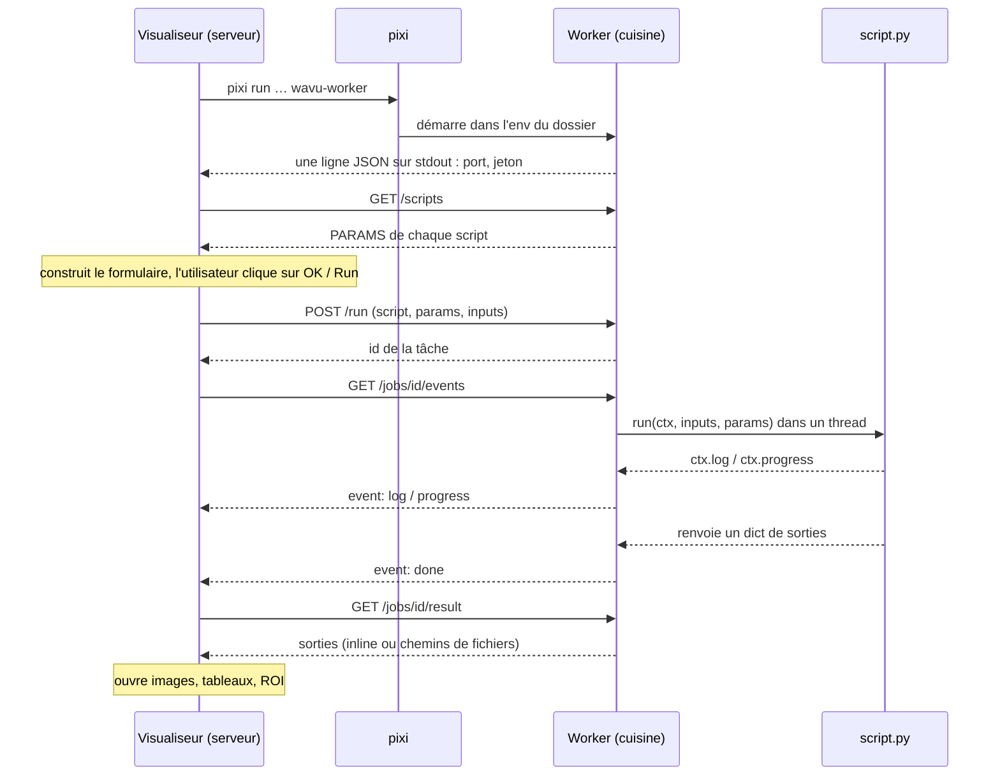

# Architecture (avancé)

!!! abstract "Pour les curieux et pour les développeurs"
    Vous n'avez pas besoin de cette page pour écrire ou lancer des scripts.
    Lisez-la si vous voulez savoir exactement ce qui se passe entre le
    visualiseur et votre Python, ou si vous voulez connecter un nouveau
    visualiseur à Wavu.

## L'idée en mots simples { #the-idea-in-plain-words }

Retour au restaurant. Wavu a **un seul modèle de cuisine et deux serveurs**.

- **Le cœur** (`src/wavu`) est la cuisine : le programme **worker**, la
  petite langue qu'il parle (HTTP et JSON), les règles que suit une recette
  (le *contrat de script* : `PARAMS` plus `run`), et `wavu.client`, un
  serveur Python prêt à l'emploi.
- **Les frontends** sont les serveurs : **wavu-fiji** (des scripts Groovy
  dans le menu de Fiji, sans compilation Java) et **wavu-napari** (un widget
  ancré, ou *dock widget*, de napari construit sur `wavu.client`).

Un serveur ne cuisine jamais. Il va en cuisine, lit la carte, y porte votre
commande et rapporte les assiettes. Comme les deux serveurs parlent la même
langue à la même cuisine, un même dossier de script les sert tous les deux.



## Un worker par dossier de script { #one-worker-per-script-folder }

Un **dossier de script** est un dossier qui contient un `pixi.toml`. Le
worker sert exactement un dossier, et il tourne **dans l'environnement pixi
propre à ce dossier**. Appeler votre `run` est donc un appel de fonction
Python ordinaire : pas de copie d'objets Python entre processus, pas de
nouveau processus par tâche.

Au démarrage, le worker examine chaque fichier `.py` du dossier qui définit
`run`. Les noms qui commencent par `_`, `.` ou `test_` sont ignorés. Un
fichier dont l'import échoue n'empêche pas les autres ; son erreur est
signalée par `/scripts` sous `errors`.

Deux dossiers, c'est deux workers, chacun dans son propre environnement.
C'est pour cela qu'un script PyTorch et un script qui n'utilise que NumPy
n'entrent jamais en conflit.

## Comment un frontend démarre le worker { #how-a-frontend-starts-the-worker }

Le frontend lance une seule commande dans le dossier de script :

```sh
pixi run --manifest-path <folder>/pixi.toml [--frozen] wavu-worker --script-dir <folder>
```

- Au premier lancement, pixi installe l'environnement (quelques minutes pour
  les grosses piles logicielles, une seule fois). Les lancements suivants
  démarrent en quelques secondes.
- `--frozen` installe exactement ce que dit `pixi.lock`. wavu-fiji l'ajoute
  pour les scripts **installés** (dossiers sous `<Fiji>/wavu/scripts/` qui
  fournissent un `pixi.lock`) ; `wavu.client.Worker.start(..., frozen=True)`
  fait de même.
- **Nettoyage de l'environnement.** `wavu.client` retire les variables
  `PIXI_*`, `CONDA_*`, `VIRTUAL_ENV*`, `PYTHONHOME`, `PYTHONPATH` et
  `INIT_CWD` de l'hôte avant de démarrer le processus enfant. Sans cela, un
  visualiseur qui tourne lui-même sous `pixi run` (c'est le cas de napari)
  pourrait faire activer le mauvais environnement à l'enfant. Les deux
  clients définissent aussi `NO_COLOR=1`, `PYTHONUNBUFFERED=1` et
  `PYTHONIOENCODING=utf-8`.

### La poignée de main { #the-handshake }

Le worker choisit un port libre au hasard sur `127.0.0.1`, crée un jeton
(*token*) aléatoire, et écrit **exactement une ligne JSON** sur stdout :

```json
{"wavu": "0.1.0", "port": 51234, "token": "..."}
```

Le frontend lit les lignes jusqu'à en trouver une avec `port` et `token`.
Tout le reste (la progression de l'installation pixi, qui arrive sur
stderr) va dans le log de l'utilisateur. Après la poignée de main, le worker
n'écrit plus jamais sur stdout : le `print` d'un script va dans le log de sa
tâche.

### Mode rattachement : le fichier de poignée de main { #attach-mode-the-handshake-file }

Avec `--handshake-file` (chemin par défaut `~/.wavu/worker.json`), le worker
écrit aussi le port, le jeton, `pid`, `host`, `script_dir` et `tmp_dir` dans
un fichier, et le supprime en quittant. Les tâches `pixi run worker` et
`pixi run debug` du modèle l'utilisent, et les deux frontends ont un bouton
ou une entrée de menu **Connect to running worker** (se connecter à un
worker en cours d'exécution) qui le lit.

### Durée de vie { #lifetime }

| Comment il s'arrête | Quand |
|---|---|
| stdin se ferme | le frontend qui l'a démarré quitte (il garde le tube ouvert) |
| `POST /shutdown` | **Stop Worker** dans Fiji, **Stop worker** dans napari, `Worker.stop()` |
| jamais par stdin | démarré avec `--detached` (usage en terminal et en conteneur) |

Un worker démarré par un visualiseur ne lui survit donc jamais.

## Authentification par jeton { #token-authentication }

Chaque requête doit porter `Authorization: Bearer <token>` ; sinon la
réponse est `401`. Le worker compare les jetons avec `hmac.compare_digest`.
Pourquoi s'en soucier sur `127.0.0.1` ? Les autres utilisateurs de la même
machine et les pages web de votre navigateur peuvent aussi joindre
localhost ; le jeton les empêche de lancer des scripts via votre worker. Le
jeton n'existe que dans le processus parent, ou dans le fichier de poignée
de main.

## L'API HTTP { #the-http-api }

| Méthode | Chemin | Ce qu'elle fait |
|---|---|---|
| GET | `/health` | `{"ok": true, "wavu", "scripts", "script_dir"}` |
| GET | `/scripts` | pour chaque script, `name`, `doc` et `params` (le schéma `PARAMS`), plus `errors` |
| POST | `/run` | `{"script", "params", "inputs", "inline_limit"?}` → `{"job": id}`, ou `400` avec un message |
| GET | `/jobs/<id>/events[?since=N]` | événements envoyés par le serveur (SSE) : `log`, `progress`, puis l'un de `done`, `error`, `cancelled` |
| POST | `/jobs/<id>/cancel` | demande à la tâche de s'arrêter |
| GET | `/jobs/<id>/result` | `status` plus `outputs` ou `error` ; `409` tant qu'elle tourne |
| POST | `/shutdown` | répond, puis le worker quitte |

Le flux d'événements est du texte brut, un événement à la fois :

```text
id: 3
event: progress
data: {"value": 0.5}
```

Un commentaire `: keepalive` arrive toutes les 15 secondes. Le flux se ferme
après l'événement final. Si la connexion tombe, reconnectez-vous avec
`?since=<events already seen>` (le nombre d'événements déjà reçus) et rien
n'est perdu ; wavu-fiji le fait automatiquement.

## Une exécution, de bout en bout { #one-run-end-to-end }



## Les données en transit { #data-on-the-wire }

Wavu est un pont pour les **petites données** (une image en mémoire,
jusqu'à environ 1–2 Go). Les données plus grandes, jusqu'à environ 50 Go
en local, ne voyagent pas du tout : le script reçoit un **chemin** vers un
stockage OME-Zarr et le lit par blocs
([analyse en flux](../workflows/large-data.md) ; ça marche, mais il n'est
pas recommandé de la piloter depuis Fiji ou napari).

- **Inline :** un petit tableau (au plus **4 Mio**) voyage dans le JSON
  sous forme d'octets little-endian en base64, avec `dtype`, `shape` et
  `meta`. Le worker et `wavu.client` exigent aussi qu'il ait au plus
  3 dimensions.
- **Par fichier :** tout ce qui est plus gros passe en TIFF (de même que
  les tableaux 4-D et 5-D venant du worker et de `wavu.client`). Les entrées
  sont écrites par le frontend dans un dossier temporaire ; les sorties
  arrivent dans le dossier temporaire propre à la tâche (`job-…` dans le
  dossier temporaire `wavu-…` du worker, supprimé quand le worker quitte,
  sauf avec `--keep-tmp`).
- `meta` transporte `title`, `pixel_um`, `axes` et, pour les sorties,
  `channel_names` et toutes les clés `extra` de `wavu.Image`.

Chaque sortie a un `kind` (type) :

| kind | transporte | créé à partir de |
|---|---|---|
| `image` | `data` inline, ou `path` vers un TIFF ImageJ | tableau NumPy ou `wavu.Image` (converti en uint8, uint16 ou float32) |
| `table` | `path` vers un CSV, plus `columns` | DataFrame pandas ou liste de dicts |
| `rois` | `path` vers un zip RoiSet ImageJ | `wavu.RoiSet` |
| `file` | `path` | `pathlib.Path` |
| `value` | `value` | nombre, texte, booléen ou `None` |

Chaque frontend décide comment *afficher* un type : voir
[Ce que vous pouvez renvoyer](../write/outputs.md), qui a un onglet pour
Fiji et un pour napari.

## L'annulation est coopérative { #cancellation-is-cooperative }

`POST /jobs/<id>/cancel` ne fait que lever un drapeau. Votre script le voit
via `ctx.cancelled()` ou `ctx.check_cancelled()` et s'arrête à un endroit
sûr. Si `run` se termine, ou lève une exception, après que le drapeau a été
levé, la tâche finit en `cancelled`. Un script coincé dans un seul long
appel termine d'abord cet appel ; le seul arrêt forcé est d'éteindre le
worker. Voir [Log, progression et annulation](../write/logs-progress-cancel.md).

## Débogage et rattachement { #debugging-and-attaching }

- `wavu-worker --debugpy 5678 [--debugpy-wait]` démarre debugpy pour que
  **Attach to Wavu worker** de VS Code puisse se connecter. La boîte de
  dialogue de wavu-fiji a une case **Debug in VS Code** qui redémarre le
  worker de cette façon.
- `pixi run debug` (tâche du modèle) démarre un worker détaché avec debugpy
  et un fichier de poignée de main ; le visualiseur s'y rattache ensuite
  avec **Connect to running worker**. Détails :
  [Déboguer dans VS Code](../help/debug-in-vscode.md).
- `WAVU_ACCESS_LOG=1` fait écrire au worker chaque requête HTTP sur stderr.

## Conteneurs { #containers }

Le `Dockerfile` d'un dossier de script (issu du modèle) ou le `Dockerfile`
à la racine de Wavu (avec `--build-arg SCRIPT_DIR=...`) construit une image
qui installe `pixi.lock` avec `pixi install --locked` et lance
`wavu-worker --host 0.0.0.0 --port 8765 --detached`, avec son fichier de
poignée de main dans `/data/.wavu/worker.json` et les fichiers des tâches
dans `/data/.wavu-tmp`. La version publiée de Wavu ne fournit une telle
image que pour le script du modèle
(`ghcr.io/oxford-zeiss-centre-of-excellence/wavu-worker`) ; les images de
vos propres scripts, c'est vous qui les construisez et les publiez.

Dans le conteneur, votre dossier de données a un autre chemin, donc les
chemins de fichiers doivent être traduits. Les deux frontends demandent un
dossier de l'hôte et le même dossier dans le conteneur : wavu-fiji dans
**Connect to Running Worker**, wavu-napari sous **Remote / container**
(distant / conteneur) ; les deux ont aussi un champ **Host** (hôte) pour un
worker sur une autre machine. `wavu.client` fait de même avec
`Worker.connect(handshake, host=None, host_prefix=None, worker_prefix=None)` :
`to_worker` et `from_worker` réécrivent les chemins dans les deux sens, et
les grosses entrées sont écrites dans `<host folder>/.wavu-tmp` pour que le
conteneur puisse les voir. Un conteneur connecté sans les deux préfixes ne
peut recevoir que des entrées de taille inline (au plus 4 Mio et 3-D) et ne
renvoyer que des sorties de taille inline. Mode d'emploi :
[Partager sous forme de conteneur](../write/container.md).

## L'isolation n'est pas la sécurité { #isolation-is-not-security }

L'environnement de chaque dossier isole les **paquets**. Il n'enferme pas le
script : un script tourne sous votre identité et peut lire, écrire et
supprimer tout ce que vous pouvez. Lancez des scripts de confiance, comme
vous le feriez avec un notebook.

## Ajouter un nouveau frontend { #adding-a-new-frontend }

Tout programme capable de démarrer un processus et de parler HTTP peut
devenir un serveur. Le contrat :

1. **Lancer** `pixi run --manifest-path <folder>/pixi.toml wavu-worker
   --script-dir <folder>` avec un tube sur stdin, et garder ce tube ouvert.
   (Ou se rattacher via `~/.wavu/worker.json`.)
2. **Poignée de main :** lire les lignes de stdout jusqu'à ce que l'une
   s'analyse comme du JSON avec `port` et `token`. Montrer stderr à
   l'utilisateur : le premier démarrage installe des paquets.
3. **Carte :** `GET /scripts` et construire un formulaire à partir de chaque
   entrée de `PARAMS` (`float`, `int`, `str`, `bool`, `choice`, `image`).
   Les champs `image` choisissent l'une des images ouvertes dans le
   visualiseur.
4. **Commande :** `POST /run` avec les valeurs ; les images partent inline
   ou comme chemin vers un TIFF, avec `pixel_um` dans `meta` si vous le
   connaissez.
5. **Flux :** lire `/jobs/<id>/events`, afficher `log` et `progress`,
   proposer un bouton d'annulation qui appelle `/cancel`.
6. **Service :** `GET /jobs/<id>/result` et faire correspondre chaque type
   de sortie aux objets de votre visualiseur.

En Python, `wavu.client` fait déjà les étapes 1, 2, 4, 5 et la partie
chargement de l'étape 6, y compris le nettoyage de l'environnement et les
fichiers temporaires :

```python
from wavu.client import Worker

with Worker.start("path/to/script-folder", on_log=print) as w:
    print(w.scripts())
    result = w.run("script", params={"sigma": 2.0}, inputs={"image": arr}, on_log=print)
    blurred = result.outputs["blurred"].value
```

`run` accepte aussi `on_progress` et un `threading.Event` nommé `cancel` ;
il renvoie chaque sortie déjà chargée (tableau, table, `RoiSet`, `Path` ou
valeur) et lève `WorkerError` (avec la trace d'appels) ou `JobCancelled`.
wavu-napari ne fait que quelques centaines de lignes par-dessus : voir
[Fonctionnement interne de wavu-napari](../napari/internals.md).

La référence complète est
[docs/protocol.md sur GitHub](https://github.com/Oxford-Zeiss-Centre-of-Excellence/Wavu/blob/main/docs/protocol.md)
(en anglais) ; les raisons de chaque choix sont dans
[docs/decisions.md](https://github.com/Oxford-Zeiss-Centre-of-Excellence/Wavu/blob/main/docs/decisions.md).

## En une phrase { #in-one-sentence }

Un visualiseur démarre un `wavu-worker` par dossier de script, dans
l'environnement pixi de ce dossier, lit une poignée de main d'une ligne,
puis commande des exécutions via une petite API HTTP protégée par jeton sur
`127.0.0.1` ; ainsi, tout visualiseur qui parle cette API peut servir les
mêmes scripts.
