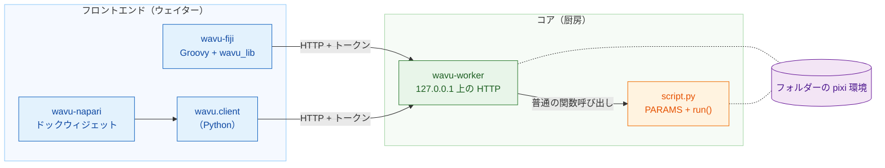
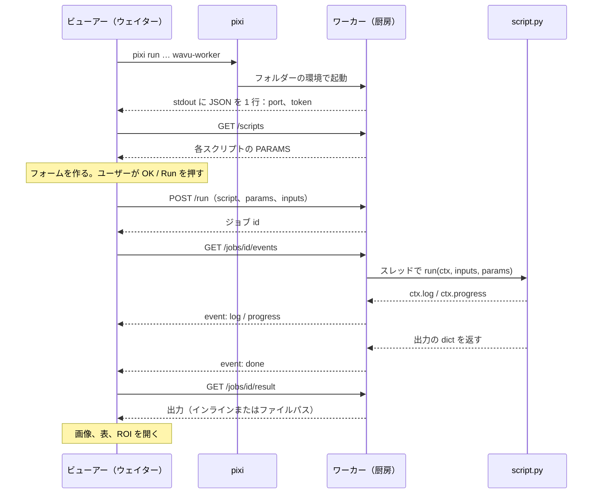

# アーキテクチャ（上級）

!!! abstract "興味のある方と、作る側の方へ"
    スクリプトを書いたり実行したりするのに、このページは必要ありません。
    ビューアーとあなたの Python の間で正確に何が起きているかを知りたい方や、
    新しいビューアーを Wavu につなぎたい方向けのページです。

## やさしく言うと

レストランに戻りましょう。Wavu には **厨房の設計が 1 つと、ウェイターが
2 人** います。

- **コア**（`src/wavu`）は厨房です。**ワーカー** プログラム、ワーカーが話す
  小さな言葉（HTTP と JSON）、レシピが守るルール（*スクリプト契約*：
  `PARAMS` と `run`）、そして出来合いの Python ウェイターである
  `wavu.client` から成ります。
- **フロントエンド** はウェイターです。**wavu-fiji**（Fiji のメニューに入る
  Groovy スクリプト。Java のビルドは不要）と **wavu-napari**（`wavu.client`
  の上に作られた napari のドックウィジェット）です。

ウェイターは料理をしません。厨房まで歩いていき、メニューを読み、注文を
運び込み、料理を運び出します。2 人のウェイターが同じ厨房に同じ言葉で話す
ので、1 つのスクリプトフォルダーで両方に料理を出せます。



## スクリプトフォルダーごとにワーカーは 1 つ

**スクリプトフォルダー** とは、`pixi.toml` があるフォルダーのことです。
ワーカーはちょうど 1 つのフォルダーを担当し、**そのフォルダー専用の pixi
環境の中で** 動きます。だから、あなたの `run` を呼ぶのは普通の Python の
関数呼び出しです。プロセス間で Python オブジェクトをコピーすることも、
ジョブごとに新しいプロセスを作ることもありません。

起動するとき、ワーカーはフォルダー内の `.py` ファイルのうち `run` を定義
しているものをすべて調べます。名前が `_`、`.`、`test_` で始まるものは
飛ばします。import に失敗したファイルがあっても、ほかのファイルは止まり
ません。そのエラーは `/scripts` の `errors` で報告されます。

フォルダーが 2 つならワーカーも 2 つで、それぞれ自分の環境で動きます。
だから PyTorch のスクリプトと NumPy だけのスクリプトがぶつかることは
ありません。

## フロントエンドがワーカーを起動するしくみ

フロントエンドは、スクリプトフォルダーで次のコマンドを 1 つ実行します。

```sh
pixi run --manifest-path <folder>/pixi.toml [--frozen] wavu-worker --script-dir <folder>
```

- 最初の実行では、pixi が環境をインストールします（重いスタックだと数分。
  一度だけです）。それ以降は数秒で起動します。
- `--frozen` は、`pixi.lock` に書かれたとおりのものをインストールします。
  wavu-fiji は **インストール済み** のスクリプト（`<Fiji>/wavu/scripts/`
  の下にあり、`pixi.lock` が付いているフォルダー）にこれを付けます。
  `wavu.client.Worker.start(..., frozen=True)` も同じことをします。
- **環境変数の掃除。** `wavu.client` は子プロセスを起動する前に、ホストの
  `PIXI_*`、`CONDA_*`、`VIRTUAL_ENV*`、`PYTHONHOME`、`PYTHONPATH`、
  `INIT_CWD` 変数を取り除きます。これをしないと、ビューアー自身が
  `pixi run` の下で動いている場合（napari がそうです）、子プロセスが
  間違った環境を有効にしてしまうことがあります。どちらのクライアントも
  `NO_COLOR=1`、`PYTHONUNBUFFERED=1`、`PYTHONIOENCODING=utf-8` を設定します。

### ハンドシェイク

ワーカーは `127.0.0.1` 上の空いているポートをランダムに選び、ランダムな
トークンを作って、stdout に **ちょうど 1 行の JSON** を出力します。

```json
{"wavu": "0.1.0", "port": 51234, "token": "..."}
```

フロントエンドは、`port` と `token` を含む行が来るまで行を読みます。それ
以外のもの（stderr に出る pixi のインストールの進み具合）は、ユーザーの
ログに流します。ハンドシェイクの後、ワーカーが stdout に書くことは二度と
ありません。スクリプトの `print` は、そのジョブのログに入ります。

### アタッチモード：ハンドシェイクファイル

`--handshake-file`（既定のパスは `~/.wavu/worker.json`）を付けると、
ワーカーはポート、トークン、`pid`、`host`、`script_dir`、`tmp_dir` を
ファイルにも書き出し、終了時に削除します。テンプレートの `pixi run worker`
と `pixi run debug` タスクはこれを使います。どちらのフロントエンドにも、
このファイルを読む **Connect to running worker**（実行中のワーカーに接続）
ボタンまたはメニュー項目があります。

### 寿命

| 終わり方 | いつ |
|---|---|
| stdin が閉じる | ワーカーを起動したフロントエンドが終了したとき（フロントエンドがパイプを開いたままにしている） |
| `POST /shutdown` | Fiji の **Stop Worker**、napari の **Stop worker**、`Worker.stop()` |
| stdin では終わらない | `--detached` で起動したとき（ターミナルやコンテナでの利用） |

つまり、ビューアーが起動したワーカーがビューアーより長生きすることは
ありません。

## トークン認証

すべてのリクエストに `Authorization: Bearer <token>` が必要です。ないと
答えは `401` です。ワーカーは `hmac.compare_digest` でトークンを比較します。
なぜ `127.0.0.1` でわざわざ？ 同じマシンのほかのユーザーや、ブラウザーで
開いている Web ページも localhost に届くからです。トークンがあれば、
それらがあなたのワーカーを通してスクリプトを実行することを防げます。
トークンは親プロセスか、ハンドシェイクファイルの中にしかありません。

## HTTP API

| メソッド | パス | 何をするか |
|---|---|---|
| GET | `/health` | `{"ok": true, "wavu", "scripts", "script_dir"}` |
| GET | `/scripts` | 各スクリプトの `name`、`doc`、`params`（`PARAMS` のスキーマ）と、`errors` |
| POST | `/run` | `{"script", "params", "inputs", "inline_limit"?}` → `{"job": id}`、またはメッセージ付きの `400` |
| GET | `/jobs/<id>/events[?since=N]` | server-sent events：`log`、`progress`、最後に `done`、`error`、`cancelled` のどれか 1 つ |
| POST | `/jobs/<id>/cancel` | ジョブに止まるよう頼む |
| GET | `/jobs/<id>/result` | `status` と、`outputs` または `error`。実行中は `409` |
| POST | `/shutdown` | 応答してから、ワーカーが終了する |

イベントストリームはプレーンテキストで、1 回に 1 イベントずつ届きます。

```text
id: 3
event: progress
data: {"value": 0.5}
```

15 秒ごとに `: keepalive` コメントが届きます。最後のイベントの後、
ストリームは閉じます。接続が切れたら `?since=<受け取り済みのイベント数>`
を付けて再接続すれば、何も失われません。wavu-fiji はこれを自動で行います。

## 1 回の実行、最初から最後まで



## 通信で運ばれるデータ

Wavu は **小さなデータ** のための橋です（メモリ上の画像 1 枚、だいたい
1〜2 GB まで）。

- **インライン：** 小さな配列（最大 **4 MiB**）は、base64 で符号化した
  リトルエンディアンのバイト列として、`dtype`、`shape`、`meta` と一緒に
  JSON の中で運ばれます。ワーカーと `wavu.client` は、さらに 3 次元以下で
  あることも求めます。
- **ファイル経由：** それより大きいものは TIFF で送られます（ワーカーと
  `wavu.client` から出る 4 次元・5 次元の配列も同じです）。入力は
  フロントエンドが一時フォルダーに書き出します。出力はジョブ専用の一時
  フォルダー（ワーカーの `wavu-…` 一時フォルダー内の `job-…`。
  `--keep-tmp` を付けない限り、ワーカーの終了時に削除されます）に置かれます。
- `meta` は `title`、`pixel_um`、`axes` を運び、出力の場合はさらに
  `channel_names` と、`wavu.Image` の `extra` のキーを運びます。

すべての出力には `kind` があります。

| kind | 運ぶもの | 元になるもの |
|---|---|---|
| `image` | インラインの `data`、または ImageJ TIFF への `path` | NumPy 配列または `wavu.Image`（uint8、uint16、float32 のどれかに変換） |
| `table` | CSV への `path` と `columns` | pandas の DataFrame、または dict のリスト |
| `rois` | ImageJ の RoiSet zip への `path` | `wavu.RoiSet` |
| `file` | `path` | `pathlib.Path` |
| `value` | `value` | 数値、テキスト、bool、または `None` |

それぞれの kind をどう *見せる* かは、フロントエンドが決めます。Fiji に
ついては [返せるもの](../write/outputs.md)、napari については
[napari で戻ってくるもの](../napari/layers.md) を見てください。

## キャンセルは協力して行う

`POST /jobs/<id>/cancel` は旗を立てるだけです。スクリプトは
`ctx.cancelled()` または `ctx.check_cancelled()` でそれに気づき、安全な
ところで止まります。旗が立った後に `run` が戻るか例外を出すと、ジョブは
`cancelled` で終わります。1 つの長い呼び出しの中で止まっているスクリプトは、
まずその呼び出しを終えます。強制的に止める方法は、ワーカーを終了させる
ことだけです。[ログ、進捗、キャンセル](../write/logs-progress-cancel.md)
を見てください。

## デバッグとアタッチ

- `wavu-worker --debugpy 5678 [--debugpy-wait]` は debugpy を起動し、
  VS Code の **Attach to Wavu worker** が接続できるようにします。wavu-fiji
  のダイアログには、この方法でワーカーを再起動する **Debug in VS Code**
  チェックボックスがあります。
- `pixi run debug`（テンプレートのタスク）は、debugpy とハンドシェイク
  ファイル付きで、切り離されたワーカーを起動します。ビューアーは
  **Connect to running worker** でそこにアタッチします。詳しくは
  [VS Code でデバッグする](../help/debug-in-vscode.md) を見てください。
- `WAVU_ACCESS_LOG=1` を設定すると、ワーカーは HTTP リクエストを 1 つずつ
  stderr に出力します。

## コンテナ

スクリプトフォルダーの `Dockerfile`（テンプレートから）または Wavu の
ルートの `Dockerfile`（`--build-arg SCRIPT_DIR=...` 付き）でイメージを
ビルドします。このイメージは `pixi install --locked` で `pixi.lock` を
インストールし、`wavu-worker --host 0.0.0.0 --port 8765 --detached` を
実行して、ハンドシェイクファイルを `/data/.wavu/worker.json` に、ジョブの
ファイルを `/data/.wavu-tmp` に置きます。Wavu のリリースがこうした
イメージを公開するのはテンプレートスクリプトの分だけです
（`ghcr.io/oxford-zeiss-centre-of-excellence/wavu-worker`）。自分の
スクリプトのイメージは、自分でビルドして公開します。

コンテナの中では、データフォルダーのパスが違うので、ファイルパスを変換する
必要があります。どちらのフロントエンドも、ホスト側のフォルダーと、コンテナ
内の同じフォルダーを尋ねます。wavu-fiji は **Connect to Running Worker** で、
wavu-napari は **Remote / container** の下で尋ねます。どちらにも、別の
マシンのワーカー用の **Host** 欄があります。`wavu.client` も
`Worker.connect(handshake, host=None, host_prefix=None, worker_prefix=None)`
で同じことをします。`to_worker` と `from_worker` がパスを双方向に書き換え、
大きな入力はコンテナから見えるように `<host folder>/.wavu-tmp` に書き出され
ます。2 つのプレフィックスなしで接続したコンテナは、インラインで送れる
大きさの入力（最大 4 MiB、3 次元まで）しか受け取れず、インラインで送れる
大きさの出力しか返せません。使い方は
[コンテナとして共有する](../write/container.md) にあります。

## 分離はセキュリティではない

フォルダーごとの環境は **パッケージ** を分けます。スクリプトを閉じ込める
ものではありません。スクリプトはあなたとして動き、あなたが読み書き・削除
できるものは何でも読み書き・削除できます。ノートブックと同じように、
信頼できるスクリプトだけを実行してください。

## 新しいフロントエンドを追加する

プロセスを起動できて HTTP を話せるプログラムなら、どれでもウェイターに
なれます。約束ごとは次のとおりです。

1. **起動：** stdin にパイプをつないで
   `pixi run --manifest-path <folder>/pixi.toml wavu-worker
   --script-dir <folder>` を実行し、そのパイプを開いたままにします。
   （または `~/.wavu/worker.json` を通してアタッチします。）
2. **ハンドシェイク：** `port` と `token` を含む JSON として読める行が
   来るまで、stdout の行を読みます。stderr はユーザーに見せます。最初の
   起動ではパッケージをインストールするからです。
3. **メニュー：** `GET /scripts` を呼び、各 `PARAMS` の項目（`float`、
   `int`、`str`、`bool`、`choice`、`image`）からフォームを作ります。
   `image` のフィールドでは、ビューアーで開いている画像から 1 つを選びます。
4. **注文：** 値を付けて `POST /run` を呼びます。画像はインラインか TIFF の
   パスで送り、分かるなら `meta` に `pixel_um` を入れます。
5. **ストリーム：** `/jobs/<id>/events` を読み、`log` と `progress` を
   表示し、`/cancel` を呼ぶキャンセルボタンを用意します。
6. **配膳：** `GET /jobs/<id>/result` を呼び、出力の kind をそれぞれ
   ビューアーのオブジェクトに対応させます。

Python なら、`wavu.client` がすでにステップ 1、2、4、5 と、6 の読み込み
部分をやってくれます。環境変数の掃除や一時ファイルの扱いも含みます。

```python
from wavu.client import Worker

with Worker.start("path/to/script-folder", on_log=print) as w:
    print(w.scripts())
    result = w.run("script", params={"sigma": 2.0}, inputs={"image": arr}, on_log=print)
    blurred = result.outputs["blurred"].value
```

`run` は `on_progress` と、`cancel` という名前の `threading.Event` も
受け取ります。すべての出力を読み込み済みの形（配列、表、`RoiSet`、`Path`、
または値）で返し、`WorkerError`（トレースバック付き）または `JobCancelled`
を送出します。wavu-napari は、その上に数百行を足しただけのものです。
[wavu-napari の内部](../napari/internals.md) を見てください。

完全なリファレンスは
[GitHub の docs/protocol.md](https://github.com/Oxford-Zeiss-Centre-of-Excellence/Wavu/blob/main/docs/protocol.md)
（英語）にあります。それぞれの選択の理由は
[docs/decisions.md](https://github.com/Oxford-Zeiss-Centre-of-Excellence/Wavu/blob/main/docs/decisions.md)
（英語）にあります。

## ひとことで言うと

ビューアーは、スクリプトフォルダーごとに 1 つの `wavu-worker` をその
フォルダーの pixi 環境の中で起動し、1 行のハンドシェイクを読み、あとは
`127.0.0.1` 上のトークンで守られた小さな HTTP API で実行を注文します。
だから、この API を話せるビューアーなら、どれでも同じスクリプトを出せます。
