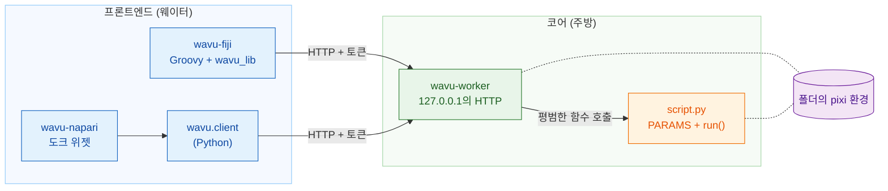
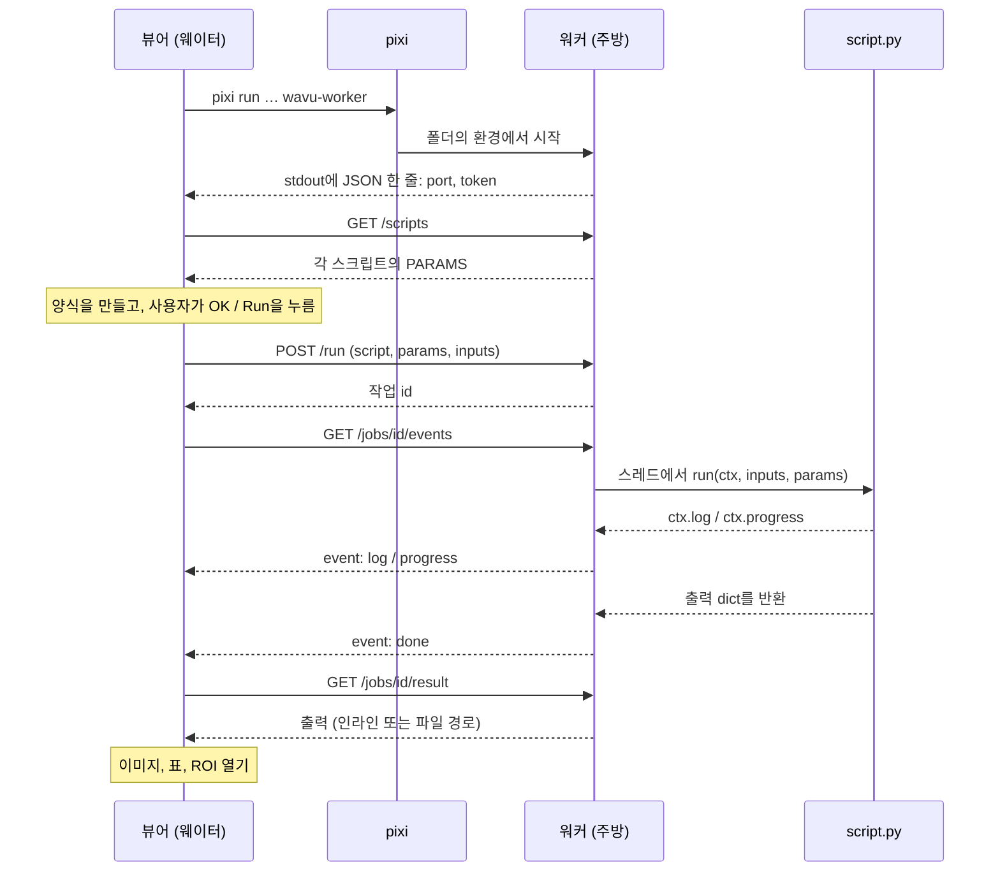

# 아키텍처 (고급)

!!! abstract "궁금한 분과 직접 만드는 분을 위해"
    스크립트를 쓰거나 실행하는 데 이 페이지는 필요 없어요. 뷰어와 여러분의
    Python 사이에서 정확히 무슨 일이 일어나는지 알고 싶거나, 새 뷰어를
    Wavu에 연결하고 싶다면 읽어 보세요.

## 쉬운 말로 설명하면

다시 레스토랑으로 돌아가 볼게요. Wavu에는 **주방 설계 하나와 웨이터 둘**이
있어요.

- **코어(core)**(`src/wavu`)는 주방이에요. **워커** 프로그램, 워커가 쓰는
  작은 언어(HTTP와 JSON), 레시피가 따르는 규칙(*스크립트 계약*: `PARAMS`와
  `run`), 그리고 미리 만들어 둔 Python 웨이터인 `wavu.client`로 이루어져요.
- **프론트엔드(frontend)**는 웨이터예요. **wavu-fiji**(Fiji 메뉴에 들어가는
  Groovy 스크립트, Java 빌드 없음)와 **wavu-napari**(`wavu.client` 위에 만든
  napari 도크 위젯)예요.

웨이터는 요리하지 않아요. 주방으로 걸어가서 메뉴를 읽고, 주문을 들고 들어가고,
요리를 들고 나와요. 두 웨이터가 같은 주방에 같은 언어로 말하니까, 스크립트
폴더 하나로 양쪽 모두에 요리를 낼 수 있어요.



## 스크립트 폴더마다 워커 하나

**스크립트 폴더**는 `pixi.toml`이 있는 폴더예요. 워커는 정확히 한 폴더만
맡고, **그 폴더만의 pixi 환경 안에서** 실행돼요. 그래서 여러분의 `run`을
부르는 건 평범한 Python 함수 호출이에요. 프로세스 사이에서 Python 객체를
복사하지도 않고, 작업마다 새 프로세스를 만들지도 않아요.

워커는 시작할 때 폴더 안에서 `run`을 정의한 `.py` 파일을 모두 살펴봐요.
이름이 `_`, `.`, `test_`로 시작하는 파일은 건너뛰어요. import에 실패한
파일이 있어도 다른 파일은 멈추지 않고, 그 오류는 `/scripts`의 `errors`에
보고돼요.

폴더가 둘이면 워커도 둘이고, 각자 자기 환경에서 돌아요. 그래서 PyTorch
스크립트와 NumPy만 쓰는 스크립트가 충돌하지 않아요.

## 프론트엔드가 워커를 시작하는 방법

프론트엔드는 스크립트 폴더에서 명령 하나를 실행해요.

```sh
pixi run --manifest-path <folder>/pixi.toml [--frozen] wavu-worker --script-dir <folder>
```

- 첫 실행에서 pixi가 환경을 설치해요(무거운 스택이면 몇 분, 한 번만).
  그다음부터는 몇 초 만에 시작해요.
- `--frozen`은 `pixi.lock`에 적힌 그대로 설치해요. wavu-fiji는
  **설치된** 스크립트(`<Fiji>/wavu/scripts/` 아래에 있고 `pixi.lock`이 함께
  들어 있는 폴더)에 이걸 붙여요. `wavu.client.Worker.start(..., frozen=True)`도
  똑같이 해요.
- **환경 변수 정리.** `wavu.client`는 자식 프로세스를 시작하기 전에 호스트의
  `PIXI_*`, `CONDA_*`, `VIRTUAL_ENV*`, `PYTHONHOME`, `PYTHONPATH`,
  `INIT_CWD` 변수를 지워요. 이렇게 하지 않으면, 뷰어 자체가 `pixi run`
  아래에서 돌 때(napari가 그래요) 자식 프로세스가 엉뚱한 환경을 활성화할 수
  있어요. 두 클라이언트 모두 `NO_COLOR=1`, `PYTHONUNBUFFERED=1`,
  `PYTHONIOENCODING=utf-8`도 설정해요.

### 핸드셰이크

워커는 `127.0.0.1`에서 비어 있는 포트를 무작위로 고르고, 무작위 토큰을
만들고, stdout에 **정확히 한 줄의 JSON**을 출력해요.

```json
{"wavu": "0.1.0", "port": 51234, "token": "..."}
```

프론트엔드는 `port`와 `token`이 있는 줄이 나올 때까지 줄을 읽어요. 그 밖의
것(stderr로 오는 pixi 설치 진행 상황)은 사용자의 로그로 보내요. 핸드셰이크
뒤에는 워커가 stdout에 다시는 쓰지 않아요. 스크립트의 `print`는 그 작업의
로그로 가요.

### 연결(attach) 모드: 핸드셰이크 파일

`--handshake-file`(기본 경로 `~/.wavu/worker.json`)을 주면 워커가 포트,
토큰, `pid`, `host`, `script_dir`, `tmp_dir`를 파일에도 쓰고, 끝날 때
지워요. 템플릿의 `pixi run worker`와 `pixi run debug` 태스크가 이걸 쓰고,
두 프론트엔드 모두 이 파일을 읽는 **Connect to running worker**(실행 중인
워커에 연결) 버튼이나 메뉴 항목이 있어요.

### 수명

| 끝나는 방법 | 언제 |
|---|---|
| stdin이 닫힘 | 워커를 시작한 프론트엔드가 종료될 때(프론트엔드가 파이프를 열어 두고 있어요) |
| `POST /shutdown` | Fiji의 **Stop Worker**, napari의 **Stop worker**, `Worker.stop()` |
| stdin으로는 끝나지 않음 | `--detached`로 시작했을 때(터미널과 컨테이너용) |

그래서 뷰어가 시작한 워커는 뷰어보다 오래 살지 않아요.

## 토큰 인증

모든 요청에 `Authorization: Bearer <token>`이 있어야 해요. 없으면 답은
`401`이에요. 워커는 `hmac.compare_digest`로 토큰을 비교해요. 왜 굳이
`127.0.0.1`에서까지? 같은 컴퓨터의 다른 사용자나 브라우저에 열린 웹 페이지도
localhost에 닿을 수 있거든요. 토큰은 그들이 여러분의 워커로 스크립트를
실행하지 못하게 막아요. 토큰은 부모 프로세스나 핸드셰이크 파일에만 있어요.

## HTTP API

| 메서드 | 경로 | 하는 일 |
|---|---|---|
| GET | `/health` | `{"ok": true, "wavu", "scripts", "script_dir"}` |
| GET | `/scripts` | 각 스크립트의 `name`, `doc`, `params`(`PARAMS` 스키마), 그리고 `errors` |
| POST | `/run` | `{"script", "params", "inputs", "inline_limit"?}` → `{"job": id}`, 또는 메시지가 담긴 `400` |
| GET | `/jobs/<id>/events[?since=N]` | server-sent events: `log`, `progress`, 그리고 `done`, `error`, `cancelled` 중 하나 |
| POST | `/jobs/<id>/cancel` | 작업에 멈춰 달라고 요청해요 |
| GET | `/jobs/<id>/result` | `status`와 `outputs` 또는 `error`, 아직 실행 중이면 `409` |
| POST | `/shutdown` | 응답한 다음 워커가 종료돼요 |

이벤트 스트림은 일반 텍스트이고, 한 번에 이벤트 하나씩 와요.

```text
id: 3
event: progress
data: {"value": 0.5}
```

15초마다 `: keepalive` 주석이 와요. 마지막 이벤트 뒤에 스트림이 닫혀요.
연결이 끊기면 `?since=<이미 받은 이벤트 수>`를 붙여 다시 연결하면 아무것도
잃지 않아요. wavu-fiji는 이걸 자동으로 해요.

## 실행 한 번, 처음부터 끝까지



## 주고받는 데이터

Wavu는 **작은 데이터**를 위한 다리예요(메모리에 들어가는 이미지 한 장, 대략
1–2 GB까지).

- **인라인:** 작은 배열(최대 **4 MiB**)은 base64로 인코딩한 리틀 엔디언
  바이트로 JSON 안에 실려 가고, `dtype`, `shape`, `meta`가 함께 가요. 워커와
  `wavu.client`는 3차원 이하여야 한다는 조건도 붙여요.
- **파일로:** 그보다 큰 것은 TIFF로 가요(워커와 `wavu.client`에서 나오는
  4차원·5차원 배열도 마찬가지예요). 입력은 프론트엔드가 임시 폴더에 써요.
  출력은 작업 전용 임시 폴더(워커의 `wavu-…` 임시 폴더 안의 `job-…`,
  `--keep-tmp`를 주지 않으면 워커가 끝날 때 지워져요)에 놓여요.
- `meta`에는 `title`, `pixel_um`, `axes`가 담기고, 출력에는
  `channel_names`와 `wavu.Image`의 `extra` 키도 담겨요.

모든 출력에는 `kind`가 있어요.

| kind | 담는 것 | 무엇으로 만드나요 |
|---|---|---|
| `image` | 인라인 `data`, 또는 ImageJ TIFF를 가리키는 `path` | NumPy 배열 또는 `wavu.Image`(uint8, uint16, float32로 변환) |
| `table` | CSV를 가리키는 `path`와 `columns` | pandas DataFrame 또는 dict의 리스트 |
| `rois` | ImageJ RoiSet zip을 가리키는 `path` | `wavu.RoiSet` |
| `file` | `path` | `pathlib.Path` |
| `value` | `value` | 숫자, 텍스트, bool 또는 `None` |

각 kind를 어떻게 *보여 줄지*는 프론트엔드가 정해요. Fiji는
[돌려줄 수 있는 것](../write/outputs.md), napari는
[napari에서 돌려받는 것](../napari/layers.md)을 보세요.

## 취소는 협조해서 해요

`POST /jobs/<id>/cancel`은 깃발만 올려요. 스크립트는 `ctx.cancelled()`나
`ctx.check_cancelled()`로 그걸 알아채고 안전한 지점에서 멈춰요. 깃발이
올라간 뒤에 `run`이 반환하거나 예외를 던지면 작업은 `cancelled`로 끝나요.
긴 호출 하나에 묶여 있는 스크립트는 그 호출을 먼저 끝내요. 강제로 멈추는
유일한 방법은 워커를 종료하는 거예요.
[로그, 진행 상황, 취소](../write/logs-progress-cancel.md)를 보세요.

## 디버깅과 연결

- `wavu-worker --debugpy 5678 [--debugpy-wait]`는 debugpy를 시작해서
  VS Code의 **Attach to Wavu worker**가 연결할 수 있게 해요. wavu-fiji
  대화상자에는 워커를 이 방식으로 다시 시작하는 **Debug in VS Code**
  체크박스가 있어요.
- `pixi run debug`(템플릿 태스크)는 debugpy와 핸드셰이크 파일을 갖춘 분리된
  워커를 시작해요. 그러면 뷰어가 **Connect to running worker**로 연결해요.
  자세한 내용: [VS Code에서 디버그하기](../help/debug-in-vscode.md).
- `WAVU_ACCESS_LOG=1`을 설정하면 워커가 HTTP 요청을 하나하나 stderr에
  출력해요.

## 컨테이너

스크립트 폴더의 `Dockerfile`(템플릿에 들어 있어요)이나 Wavu 루트의
`Dockerfile`(`--build-arg SCRIPT_DIR=...`과 함께)로 이미지를 빌드해요. 이
이미지는 `pixi install --locked`로 `pixi.lock`을 설치하고,
`wavu-worker --host 0.0.0.0 --port 8765 --detached`를 실행하며, 핸드셰이크
파일은 `/data/.wavu/worker.json`에, 작업 파일은 `/data/.wavu-tmp`에 둬요.
Wavu 릴리스는 템플릿 스크립트에 대해서만 이런 이미지
(`ghcr.io/oxford-zeiss-centre-of-excellence/wavu-worker`)를 공개해요. 여러분
스크립트의 이미지는 직접 빌드하고 공개하세요.

컨테이너 안에서는 데이터 폴더의 경로가 달라서 파일 경로를 변환해야 해요.
두 프론트엔드 모두 호스트 폴더와 컨테이너 안의 같은 폴더를 물어봐요.
wavu-fiji는 **Connect to Running Worker**에서, wavu-napari는
**Remote / container** 아래에서요. 둘 다 다른 컴퓨터의 워커를 위한
**Host** 입력란도 있어요. `wavu.client`는
`Worker.connect(handshake, host=None, host_prefix=None, worker_prefix=None)`로
같은 일을 해요. `to_worker`와 `from_worker`가 경로를 양방향으로 바꿔 쓰고,
큰 입력은 컨테이너가 볼 수 있도록 `<host folder>/.wavu-tmp`에 써요. 두
접두어 없이 연결한 컨테이너는 인라인 크기의 입력(최대 4 MiB, 3차원)만 받고
인라인 크기의 출력만 돌려줄 수 있어요. 사용 방법:
[컨테이너로 공유하기](../write/container.md).

## 격리는 보안이 아니에요

폴더마다 있는 환경은 **패키지**를 떼어 놓아요. 스크립트를 가두지는 않아요.
스크립트는 여러분 권한으로 실행되어, 여러분이 읽고 쓰고 지울 수 있는 건
뭐든 읽고 쓰고 지울 수 있어요. 노트북처럼, 믿을 수 있는 스크립트만
실행하세요.

## 새 프론트엔드 추가하기

프로세스를 시작하고 HTTP로 말할 수 있는 프로그램이라면 무엇이든 웨이터가 될
수 있어요. 약속은 이래요.

1. **시작:** stdin에 파이프를 연결해서
   `pixi run --manifest-path <folder>/pixi.toml wavu-worker
   --script-dir <folder>`를 실행하고, 그 파이프를 열어 두세요.
   (또는 `~/.wavu/worker.json`을 통해 연결하세요.)
2. **핸드셰이크:** `port`와 `token`이 있는 JSON으로 읽히는 줄이 나올 때까지
   stdout 줄을 읽으세요. stderr는 사용자에게 보여 주세요. 첫 시작 때
   패키지를 설치하거든요.
3. **메뉴:** `GET /scripts`를 부르고, 각 `PARAMS` 항목(`float`, `int`,
   `str`, `bool`, `choice`, `image`)으로 양식을 만드세요. `image` 필드는
   뷰어에 열린 이미지 중 하나를 골라요.
4. **주문:** 값을 담아 `POST /run`을 부르세요. 이미지는 인라인이나 TIFF
   경로로 보내고, 알면 `meta`에 `pixel_um`을 넣으세요.
5. **스트림:** `/jobs/<id>/events`를 읽어 `log`와 `progress`를 보여 주고,
   `/cancel`을 부르는 취소 버튼을 두세요.
6. **서빙:** `GET /jobs/<id>/result`를 부르고 출력 kind를 각각 뷰어의
   객체에 대응시키세요.

Python에서는 `wavu.client`가 이미 1, 2, 4, 5단계와 6단계의 불러오기 부분을
해 줘요. 환경 변수 정리와 임시 파일 처리도 포함해서요.

```python
from wavu.client import Worker

with Worker.start("path/to/script-folder", on_log=print) as w:
    print(w.scripts())
    result = w.run("script", params={"sigma": 2.0}, inputs={"image": arr}, on_log=print)
    blurred = result.outputs["blurred"].value
```

`run`은 `on_progress`와 `cancel`이라는 `threading.Event`도 받아요. 모든
출력을 이미 불러온 형태(배열, 표, `RoiSet`, `Path` 또는 값)로 돌려주고,
`WorkerError`(트레이스백 포함)나 `JobCancelled`를 던져요. wavu-napari는
그 위에 몇백 줄을 얹은 것뿐이에요.
[wavu-napari 내부 구조](../napari/internals.md)를 보세요.

전체 참고 자료는
[GitHub의 docs/protocol.md](https://github.com/Oxford-Zeiss-Centre-of-Excellence/Wavu/blob/main/docs/protocol.md)(영어)에
있고, 각 선택의 이유는
[docs/decisions.md](https://github.com/Oxford-Zeiss-Centre-of-Excellence/Wavu/blob/main/docs/decisions.md)(영어)에
있어요.

## 한 문장으로

뷰어는 스크립트 폴더마다 `wavu-worker` 하나를 그 폴더의 pixi 환경 안에서
시작하고, 한 줄짜리 핸드셰이크를 읽은 다음, `127.0.0.1`에서 토큰으로 보호되는
작은 HTTP API로 실행을 주문해요. 그래서 이 API를 말할 수 있는 뷰어라면
어느 것이든 같은 스크립트를 낼 수 있어요.
