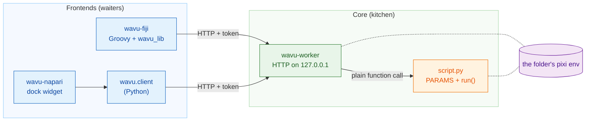
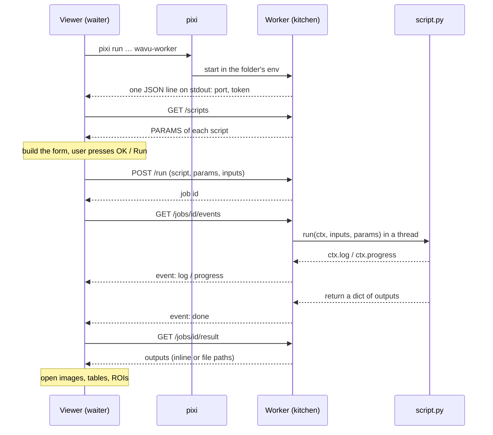

# Architecture (advanced)

!!! abstract "For the curious and for builders"
    You do not need this page to write or run scripts. Read it if you want to
    know exactly what happens between the viewer and your Python, or if you
    want to connect a new viewer to Wavu.

## The idea in plain words

Back to the restaurant. Wavu has **one kitchen design and two waiters**.

- **The core** (`src/wavu`) is the kitchen: the **worker** program, the
  little language it speaks (HTTP and JSON), the rules a recipe follows (the
  *script contract*: `PARAMS` plus `run`), and `wavu.client`, a ready-made
  Python waiter.
- **The frontends** are the waiters: **wavu-fiji** (Groovy scripts in Fiji's
  menu, no Java build) and **wavu-napari** (a napari dock widget built on
  `wavu.client`).

A waiter never cooks. It walks to the kitchen, reads the menu, carries your
order in, and carries the plates out. Because both waiters speak the same
language to the same kitchen, one script folder serves both.



## One worker per script folder

A **script folder** is a folder with a `pixi.toml`. The worker serves exactly
one folder, and it runs **inside that folder's own pixi environment**. So
calling your `run` is an ordinary Python function call: no copying of
Python objects between processes, no new process per job.

When it starts, the worker looks at every `.py` file in the folder that
defines `run`. Names starting with `_`, `.` or `test_` are skipped. A file
that fails to import does not stop the others; its error is reported by
`/scripts` under `errors`.

Two folders mean two workers, each in its own environment. That is why a
PyTorch script and a NumPy-only script never clash.

## How a frontend starts the worker

The frontend runs one command in the script folder:

```sh
pixi run --manifest-path <folder>/pixi.toml [--frozen] wavu-worker --script-dir <folder>
```

- The first run makes pixi install the environment (minutes for heavy
  stacks, once). Later runs start in seconds.
- `--frozen` installs exactly what `pixi.lock` says. wavu-fiji adds it for
  **installed** scripts (folders under `<Fiji>/wavu/scripts/` that ship a
  `pixi.lock`); `wavu.client.Worker.start(..., frozen=True)` does the same.
- **Environment scrubbing.** `wavu.client` removes the host's `PIXI_*`,
  `CONDA_*`, `VIRTUAL_ENV*`, `PYTHONHOME`, `PYTHONPATH` and `INIT_CWD`
  variables before it starts the child. Without that, a viewer that itself
  runs under `pixi run` (napari does) could make the child activate the
  wrong environment. Both clients also set `NO_COLOR=1`,
  `PYTHONUNBUFFERED=1` and `PYTHONIOENCODING=utf-8`.

### The handshake

The worker picks a random free port on `127.0.0.1`, makes a random token,
and prints **exactly one JSON line** on stdout:

```json
{"wavu": "0.1.0", "port": 51234, "token": "..."}
```

The frontend reads lines until it sees one with `port` and `token`. Anything
else (pixi's install progress, which arrives on stderr) goes to the user's
log. After the handshake, the worker never writes to stdout again: a
script's `print` goes to that job's log.

### Attach mode: the handshake file

With `--handshake-file` (default path `~/.wavu/worker.json`), the worker
also writes the port, token, `pid`, `host`, `script_dir` and `tmp_dir` to a
file, and removes it on exit. The template's `pixi run worker` and
`pixi run debug` tasks use it, and both frontends have a
**Connect to running worker** button or menu item that reads it.

### Lifetime

| How it ends | When |
|---|---|
| stdin closes | the frontend that started it exits (it holds the pipe open) |
| `POST /shutdown` | **Stop Worker** in Fiji, **Stop worker** in napari, `Worker.stop()` |
| never by stdin | started with `--detached` (terminal and container use) |

So a worker started by a viewer never outlives it.

## Token authentication

Every request needs `Authorization: Bearer <token>`; otherwise the answer is
`401`. The worker compares tokens with `hmac.compare_digest`. Why bother on
`127.0.0.1`? Other users on the same machine and web pages in your browser
can reach localhost too; the token stops them from running scripts through
your worker. The token is only in the parent process, or in the handshake
file.

## The HTTP API

| Method | Path | What it does |
|---|---|---|
| GET | `/health` | `{"ok": true, "wavu", "scripts", "script_dir"}` |
| GET | `/scripts` | each script's `name`, `doc` and `params` (the `PARAMS` schema), plus `errors` |
| POST | `/run` | `{"script", "params", "inputs", "inline_limit"?}` → `{"job": id}`, or `400` with a message |
| GET | `/jobs/<id>/events[?since=N]` | server-sent events: `log`, `progress`, then one of `done`, `error`, `cancelled` |
| POST | `/jobs/<id>/cancel` | asks the job to stop |
| GET | `/jobs/<id>/result` | `status` plus `outputs` or `error`; `409` while still running |
| POST | `/shutdown` | answers, then the worker exits |

The event stream is plain text, one event at a time:

```text
id: 3
event: progress
data: {"value": 0.5}
```

A `: keepalive` comment arrives every 15 seconds. The stream closes after
the terminal event. If the connection drops, reconnect with
`?since=<events already seen>` and nothing is lost; wavu-fiji does this
automatically.

## One run, end to end



## Data on the wire

Wavu is a bridge for **small data** (one image in memory, roughly up to
1–2 GB).

- **Inline:** a small array (at most **4 MiB**) travels inside the JSON as
  base64 little-endian bytes, with `dtype`, `shape` and `meta`. The worker
  and `wavu.client` also require it to be at most 3-D.
- **By file:** anything bigger goes as a TIFF (as do 4-D and 5-D arrays from
  the worker and `wavu.client`). Inputs are written by the frontend to a
  temp folder; outputs land in the job's own
  temp folder (`job-…` inside the worker's `wavu-…` temp folder, removed
  when the worker exits unless `--keep-tmp`).
- `meta` carries `title`, `pixel_um`, `axes` and, for outputs,
  `channel_names` and any `extra` keys from `wavu.Image`.

Every output has a `kind`:

| kind | carries | made from |
|---|---|---|
| `image` | inline `data`, or `path` to an ImageJ TIFF | NumPy array or `wavu.Image` (converted to uint8, uint16 or float32) |
| `table` | `path` to a CSV, plus `columns` | pandas DataFrame or list of dicts |
| `rois` | `path` to an ImageJ RoiSet zip | `wavu.RoiSet` |
| `file` | `path` | `pathlib.Path` |
| `value` | `value` | number, text, bool or `None` |

Each frontend decides how to *show* a kind: see
[What you can return](../write/outputs.md), which has a tab for Fiji and
one for napari.

## Cancellation is cooperative

`POST /jobs/<id>/cancel` only raises a flag. Your script sees it through
`ctx.cancelled()` or `ctx.check_cancelled()` and stops at a safe point. If
`run` returns, or raises, after the flag was raised, the job ends as
`cancelled`. A script stuck in one long call finishes that call first; the
only hard stop is shutting the worker down. See
[Logs, progress and cancel](../write/logs-progress-cancel.md).

## Debugging and attaching

- `wavu-worker --debugpy 5678 [--debugpy-wait]` starts debugpy so VS Code's
  **Attach to Wavu worker** can connect. wavu-fiji's dialog has a
  **Debug in VS Code** box that restarts the worker this way.
- `pixi run debug` (template task) starts a detached worker with debugpy and
  a handshake file; the viewer then attaches with **Connect to running
  worker**. Details: [Debug in VS Code](../help/debug-in-vscode.md).
- `WAVU_ACCESS_LOG=1` makes the worker print each HTTP request to stderr.

## Containers

A script folder's `Dockerfile` (from the template) or Wavu's root
`Dockerfile` (with `--build-arg SCRIPT_DIR=...`) builds an image that
installs `pixi.lock` with `pixi install --locked` and runs
`wavu-worker --host 0.0.0.0 --port 8765 --detached` with its handshake file
in `/data/.wavu/worker.json` and job files in `/data/.wavu-tmp`. Wavu's
release publishes such an image only for the template script
(`ghcr.io/oxford-zeiss-centre-of-excellence/wavu-worker`); you build and
publish images of your own scripts.

Inside the container, your data folder has a different path, so file paths
must be translated. Both frontends ask for a host folder and the same
folder inside the container: wavu-fiji in **Connect to Running Worker**,
wavu-napari under **Remote / container**; both also have a **Host** field
for a worker on another machine. `wavu.client` does the same through
`Worker.connect(handshake, host=None, host_prefix=None, worker_prefix=None)`:
`to_worker` and `from_worker` rewrite paths in both directions, and large
inputs are written to `<host folder>/.wavu-tmp` so the container can see
them. A container connected without the two prefixes can only take
inline-sized inputs (up to 4 MiB and 3-D) and return inline-sized outputs. How to use
it: [Share as a container](../write/container.md).

## Isolation is not security

Each folder's environment keeps **packages** apart. It does not lock the
script in: a script runs as you and can read, write and delete whatever you
can. Run scripts you trust, as you would a notebook.

## Adding a new frontend

Any program that can start a process and speak HTTP can become a waiter.
The contract:

1. **Launch** `pixi run --manifest-path <folder>/pixi.toml wavu-worker
   --script-dir <folder>` with a pipe on stdin, and keep that pipe open.
   (Or attach through `~/.wavu/worker.json`.)
2. **Handshake:** read stdout lines until one parses as JSON with `port` and
   `token`. Show stderr to the user: the first start installs packages.
3. **Menu:** `GET /scripts` and build a form from each `PARAMS` entry
   (`float`, `int`, `str`, `bool`, `choice`, `image`). `image` fields pick
   one of the viewer's open images.
4. **Order:** `POST /run` with the values; images go inline or as a TIFF
   path, with `pixel_um` in `meta` if you know it.
5. **Stream:** read `/jobs/<id>/events`, show `log` and `progress`, offer a
   cancel button that calls `/cancel`.
6. **Serve:** `GET /jobs/<id>/result` and map each output kind onto your
   viewer's objects.

In Python, `wavu.client` already does steps 1, 2, 4, 5 and the loading part
of 6, including environment scrubbing and temp files:

```python
from wavu.client import Worker

with Worker.start("path/to/script-folder", on_log=print) as w:
    print(w.scripts())
    result = w.run("script", params={"sigma": 2.0}, inputs={"image": arr}, on_log=print)
    blurred = result.outputs["blurred"].value
```

`run` also takes `on_progress` and a `threading.Event` called `cancel`; it
returns every output already loaded (array, table, `RoiSet`, `Path` or
value) and raises `WorkerError` (with the traceback) or `JobCancelled`.
wavu-napari is a few hundred lines on top of it: see
[wavu-napari internals](../napari/internals.md).

The full reference is
[docs/protocol.md on GitHub](https://github.com/Oxford-Zeiss-Centre-of-Excellence/Wavu/blob/main/docs/protocol.md);
the reasons behind each choice are in
[docs/decisions.md](https://github.com/Oxford-Zeiss-Centre-of-Excellence/Wavu/blob/main/docs/decisions.md).

## In one sentence

A viewer starts one `wavu-worker` per script folder inside that folder's
pixi environment, reads a one-line handshake, and then orders runs over a
small token-protected HTTP API on `127.0.0.1`, so any viewer that speaks it
can serve the same scripts.
