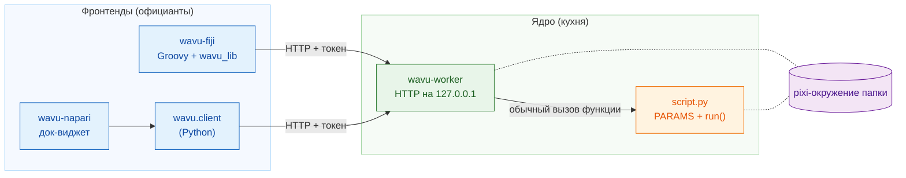
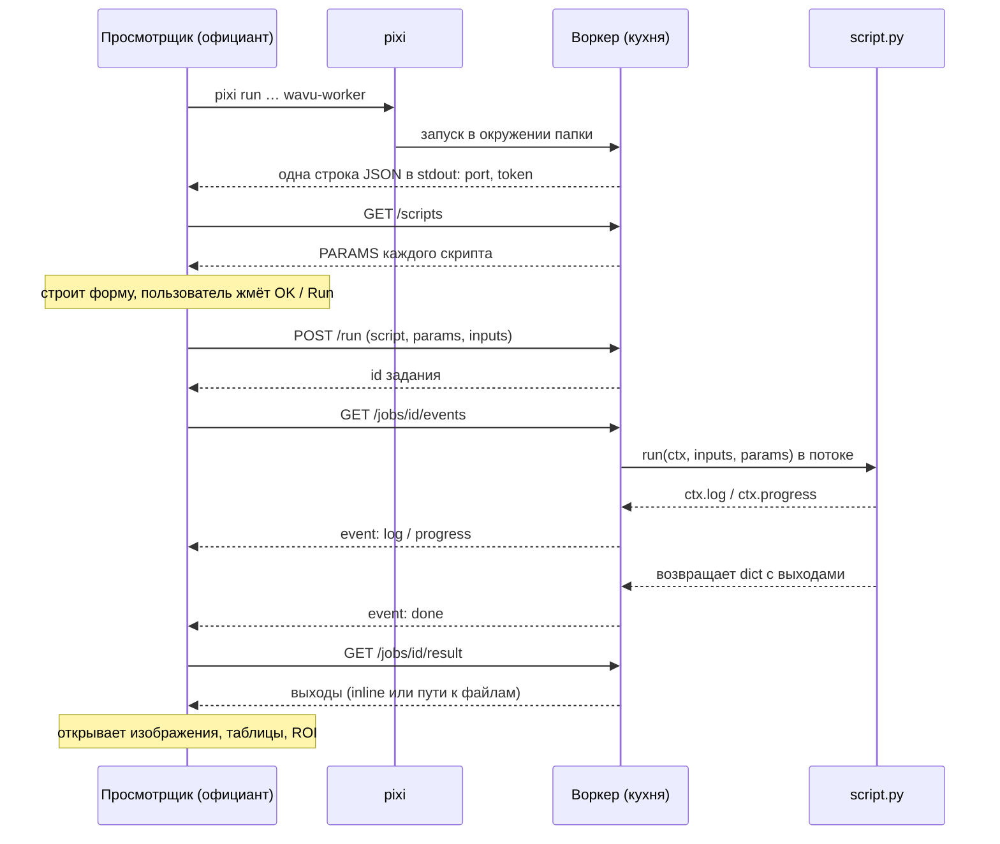

# Архитектура (для продвинутых)

!!! abstract "Для любопытных и для разработчиков"
    Эта страница не нужна, чтобы писать или запускать скрипты. Читайте её,
    если хотите точно знать, что происходит между просмотрщиком и вашим
    Python, или если хотите подключить к Wavu новый просмотрщик.

## Идея простыми словами

Вернёмся в ресторан. У Wavu **одна кухня и два официанта**.

- **Ядро** (`src/wavu`) — это кухня: программа **воркер (worker)**,
  небольшой язык, на котором она говорит (HTTP и JSON), правила, которым
  следует рецепт (*контракт скрипта*: `PARAMS` плюс `run`), и
  `wavu.client` — готовый официант на Python.
- **Фронтенды** — это официанты: **wavu-fiji** (Groovy-скрипты в меню Fiji,
  без сборки Java) и **wavu-napari** (док-виджет napari, построенный на
  `wavu.client`).

Официант никогда не готовит. Он идёт на кухню, читает меню, относит туда
ваш заказ и выносит тарелки. Поскольку оба официанта говорят с одной кухней
на одном языке, одна папка скрипта обслуживает обоих.



## Один воркер на папку скрипта

**Папка скрипта** — это папка с `pixi.toml`. Воркер обслуживает ровно одну
папку и работает **внутри собственного pixi-окружения этой папки**. Поэтому
вызов вашей `run` — обычный вызов функции Python: никакого копирования
Python-объектов между процессами, никакого нового процесса на каждое
задание.

При запуске воркер просматривает все файлы `.py` в папке, где определена
`run`. Имена, начинающиеся с `_`, `.` или `test_`, пропускаются. Файл,
который не удалось импортировать, не мешает остальным; его ошибка
возвращается в `/scripts` в поле `errors`.

Две папки — два воркера, каждый в своём окружении. Именно поэтому скрипт с
PyTorch и скрипт только с NumPy никогда не конфликтуют.

## Как фронтенд запускает воркер

Фронтенд выполняет в папке скрипта одну команду:

```sh
pixi run --manifest-path <folder>/pixi.toml [--frozen] wavu-worker --script-dir <folder>
```

- При первом запуске pixi устанавливает окружение (для тяжёлых наборов
  пакетов — минуты, один раз). Последующие запуски занимают секунды.
- `--frozen` устанавливает ровно то, что записано в `pixi.lock`. wavu-fiji
  добавляет его для **установленных** скриптов (папок в
  `<Fiji>/wavu/scripts/`, в которых есть `pixi.lock`);
  `wavu.client.Worker.start(..., frozen=True)` делает то же самое.
- **Очистка окружения.** Перед запуском дочернего процесса `wavu.client`
  удаляет переменные хоста `PIXI_*`, `CONDA_*`, `VIRTUAL_ENV*`,
  `PYTHONHOME`, `PYTHONPATH` и `INIT_CWD`. Без этого просмотрщик, который
  сам работает под `pixi run` (как napari), мог бы заставить дочерний
  процесс активировать не то окружение. Оба клиента также задают
  `NO_COLOR=1`, `PYTHONUNBUFFERED=1` и `PYTHONIOENCODING=utf-8`.

### Рукопожатие

Воркер выбирает случайный свободный порт на `127.0.0.1`, создаёт случайный
токен и печатает в stdout **ровно одну строку JSON**:

```json
{"wavu": "0.1.0", "port": 51234, "token": "..."}
```

Фронтенд читает строки, пока не встретит строку с `port` и `token`. Всё
остальное (прогресс установки pixi, который идёт в stderr) попадает в журнал
пользователя. После рукопожатия воркер больше никогда не пишет в stdout:
`print` скрипта уходит в журнал соответствующего задания.

### Режим подключения: файл рукопожатия

С `--handshake-file` (путь по умолчанию `~/.wavu/worker.json`) воркер также
записывает в файл порт, токен, `pid`, `host`, `script_dir` и `tmp_dir`, а
при выходе удаляет его. Им пользуются задачи шаблона `pixi run worker` и
`pixi run debug`, а в обоих фронтендах есть кнопка или пункт меню
**Connect to running worker** (подключиться к работающему воркеру), который
его читает.

### Время жизни

| Как он завершается | Когда |
|---|---|
| закрывается stdin | завершился фронтенд, который его запустил (он держит канал открытым) |
| `POST /shutdown` | **Stop Worker** в Fiji, **Stop worker** в napari, `Worker.stop()` |
| никогда через stdin | запущен с `--detached` (для терминала и контейнеров) |

Поэтому воркер, запущенный просмотрщиком, никогда не переживает его.

## Аутентификация по токену

Каждый запрос должен содержать `Authorization: Bearer <token>`; иначе ответ
— `401`. Воркер сравнивает токены через `hmac.compare_digest`. Зачем это на
`127.0.0.1`? До localhost могут достучаться и другие пользователи той же
машины, и веб-страницы в вашем браузере; токен не даёт им запускать скрипты
через ваш воркер. Токен есть только у родительского процесса или в файле
рукопожатия.

## HTTP API

| Метод | Путь | Что делает |
|---|---|---|
| GET | `/health` | `{"ok": true, "wavu", "scripts", "script_dir"}` |
| GET | `/scripts` | для каждого скрипта `name`, `doc` и `params` (схема `PARAMS`), плюс `errors` |
| POST | `/run` | `{"script", "params", "inputs", "inline_limit"?}` → `{"job": id}` или `400` с сообщением |
| GET | `/jobs/<id>/events[?since=N]` | server-sent events: `log`, `progress`, затем одно из `done`, `error`, `cancelled` |
| POST | `/jobs/<id>/cancel` | просит задание остановиться |
| GET | `/jobs/<id>/result` | `status` плюс `outputs` или `error`; `409`, пока задание ещё работает |
| POST | `/shutdown` | отвечает, после чего воркер завершается |

Поток событий — обычный текст, по одному событию за раз:

```text
id: 3
event: progress
data: {"value": 0.5}
```

Каждые 15 секунд приходит комментарий `: keepalive`. Поток закрывается
после завершающего события. Если соединение оборвалось, переподключитесь с
`?since=<число уже полученных событий>` — ничего не потеряется; wavu-fiji
делает это автоматически.

## Один запуск от начала до конца



## Данные при передаче { #data-on-the-wire }

Wavu — мост для **небольших данных** (одно изображение в памяти, примерно
до 1–2 ГБ). Данные побольше, примерно до 50 ГБ локально, вообще никуда
не передаются: скрипт получает **путь** к хранилищу OME-Zarr и читает его
блоками ([потоковый анализ](../workflows/large-data.md); это работает, но
управлять им из Fiji или napari не рекомендуется).

- **Inline:** небольшой массив (не больше **4 МиБ**) передаётся внутри JSON
  как байты little-endian в base64, вместе с `dtype`, `shape` и `meta`.
  Воркер и `wavu.client` также требуют, чтобы он был не более чем 3-мерным.
- **Через файл:** всё, что больше, передаётся как TIFF (как и 4- и 5-мерные
  массивы от воркера и `wavu.client`). Входы фронтенд записывает во
  временную папку; выходы попадают в собственную временную папку задания
  (`job-…` внутри временной папки воркера `wavu-…`, которая удаляется при
  выходе воркера, если не указан `--keep-tmp`).
- `meta` содержит `title`, `pixel_um`, `axes` и, для выходов,
  `channel_names` и любые ключи `extra` из `wavu.Image`.

У каждого выхода есть `kind`:

| kind | что несёт | из чего получается |
|---|---|---|
| `image` | inline `data` или `path` к TIFF в формате ImageJ | массив NumPy или `wavu.Image` (преобразуется в uint8, uint16 или float32) |
| `table` | `path` к CSV, плюс `columns` | pandas DataFrame или список словарей |
| `rois` | `path` к zip-файлу RoiSet ImageJ | `wavu.RoiSet` |
| `file` | `path` | `pathlib.Path` |
| `value` | `value` | число, текст, bool или `None` |

Как *показать* каждый вид, решает фронтенд: смотрите
[Что можно вернуть](../write/outputs.md), где есть вкладка для Fiji и
вкладка для napari.

## Отмена — совместная

`POST /jobs/<id>/cancel` только поднимает флаг. Ваш скрипт видит его через
`ctx.cancelled()` или `ctx.check_cancelled()` и останавливается в безопасной
точке. Если `run` возвращает результат или выбрасывает исключение после
того, как флаг поднят, задание завершается как `cancelled`. Скрипт, застрявший
в одном долгом вызове, сначала доводит этот вызов до конца; единственная
жёсткая остановка — выключение воркера. Смотрите
[Log, прогресс и отмена](../write/logs-progress-cancel.md).

## Отладка и подключение

- `wavu-worker --debugpy 5678 [--debugpy-wait]` запускает debugpy, чтобы к
  нему мог подключиться **Attach to Wavu worker** в VS Code. В диалоге
  wavu-fiji есть флажок **Debug in VS Code**, который перезапускает воркер
  именно так.
- `pixi run debug` (задача шаблона) запускает отсоединённый воркер с debugpy
  и файлом рукопожатия; затем просмотрщик подключается через
  **Connect to running worker**. Подробности:
  [Отладка в VS Code](../help/debug-in-vscode.md).
- `WAVU_ACCESS_LOG=1` заставляет воркер печатать каждый HTTP-запрос в stderr.

## Контейнеры

`Dockerfile` папки скрипта (из шаблона) или корневой `Dockerfile` Wavu (с
`--build-arg SCRIPT_DIR=...`) собирает образ, который устанавливает
`pixi.lock` командой `pixi install --locked` и запускает
`wavu-worker --host 0.0.0.0 --port 8765 --detached` с файлом рукопожатия в
`/data/.wavu/worker.json` и файлами заданий в `/data/.wavu-tmp`. В выпуске
Wavu такой образ публикуется только для скрипта из шаблона
(`ghcr.io/oxford-zeiss-centre-of-excellence/wavu-worker`); образы своих
скриптов вы собираете и публикуете сами.

Внутри контейнера ваша папка с данными имеет другой путь, поэтому пути к
файлам нужно переводить. Оба фронтенда спрашивают папку на хосте и ту же
папку внутри контейнера: wavu-fiji в **Connect to Running Worker**,
wavu-napari в разделе **Remote / container**; в обоих есть и поле **Host**
для воркера на другой машине. `wavu.client` делает то же самое через
`Worker.connect(handshake, host=None, host_prefix=None, worker_prefix=None)`:
`to_worker` и `from_worker` переписывают пути в обе стороны, а большие
входы записываются в `<папка на хосте>/.wavu-tmp`, чтобы контейнер их
видел. Контейнер, подключённый без этих двух префиксов, принимает только
входы размера inline (до 4 МиБ и не более 3 измерений) и возвращает только
такие же выходы. Как этим пользоваться:
[Поделиться в виде контейнера](../write/container.md).

## Изоляция — не безопасность

Окружение каждой папки разделяет **пакеты**. Оно не запирает скрипт: скрипт
работает от вашего имени и может читать, записывать и удалять всё, что можете
вы. Запускайте скрипты, которым доверяете, как с ноутбуком.

## Как добавить новый фронтенд

Официантом может стать любая программа, которая умеет запускать процесс и
говорить по HTTP. Контракт:

1. **Запуск:** `pixi run --manifest-path <folder>/pixi.toml wavu-worker
   --script-dir <folder>` с каналом на stdin; держите этот канал открытым.
   (Или подключитесь через `~/.wavu/worker.json`.)
2. **Рукопожатие:** читайте строки stdout, пока одна не разберётся как JSON
   с `port` и `token`. Показывайте stderr пользователю: при первом запуске
   устанавливаются пакеты.
3. **Меню:** `GET /scripts` и постройте форму по каждой записи `PARAMS`
   (`float`, `int`, `str`, `bool`, `choice`, `image`). Поля `image`
   выбирают одно из открытых в просмотрщике изображений.
4. **Заказ:** `POST /run` со значениями; изображения идут inline или как
   путь к TIFF, с `pixel_um` в `meta`, если он известен.
5. **Поток:** читайте `/jobs/<id>/events`, показывайте `log` и `progress`,
   дайте кнопку отмены, которая вызывает `/cancel`.
6. **Подача:** `GET /jobs/<id>/result` и сопоставьте каждый вид выхода с
   объектами вашего просмотрщика.

В Python `wavu.client` уже выполняет шаги 1, 2, 4, 5 и загрузочную часть
шага 6, включая очистку окружения и временные файлы:

```python
from wavu.client import Worker

with Worker.start("path/to/script-folder", on_log=print) as w:
    print(w.scripts())
    result = w.run("script", params={"sigma": 2.0}, inputs={"image": arr}, on_log=print)
    blurred = result.outputs["blurred"].value
```

`run` также принимает `on_progress` и `threading.Event` с именем `cancel`;
он возвращает все выходы уже загруженными (массив, таблица, `RoiSet`, `Path`
или значение) и выбрасывает `WorkerError` (с трассировкой) или
`JobCancelled`. wavu-napari — это несколько сотен строк поверх него:
смотрите [Внутреннее устройство wavu-napari](../napari/internals.md).

Полный справочник —
[docs/protocol.md на GitHub](https://github.com/Oxford-Zeiss-Centre-of-Excellence/Wavu/blob/main/docs/protocol.md);
причины каждого решения описаны в
[docs/decisions.md](https://github.com/Oxford-Zeiss-Centre-of-Excellence/Wavu/blob/main/docs/decisions.md)
(на английском).

## Одним предложением

Просмотрщик запускает по одному `wavu-worker` на папку скрипта внутри
pixi-окружения этой папки, читает однострочное рукопожатие и затем заказывает
запуски через небольшой защищённый токеном HTTP API на `127.0.0.1`, так что
любой просмотрщик, говорящий на этом языке, может подавать одни и те же
скрипты.
