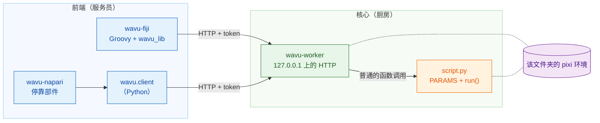
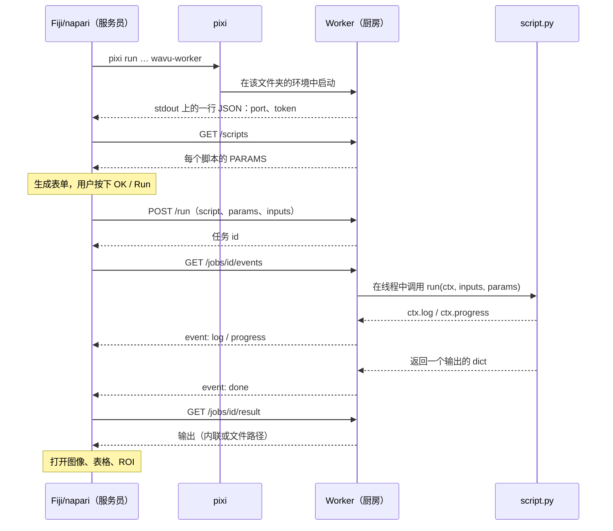

# 架构（进阶）

!!! abstract "写给好奇者和开发者"
    编写或运行脚本不需要读这一页。如果你想确切了解 Fiji/napari 和你的 Python
    之间发生了什么，或者想把一个新的 Fiji/napari 接入 Wavu，再来读它。

## 用大白话说

回到餐厅。Wavu 有**一套厨房设计和两位服务员**。

- **核心**（`src/wavu`）就是厨房：**worker** 程序、它说的小语言（HTTP 和
  JSON）、食谱要遵守的规则（*脚本约定*：`PARAMS` 加上 `run`），以及
  `wavu.client`——一位现成的 Python 服务员。
- **前端**就是服务员：**wavu-fiji**（Fiji 菜单里的 Groovy 脚本，无需构建
  Java）和 **wavu-napari**（基于 `wavu.client` 的 napari 停靠部件）。

服务员从不下厨。它走到厨房、看菜单、把你的订单送进去，再把菜端出来。
因为两位服务员用同一种语言和同一个厨房沟通，所以一个脚本文件夹能同时服务
两者。



## 每个脚本文件夹一个 worker

**脚本文件夹**就是包含 `pixi.toml` 的文件夹。一个 worker 只服务一个文件夹，
而且它**在该文件夹自己的 pixi 环境中**运行。所以调用你的 `run` 就是普通的
Python 函数调用：不需要在进程之间复制 Python 对象，也不需要为每个任务新开进程。

启动时，worker 会检查文件夹里每个定义了 `run` 的 `.py` 文件。名称以 `_`、
`.` 或 `test_` 开头的会被跳过。某个文件导入失败，不会影响其他文件；它的
报错会由 `/scripts` 列在 `errors` 下面。

两个文件夹就是两个 worker，各自在自己的环境里。这就是为什么用 PyTorch 的
脚本和只用 NumPy 的脚本永远不会冲突。

## 前端如何启动 worker

前端在脚本文件夹里运行一条命令：

```sh
pixi run --manifest-path <folder>/pixi.toml [--frozen] wavu-worker --script-dir <folder>
```

- 第一次运行时，pixi 会安装环境（依赖很重时要几分钟，只有一次）。之后几秒
  就能启动。
- `--frozen` 会严格按照 `pixi.lock` 的内容安装。wavu-fiji 会为**已安装的**脚本
  （`<Fiji>/wavu/scripts/` 下附带 `pixi.lock` 的文件夹）加上它；
  `wavu.client.Worker.start(..., frozen=True)` 也一样。
- **清理环境变量。**`wavu.client` 在启动子进程之前，会移除宿主程序的
  `PIXI_*`、`CONDA_*`、`VIRTUAL_ENV*`、`PYTHONHOME`、`PYTHONPATH` 和
  `INIT_CWD` 变量。不这样做的话，本身就在 `pixi run` 下运行的 Fiji/napari 
  （napari 就是）可能让子进程激活错误的环境。两个客户端还都会设置
  `NO_COLOR=1`、`PYTHONUNBUFFERED=1` 和 `PYTHONIOENCODING=utf-8`。

### 握手

worker 会在 `127.0.0.1` 上随机选一个空闲端口、生成一个随机 token，
然后在 stdout 上打印**恰好一行 JSON**：

```json
{"wavu": "0.1.0", "port": 51234, "token": "..."}
```

前端会一直读取，直到看到包含 `port` 和 `token` 的那一行。其他内容（pixi 的
安装进度，输出在 stderr）都会送到用户的日志里。握手之后，worker 不再向
stdout 写任何东西：脚本的 `print` 会进入该任务的日志。

### 附加模式：握手文件

加上 `--handshake-file`（默认路径 `~/.wavu/worker.json`）时，worker 还会把
端口、token、`pid`、`host`、`script_dir` 和 `tmp_dir` 写入一个文件，并在
退出时删除它。模板的 `pixi run worker` 和 `pixi run debug` 任务会用到它，
两个前端也都有一个读取它的 **Connect to running worker** 按钮或菜单项。

### 生命周期

| 如何结束 | 何时 |
|---|---|
| stdin 关闭 | 启动它的前端退出时（前端一直开着这条管道） |
| `POST /shutdown` | Fiji 的 **Stop Worker**、napari 的 **Stop worker**、`Worker.stop()` |
| 永远不会因 stdin 结束 | 用 `--detached` 启动时（用于终端和容器） |

所以由 Fiji/napari 启动的 worker，永远不会比 Fiji/napari 活得更久。

## Token 认证

每个请求都需要 `Authorization: Bearer <token>`；否则返回 `401`。worker
用 `hmac.compare_digest` 比较 token。在 `127.0.0.1` 上为什么还要这样做？
同一台机器上的其他用户，以及你浏览器里的网页，也都能访问 localhost；
token 能防止他们通过你的 worker 运行脚本。token 只存在于父进程，或握手文件里。

## HTTP API

| 方法 | 路径 | 作用 |
|---|---|---|
| GET | `/health` | `{"ok": true, "wavu", "scripts", "script_dir"}` |
| GET | `/scripts` | 每个脚本的 `name`、`doc` 和 `params`（`PARAMS` 的结构定义），以及 `errors` |
| POST | `/run` | `{"script", "params", "inputs", "inline_limit"?}` → `{"job": id}`，或带消息的 `400` |
| GET | `/jobs/<id>/events[?since=N]` | 服务器发送事件（SSE）：`log`、`progress`，最后是 `done`、`error`、`cancelled` 之一 |
| POST | `/jobs/<id>/cancel` | 请求任务停止 |
| GET | `/jobs/<id>/result` | `status`，加上 `outputs` 或 `error`；仍在运行时返回 `409` |
| POST | `/shutdown` | 先应答，然后 worker 退出 |

事件流是纯文本，一次一个事件：

```text
id: 3
event: progress
data: {"value": 0.5}
```

每 15 秒会收到一条 `: keepalive` 注释。终止事件之后，事件流就会关闭。如果连接
断开，用 `?since=<已收到的事件数>` 重新连接，什么都不会丢；wavu-fiji 会
自动这样做。

## 一次运行，从头到尾



## 传输中的数据

Wavu 是为**小数据**搭的桥（一张在内存里的图像，大约 1–2 GB 以内）。

- **内联：**小数组（最多 **4 MiB**）以 base64 编码的小端字节放在 JSON 里传输，
  附带 `dtype`、`shape` 和 `meta`。worker 和 `wavu.client` 还要求它最多是
  三维。
- **通过文件：**更大的数据一律以 TIFF 传输（worker 和 `wavu.client` 的四维、
  五维数组也是）。输入由前端写到临时文件夹；输出则放在该任务自己的临时文件夹
  （worker 的 `wavu-…` 临时文件夹里的 `job-…`，worker 退出时会删除，除非
  加上 `--keep-tmp`）。
- `meta` 带有 `title`、`pixel_um`、`axes`，输出还会带 `channel_names` 和
  `wavu.Image` 的任何 `extra` 键。

每个输出都有一个 `kind`：

| kind | 携带什么 | 由什么生成 |
|---|---|---|
| `image` | 内联的 `data`，或指向 ImageJ TIFF 的 `path` | NumPy 数组或 `wavu.Image`（转换为 uint8、uint16 或 float32） |
| `table` | 指向 CSV 的 `path`，加上 `columns` | pandas DataFrame 或由 dict 组成的 list |
| `rois` | 指向 ImageJ RoiSet zip 的 `path` | `wavu.RoiSet` |
| `file` | `path` | `pathlib.Path` |
| `value` | `value` | 数字、文本、bool 或 `None` |

每个前端自行决定如何*展示*各种 kind：请看
[可以返回什么](../write/outputs.md)，里面 Fiji 和 napari 各有一个标签页。

## 取消是协作式的

`POST /jobs/<id>/cancel` 只会竖起一面旗子。你的脚本通过 `ctx.cancelled()`
或 `ctx.check_cancelled()` 看到它，并在安全的位置停下来。如果旗子竖起之后
`run` 才返回或抛出异常，任务就以 `cancelled` 结束。卡在一个很长调用里的脚本，
会先把那个调用跑完；唯一的强制停止方式是关闭 worker。参见
[日志、进度和取消](../write/logs-progress-cancel.md)。

## 调试与附加

- `wavu-worker --debugpy 5678 [--debugpy-wait]` 会启动 debugpy，让 VS Code 的
  **Attach to Wavu worker** 可以连上。wavu-fiji 的对话框有一个
  **Debug in VS Code** 复选框，会用这种方式重启 worker。
- `pixi run debug`（模板任务）会启动一个带 debugpy 和握手文件的独立
  worker；然后 Fiji/napari 用 **Connect to running worker** 附加上去。详见
  [在 VS Code 中调试](../help/debug-in-vscode.md)。
- `WAVU_ACCESS_LOG=1` 会让 worker 把每个 HTTP 请求打印到 stderr。

## 容器

脚本文件夹里的 `Dockerfile`（来自模板），或 Wavu 根目录的 `Dockerfile`
（加上 `--build-arg SCRIPT_DIR=...`），会构建一个镜像：它用
`pixi install --locked` 安装 `pixi.lock`，并运行
`wavu-worker --host 0.0.0.0 --port 8765 --detached`，握手文件放在
`/data/.wavu/worker.json`，任务文件放在 `/data/.wavu-tmp`。Wavu 的发布版本
只为模板脚本发布这样的镜像
（`ghcr.io/oxford-zeiss-centre-of-excellence/wavu-worker`）；你自己脚本的
镜像，需要你自己构建和发布。

在容器内，你的数据文件夹路径不同，所以文件路径必须转换。两个前端都会询问
一个宿主机文件夹，以及它在容器内对应的同一个文件夹：wavu-fiji 在
**Connect to Running Worker** 里，wavu-napari 在 **Remote / container**
（远程/容器）下；两者也都有一个 **Host**（主机）字段，用于连接另一台机器上的
worker。`wavu.client` 通过
`Worker.connect(handshake, host=None, host_prefix=None, worker_prefix=None)`
做同样的事：`to_worker` 和 `from_worker` 会双向改写路径，大的输入会写到
`<宿主机文件夹>/.wavu-tmp`，让容器能看到。没有设置这两个前缀就连接的容器，
只能接收内联大小的输入（最多 4 MiB、3 维），也只能返回内联大小的输出。用法请看
[以容器形式分享](../write/container.md)。

## 隔离不等于安全

每个文件夹的环境把**包**分开，但不会把脚本关起来：脚本以你的身份运行，
你能读、写、删除的东西，它都能。只运行你信任的脚本，就像对待笔记本一样。

## 添加新的前端

任何能启动进程又会说 HTTP 的程序，都能成为服务员。约定如下：

1. **启动**：运行 `pixi run --manifest-path <folder>/pixi.toml wavu-worker
   --script-dir <folder>`，在 stdin 上接一条管道，并保持它打开。
   （或者通过 `~/.wavu/worker.json` 附加。）
2. **握手：**逐行读取 stdout，直到有一行能解析为包含 `port` 和 `token`
   的 JSON。把 stderr 显示给用户：第一次启动会安装包。
3. **菜单：**`GET /scripts`，根据每个 `PARAMS` 条目（`float`、`int`、`str`、
   `bool`、`choice`、`image`）生成表单。`image` 字段从 Fiji/napari 已打开的图像中
   选一张。
4. **点菜：**带着填好的值 `POST /run`；图像以内联或 TIFF 路径传输，如果知道
   的话，在 `meta` 里附上 `pixel_um`。
5. **流式读取：**读取 `/jobs/<id>/events`，显示 `log` 和 `progress`，并提供一个
   调用 `/cancel` 的取消按钮。
6. **上菜：**`GET /jobs/<id>/result`，把每种输出 kind 映射到 Fiji/napari 里的对象。

在 Python 里，`wavu.client` 已经实现了第 1、2、4、5 步和第 6 步的加载部分，
包括清理环境变量和临时文件：

```python
from wavu.client import Worker

with Worker.start("path/to/script-folder", on_log=print) as w:
    print(w.scripts())
    result = w.run("script", params={"sigma": 2.0}, inputs={"image": arr}, on_log=print)
    blurred = result.outputs["blurred"].value
```

`run` 还接受 `on_progress` 和一个名为 `cancel` 的 `threading.Event`；它会返回
所有已加载的输出（数组、表格、`RoiSet`、`Path` 或值），并抛出 `WorkerError`
（附带 traceback）或 `JobCancelled`。wavu-napari 就是在它之上再加几百行代码：
参见 [wavu-napari 内部实现](../napari/internals.md)。

完整的参考文档在
[GitHub 上的 docs/protocol.md](https://github.com/Oxford-Zeiss-Centre-of-Excellence/Wavu/blob/main/docs/protocol.md)（英文）；
每个设计选择背后的理由在
[docs/decisions.md](https://github.com/Oxford-Zeiss-Centre-of-Excellence/Wavu/blob/main/docs/decisions.md)（英文）。

## 一句话总结

Fiji/napari 为每个脚本文件夹，在该文件夹的 pixi 环境中启动一个 `wavu-worker`，
读取一行握手信息，然后通过 `127.0.0.1` 上一个受 token 保护的小型 HTTP API
下单运行，所以任何会说这种语言的 Fiji/napari，都能端出同样的脚本。
