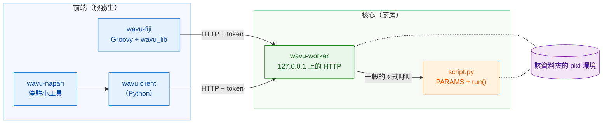
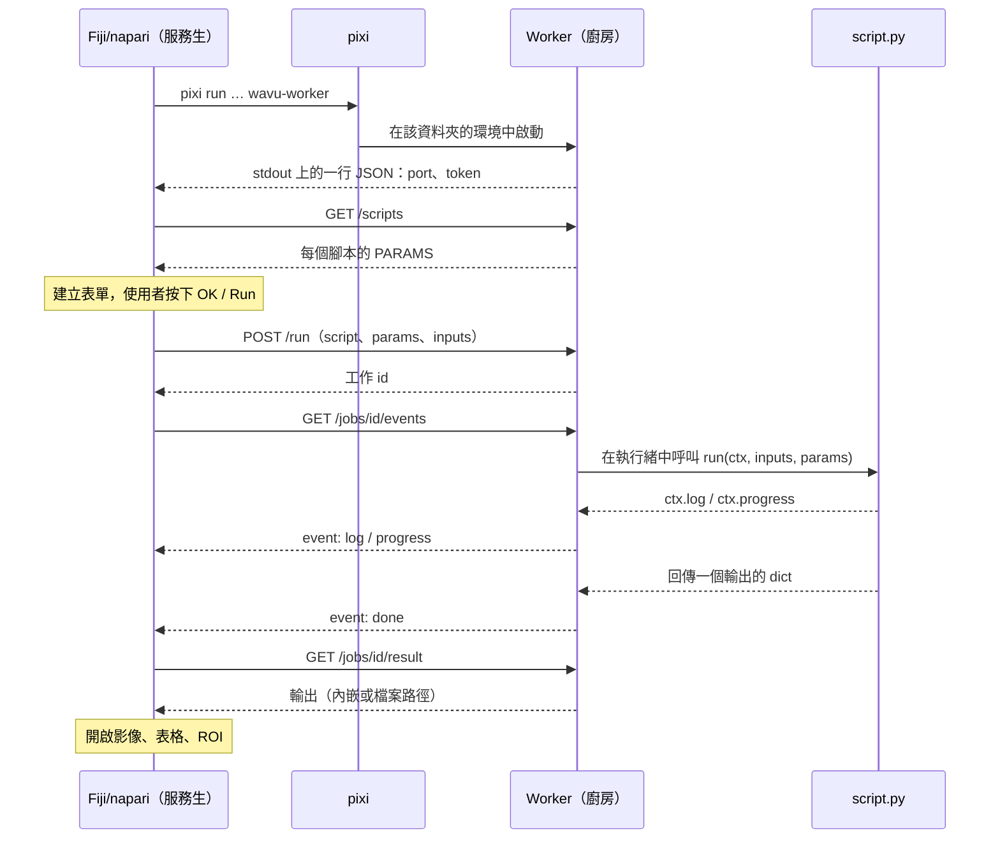

# 架構（進階）

!!! abstract "給好奇的人和開發者"
    撰寫或執行腳本不需要讀這一頁。如果你想確切知道 Fiji/napari 和你的 Python
    之間發生了什麼，或想把一個新的 Fiji/napari 接上 Wavu，再來讀它。

## 用白話說

回到餐廳。Wavu 有**一套廚房設計和兩位服務生**。

- **核心**（`src/wavu`）就是廚房：**worker** 程式、它說的小語言（HTTP 和
  JSON）、食譜要遵守的規則（*腳本約定*：`PARAMS` 加上 `run`），以及
  `wavu.client`——一位現成的 Python 服務生。
- **前端**就是服務生：**wavu-fiji**（Fiji 選單裡的 Groovy 腳本，不需要建置
  Java）和 **wavu-napari**（以 `wavu.client` 為基礎的 napari 停駐小工具）。

服務生從不下廚。它走到廚房、讀菜單、把你的點單送進去，再把餐點端出來。
因為兩位服務生用同一種語言和同一個廚房溝通，所以一個腳本資料夾能同時服務
兩者。



## 每個腳本資料夾一個 worker

**腳本資料夾**就是含有 `pixi.toml` 的資料夾。一個 worker 只服務一個資料夾，
而且它**在該資料夾自己的 pixi 環境中**執行。所以呼叫你的 `run` 就是一般的
Python 函式呼叫：不必在行程之間複製 Python 物件，也不必為每個工作開新行程。

啟動時，worker 會檢查資料夾裡每個定義了 `run` 的 `.py` 檔案。名稱以 `_`、
`.` 或 `test_` 開頭的會被略過。某個檔案匯入失敗，不會影響其他檔案；它的
錯誤會由 `/scripts` 列在 `errors` 底下。

兩個資料夾就是兩個 worker，各自在自己的環境裡。這就是為什麼用 PyTorch 的
腳本和只用 NumPy 的腳本永遠不會衝突。

## 前端如何啟動 worker

前端在腳本資料夾裡執行一個指令：

```sh
pixi run --manifest-path <folder>/pixi.toml [--frozen] wavu-worker --script-dir <folder>
```

- 第一次執行時，pixi 會安裝環境（套件很多時要幾分鐘，只有一次）。之後幾秒
  就能啟動。
- `--frozen` 會完全照 `pixi.lock` 的內容安裝。wavu-fiji 會替**已安裝的**腳本
  （`<Fiji>/wavu/scripts/` 底下附有 `pixi.lock` 的資料夾）加上它；
  `wavu.client.Worker.start(..., frozen=True)` 也一樣。
- **清理環境變數。**`wavu.client` 在啟動子行程之前，會移除主程式的
  `PIXI_*`、`CONDA_*`、`VIRTUAL_ENV*`、`PYTHONHOME`、`PYTHONPATH` 和
  `INIT_CWD` 變數。不這樣做的話，本身就在 `pixi run` 底下執行的 Fiji/napari 
  （napari 就是）可能讓子行程啟用錯誤的環境。兩個 client 也都會設定
  `NO_COLOR=1`、`PYTHONUNBUFFERED=1` 和 `PYTHONIOENCODING=utf-8`。

### 交握

worker 會在 `127.0.0.1` 上挑一個隨機的空閒連接埠、產生一個隨機 token，
然後在 stdout 上印出**剛好一行 JSON**：

```json
{"wavu": "0.1.0", "port": 51234, "token": "..."}
```

前端會一直讀取，直到看到含有 `port` 和 `token` 的那一行。其他內容（pixi 的
安裝進度，會出現在 stderr）都會送到使用者的 log。交握之後，worker 不會再
寫入 stdout：腳本的 `print` 會進到該工作的 log。

### 附加模式：交握檔案

加上 `--handshake-file`（預設路徑 `~/.wavu/worker.json`）時，worker 還會把
連接埠、token、`pid`、`host`、`script_dir` 和 `tmp_dir` 寫進一個檔案，並在
結束時刪除它。範本的 `pixi run worker` 和 `pixi run debug` 工作會用到它，
兩個前端也都有一個讀取它的 **Connect to running worker** 按鈕或選單項目。

### 生命週期

| 如何結束 | 何時 |
|---|---|
| stdin 關閉 | 啟動它的前端結束時（前端一直開著這條管道） |
| `POST /shutdown` | Fiji 的 **Stop Worker**、napari 的 **Stop worker**、`Worker.stop()` |
| 永遠不會因 stdin 結束 | 用 `--detached` 啟動時（在終端機和容器中使用） |

所以由 Fiji/napari 啟動的 worker，永遠不會比 Fiji/napari 活得更久。

## Token 驗證

每個請求都需要 `Authorization: Bearer <token>`；否則回應就是 `401`。worker
用 `hmac.compare_digest` 比對 token。在 `127.0.0.1` 上為什麼還要這樣做？
同一台機器上的其他使用者，以及你瀏覽器裡的網頁，也都連得到 localhost；
token 能防止他們透過你的 worker 執行腳本。token 只存在於父行程，或交握檔案裡。

## HTTP API

| 方法 | 路徑 | 作用 |
|---|---|---|
| GET | `/health` | `{"ok": true, "wavu", "scripts", "script_dir"}` |
| GET | `/scripts` | 每個腳本的 `name`、`doc` 和 `params`（`PARAMS` 結構描述），以及 `errors` |
| POST | `/run` | `{"script", "params", "inputs", "inline_limit"?}` → `{"job": id}`，或附帶訊息的 `400` |
| GET | `/jobs/<id>/events[?since=N]` | 伺服器傳送事件（SSE）：`log`、`progress`，最後是 `done`、`error`、`cancelled` 其中之一 |
| POST | `/jobs/<id>/cancel` | 要求工作停止 |
| GET | `/jobs/<id>/result` | `status`，加上 `outputs` 或 `error`；仍在執行時回應 `409` |
| POST | `/shutdown` | 先回應，然後 worker 結束 |

事件串流是純文字，一次一個事件：

```text
id: 3
event: progress
data: {"value": 0.5}
```

每 15 秒會送來一個 `: keepalive` 註解。最終事件之後，串流就會關閉。如果連線
中斷，用 `?since=<已收到的事件數>` 重新連線，就什麼都不會遺失；wavu-fiji 會
自動這樣做。

## 一次執行，從頭到尾



## 傳輸中的資料

Wavu 是為**小型資料**搭的橋（一張在記憶體裡的影像，大約 1–2 GB 以內）。

- **內嵌：**小型陣列（最多 **4 MiB**）以 base64 的 little-endian 位元組放在
  JSON 裡傳送，附帶 `dtype`、`shape` 和 `meta`。worker 和 `wavu.client` 還要求
  它最多是 3 維。
- **透過檔案：**更大的資料一律以 TIFF 傳送（worker 和 `wavu.client` 的 4 維、
  5 維陣列也是）。輸入由前端寫到暫存資料夾；輸出則放在該工作自己的暫存資料夾
  （worker 的 `wavu-…` 暫存資料夾裡的 `job-…`，worker 結束時會刪除，除非
  加上 `--keep-tmp`）。
- `meta` 帶有 `title`、`pixel_um`、`axes`，輸出還會帶 `channel_names` 和
  `wavu.Image` 的任何 `extra` 鍵。

每個輸出都有一個 `kind`：

| kind | 帶著什麼 | 從什麼產生 |
|---|---|---|
| `image` | 內嵌的 `data`，或指向 ImageJ TIFF 的 `path` | NumPy 陣列或 `wavu.Image`（轉成 uint8、uint16 或 float32） |
| `table` | 指向 CSV 的 `path`，加上 `columns` | pandas DataFrame 或由 dict 組成的 list |
| `rois` | 指向 ImageJ RoiSet zip 的 `path` | `wavu.RoiSet` |
| `file` | `path` | `pathlib.Path` |
| `value` | `value` | 數字、文字、bool 或 `None` |

每個前端自行決定如何*呈現*各種 kind：請看
[可以回傳什麼](../write/outputs.md)，裡面 Fiji 和 napari 各有一個分頁。

## 取消是合作式的

`POST /jobs/<id>/cancel` 只會舉起一面旗子。你的腳本透過 `ctx.cancelled()`
或 `ctx.check_cancelled()` 看到它，並在安全的地方停下來。如果旗子舉起之後
`run` 才回傳或丟出例外，工作就以 `cancelled` 結束。卡在一個很長呼叫裡的腳本，
會先把那個呼叫跑完；唯一的強制停止方式是關掉 worker。請看
[Log、進度與取消](../write/logs-progress-cancel.md)。

## 除錯與附加

- `wavu-worker --debugpy 5678 [--debugpy-wait]` 會啟動 debugpy，讓 VS Code 的
  **Attach to Wavu worker** 可以連上。wavu-fiji 的對話框有一個
  **Debug in VS Code** 勾選框，會用這種方式重新啟動 worker。
- `pixi run debug`（範本工作）會啟動一個附帶 debugpy 和交握檔案的獨立
  worker；接著 Fiji/napari 用 **Connect to running worker** 附加上去。詳情請看
  [在 VS Code 中除錯](../help/debug-in-vscode.md)。
- `WAVU_ACCESS_LOG=1` 會讓 worker 把每個 HTTP 請求印到 stderr。

## 容器

腳本資料夾裡的 `Dockerfile`（來自範本），或 Wavu 根目錄的 `Dockerfile`
（加上 `--build-arg SCRIPT_DIR=...`），會建置一個映像檔：它用
`pixi install --locked` 安裝 `pixi.lock`，並執行
`wavu-worker --host 0.0.0.0 --port 8765 --detached`，交握檔案放在
`/data/.wavu/worker.json`，工作檔案放在 `/data/.wavu-tmp`。Wavu 的發布版本
只為範本腳本發布這樣的映像檔
（`ghcr.io/oxford-zeiss-centre-of-excellence/wavu-worker`）；你自己的腳本，
映像檔要由你自己建置和發布。

在容器裡，你的資料資料夾路徑不同，所以檔案路徑必須轉換。兩個前端都會詢問
一個主機資料夾，以及它在容器裡對應的同一個資料夾：wavu-fiji 在
**Connect to Running Worker** 裡，wavu-napari 在 **Remote / container**
（遠端／容器）底下；兩者也都有一個 **Host**（主機）欄位，用來連接另一台機器上的
worker。`wavu.client` 透過
`Worker.connect(handshake, host=None, host_prefix=None, worker_prefix=None)`
做同樣的事：`to_worker` 和 `from_worker` 會雙向改寫路徑，大型輸入會寫到
`<主機資料夾>/.wavu-tmp`，讓容器看得到。沒有設定這兩個前綴就連上的容器，
只能接收內嵌大小的輸入（最多 4 MiB、3 維），也只能回傳內嵌大小的輸出。用法請看
[以容器分享](../write/container.md)。

## 隔離不等於安全

每個資料夾的環境把**套件**分開，但不會把腳本關起來：腳本以你的身分執行，
你能讀、寫、刪除的東西，它都能。只執行你信任的腳本，就像對待筆記本一樣。

## 加入新的前端

任何能啟動行程又會說 HTTP 的程式，都能成為服務生。約定如下：

1. **啟動**：執行 `pixi run --manifest-path <folder>/pixi.toml wavu-worker
   --script-dir <folder>`，在 stdin 上接一條管道，並保持它開著。
   （或透過 `~/.wavu/worker.json` 附加。）
2. **交握：**讀取 stdout 的每一行，直到有一行能解析成含有 `port` 和 `token`
   的 JSON。把 stderr 顯示給使用者看：第一次啟動會安裝套件。
3. **菜單：**`GET /scripts`，依每個 `PARAMS` 項目（`float`、`int`、`str`、
   `bool`、`choice`、`image`）建立表單。`image` 欄位從 Fiji/napari 已開啟的影像中
   選一張。
4. **點餐：**帶著填好的值 `POST /run`；影像以內嵌或 TIFF 路徑傳送，若知道
   的話，在 `meta` 裡附上 `pixel_um`。
5. **串流：**讀取 `/jobs/<id>/events`，顯示 `log` 和 `progress`，並提供一個
   會呼叫 `/cancel` 的取消按鈕。
6. **上菜：**`GET /jobs/<id>/result`，把每種輸出 kind 對應到 Fiji/napari 裡的物件。

在 Python 裡，`wavu.client` 已經做好第 1、2、4、5 步和第 6 步的載入部分，
包括清理環境變數和暫存檔案：

```python
from wavu.client import Worker

with Worker.start("path/to/script-folder", on_log=print) as w:
    print(w.scripts())
    result = w.run("script", params={"sigma": 2.0}, inputs={"image": arr}, on_log=print)
    blurred = result.outputs["blurred"].value
```

`run` 也接受 `on_progress` 和一個名為 `cancel` 的 `threading.Event`；它會回傳
所有已載入的輸出（陣列、表格、`RoiSet`、`Path` 或值），並丟出 `WorkerError`
（附帶 traceback）或 `JobCancelled`。wavu-napari 就是在它上面再加幾百行程式碼：
請看 [wavu-napari 內部構造](../napari/internals.md)。

完整的參考資料在
[GitHub 上的 docs/protocol.md](https://github.com/Oxford-Zeiss-Centre-of-Excellence/Wavu/blob/main/docs/protocol.md)（英文）；
每個設計選擇背後的理由在
[docs/decisions.md](https://github.com/Oxford-Zeiss-Centre-of-Excellence/Wavu/blob/main/docs/decisions.md)（英文）。

## 一句話總結

Fiji/napari 為每個腳本資料夾，在該資料夾的 pixi 環境中啟動一個 `wavu-worker`，
讀取一行交握訊息，然後透過 `127.0.0.1` 上一個受 token 保護的小型 HTTP API
下單執行，所以任何會說這種語言的 Fiji/napari，都能端出同樣的腳本。
